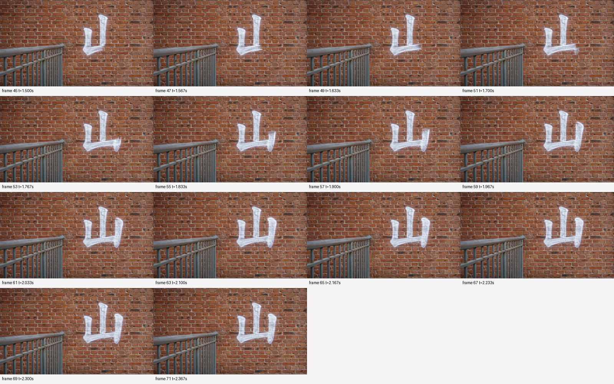
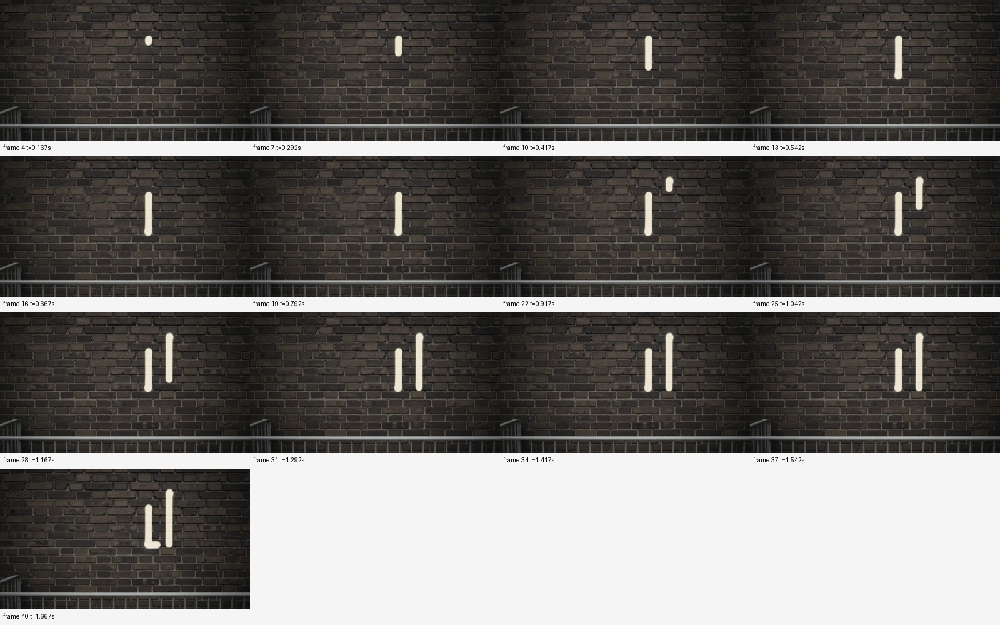
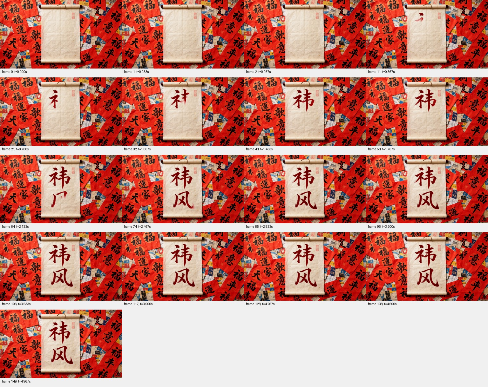

> 历史调研的公开整理副本；原始阅读口径不升级为本轮重读。最新整合见[项目状态](../../../docs/project/STATUS.md)。原始材料和缓存保留本地。

核查日期：2026-10-15。来源：[VidScribe 论文](https://arxiv.org/abs/2609.36598)、[作者公开数据集](https://huggingface.co/datasets/Vicky0720/VidScribe)。

这是对**已有公开生成结果的定性核查**，没有重新调用模型生成。选择两个明确带 `handwriting_stroke` 条件的中文提示，下载四个模型标签下的全部对应文件，共 8 段。模型名称沿用数据集目录，不代表本次独立核验了商业端的模型版本、采样设置或服务状态。不能据此报告排行榜、总体错误率或“所有视频都不对”。

**如何看过这些视频。** 本次对每段视频提取了 17 个时序画面，包括开头三帧和覆盖全片的采样帧；对两个“山”样例和一个“祎风”样例进一步提取密集画面。下列判断基于实际可见画面，没有声称人工逐帧标注了全部视频，也没有把 OCR 当作笔顺裁判。原 MP4、带帧号的联系表及帧率等记录均保存于 `video_audit/`。

**两个提示及其限制。**

| 样例 | 目标 | 提示中的主要条件 | 影响判断的限制 |
|---|---|---|---|
| TRE-T2V-0048 | 山 | 砖墙、喷绘、米白圆体、固定镜头、逐笔出现、首笔在第一帧可见、5 秒内完成 | 同时写“从第一帧出现”“fully present and rendered”和逐笔完成，措辞有张力；未显式列出规范笔顺；喷绘过程不一定必须出现毛笔 |
| TRE-T2V-r2-018 | 祎风 | 深红楷体、宣纸/红纸卷轴、复杂背景、固定镜头、逐笔出现 | 没有明确要求空白起笔；没有指定简繁转换许可；红纸与宣纸场景描述存在混合；背景也可能出现其他文字 |

完整作者提示保存在 `sources/metadata_T2V_GT.json` 和 `sources/metadata_T2V_GT_round2.json`，相应记录分别是上述 sample_id。对“首帧已有文字”只报告观察，不擅自当作必然违反提示；对规范笔顺则明确采用中文规范书写这一研究目标，而非把原提示未写明的要求偷偷计入原榜单。

**逐段观察。**

| 数据集模型标签 | 样例 | 实际观察 | 能支持的判断 |
|---|---|---|---|
| gemini-omni-1.1-flash | 山 | 约 0.17–0.79 秒先形成左侧短竖，约 0.92 秒才开始右邻的中竖；随后补底部、右竖；后半段又出现一根额外独立竖 | 字数/笔画控制失败；先左竖后中竖与“山”的规范次序不符 |
| minimax-h3 | 山 | 先出现中间竖，随后形成可辨认的“山”；后半段在右边继续添加另一字形 | 首个字的粗略形成次序较合理，但整段没有停在目标单字；不能以最后出现了“山”就判定任务通过 |
| kling-3.0-omni | 山 | 所检查画面主要是砖墙和栏杆，没有清楚形成目标字 | 这份公开文件没有呈现目标书写过程；不能进一步断言其原因是模型能力、服务失败还是数据导出问题 |
| wan-3.0 | 山 | 中竖、左侧及底部依次出现；最终清楚形成“山”，没有同类多字问题；帧 51–61 中，右侧竖的可见墨迹由底部向上延长 | 一个关键反例：最终字符可读、整体稳定，但末竖的显现方向与规范落笔方向不同 |
| gemini-omni-1.1-flash | 祎风 | 首帧左字已成形，右字已有部分结构；右侧形态接近繁体“風”，后续主要加笔和修饰 | 不能评估已发生在首帧之前的完整笔顺；没有得到清楚可核验的“简体祎风完整书写过程” |
| minimax-h3 | 祎风 | 出现手和笔，墨迹逐步增多；最终主要是一团相互交织的复杂字形，未清楚分成目标两个字 | 写字场景逼真不代表目标文本和多字结构可靠；不从缩略图进一步断言每次笔尖接触是否正确 |
| kling-3.0-omni | 祎风 | 检查画面主要是红色纸面，没有可辨认的完整目标文字 | 同上，只判断这份公开结果未完成目标；保留数据链路原因不明这一限制 |
| wan-3.0 | 祎风 | 从空白逐步形成上下排列、外观接近目标的两个字，最终保持；第一个字右部在短时间内集中补齐 | 证明不能说“多字完全做不了”；但尚无逐笔身份、方向、起止时刻标注，不能把“看起来写出了两个字”升级成全部笔顺合格 |

**最有信息量的画面证据。**

`wan-3.0` 的“山”末竖：frame 51（1.700 秒）右端只有起始墨迹，frame 53（1.767 秒）在底部附近显现，frame 55–61（1.833–2.033 秒）逐渐向上伸长。这里没有把笔画产生方向与物理笔尖运动混为一谈——视频中未显示可追踪的书写工具，因此能直接确认的是**墨迹显现方向**。

`gemini-omni-1.1-flash` 的“山”首先出现左短竖，再出现中竖。密集帧排除了仅由稀疏抽帧造成的次序误读。

同时保留较好的多字结果：`wan-3.0` 能逐步形成两个纵向排列字形。它是后续评测需要覆盖的能力，而不是应被忽略的成功部分。

**文件、来源与复核。**

所有视频可按以下作者数据集路径定位：`generated_videos/<模型标签>/<样例编号>.mp4`。例如：[Wan 标签的山视频](https://huggingface.co/datasets/Vicky0720/VidScribe/resolve/main/generated_videos/wan-3.0/TRE-T2V-0048.mp4)、[Gemini 标签的山视频](https://huggingface.co/datasets/Vicky0720/VidScribe/resolve/main/generated_videos/gemini-omni-1.1-flash/TRE-T2V-0048.mp4)。各文件 URL、帧数、帧率、分辨率、抽取帧号见 manifest.json（本地缓存，未随公开仓库分发）。

本次核查支持的是：**公开生成结果中确实存在文本增生、笔顺错误、笔画方向错误、未执行书写和多字结构混乱等不同问题；同时存在最终字形与多字排版相对成功的结果。** 它没有量化各问题的发生概率。正式实验应改用无歧义提示、固定版本和参数、多随机种子，并把单字可读率、严格整字笔顺通过率、整句通过率分别报告。
