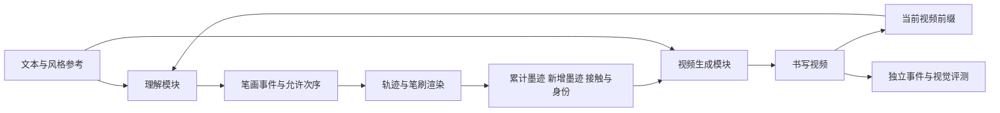

本文件是依据调研提出的**实验设计**，没有把未开展的训练、消融或效果当成结果。目标不是预设 UMM 一定更好，而是找出它能否提供超出字库、轨迹生成和外置理解器的贡献。

**1．建议的任务定义。**

首先定义“中文规范/允许笔顺的过程视频生成”，再分别扩展艺术风格和真人书写。输入包含目标文本、风格参考、画布/布局与时长；输出包含视频以及可选的结构化事件序列。研究阶段将干净画布、艺术材质、真实手笔场景分层报告，避免最终场景复杂度掩盖基础笔画错误。

| 层次 | 条件 | 判断依据 |
|---|---|---|
| A：规范事件 | 常用简体、固定视角、清晰底色 | 规范笔画身份、次序、方向，明确单笔起止 |
| B：风格迁移 | 未见字体/书家参考，多字与不同布局 | 风格许可的笔画对应、字形可读、事件顺序；连笔需单独标注 |
| C：书写物理 | 笔尖、接触、压力/姿态、纸张与墨迹 | 同步采集或受控模拟的状态；RGB 中新增墨迹与动作一致 |
| D：长程与高速 | 长句、密集笔画、变速与停顿 | 整句全对率、事件漏检率、真实时间轴，不以倍速播放代替 |

A 可以建立可判定性，B/C 才更能体现与既有笔顺动画的区别。不是声称必须按四个阶段逐一完成后才能研究；它们是分开归因的评测层。

**2．三个可被否证的假设。**

| 假设 | 支持它需要观察到什么 | 什么结果会否定或削弱它 |
|---|---|---|
| H1：过程理解联合训练有益于生成 | 相同视频骨干、事件条件、数据和预算下，严格笔顺/方向改善；未见字符或风格仍有效 | 只提高最终 OCR；或外置理解器达到同样收益；或只靠多轮重试增加预算 |
| H2：身份保持的事件表示比自由文本计划可靠 | 少笔、错笔、交叉合并减少；细粒度过程控制显著优于语义步骤控制 | 仅改变语言描述，RGB 中执行不变；效果被确定性字库播放完全覆盖 |
| H3：画布与接触状态能改善生成因果关系 | 新增墨迹与接触区域一致，抬笔时不继续增墨，已写区域保持 | 只改善视频质感；笔尖走对但墨迹仍瞬移，或依靠事后强制覆盖才得到结果而未说明 |

H1 应作为 UMM 论点的核心。H2、H3 可以在非 UMM 系统上成立，不能把它们的收益自动归功于统一模型。

**3．必要的比较对象。**

| 编号 | 系统 | 它排除的替代解释 |
|---|---|---|
| B0 | 已知字库有序 SVG/轨迹＋确定性渲染 | 是否只是重新做了现成笔顺播放 |
| B1 | 通用视频模型，仅文本提示 | 基础能力；不能作为唯一比较对象 |
| B2 | DiffInk/OLHWG 轨迹＋一致渲染，必要时再视频修饰 | 收益是否来自更强的轨迹生成，而非 UMM |
| B3 | VideoSketcher 式外置语言规划＋相同视频骨干 | UMM 是否优于已有语义规划方式 |
| B4 | 外置 VLM 读取前缀、输出与 UMM 完全同格式的事件条件 | 共享训练是否有超出接口连接的收益 |
| B5 | 相同骨干和事件条件，只有生成训练 | 结构控制本身的收益 |
| B6 | 相同骨干和条件，联合最终图 OCR/书法识别 | 过程监督是否比终局理解更有用 |
| B7 | 相同骨干和条件，联合前缀状态、下一笔、错误定位 | 目标 UMM 方案 |
| Oracle | 直接提供真值事件/轨迹/接触条件 | 问题出在计划端还是视频执行端的上界诊断 |

B4、B5、B6、B7 是判断 H1 最重要的一组。不同体量的模型可以提供实用系统比较，但不能单凭大模型胜小模型就宣称统一机制有效。

对多轮自检，给外置控制器同样的轮数或总生成预算；另报单次生成和固定预算内最佳结果。对于只在训练期增加理解任务的方案，还应控制优化步数、训练样本曝光量与可训练参数规模。无法完全相同的成本应明确报告，不用名义参数量冒充严格匹配。

**4．候选实现，不把常见拼接包装为新方法。**



图中的理解和生成既可以是独立模块，也可以共享 UMM 骨干，必须通过上述对照比较。渲染器作为条件还是最终强制合成的一部分，也必须明确标注；后者的正确性可能来自程序，不应全部算作生成模型学到的能力。

事件表示建议从简单可核验形式开始：

```text
character_id, stroke_id, component_id
curve_points / curve_latent, direction
start_time, end_time, pen_state
allowed_predecessors, style_variant
pressure / tilt / brush_parameters   # 仅在有数据或明确模拟定义时使用
```

相同字符的不同笔画不能只靠颜色或空间位置区分，交叉区域尤其需要身份。对行草的连笔，将标准笔画映射到实际动作片段，再评价允许的先后关系；“一个标准笔画 = 一次落笔”不能当作所有书体的前提。

生成条件可包含四类时空图：累计墨迹 C_t、新增墨迹 ΔC_t、接触区域 K_t、当前笔画身份 S_t。它们的用途不同：C_t 限定历史，ΔC_t 指明本帧应该发生什么，K_t 约束发生地点，S_t 防止把相邻笔画混为一笔。时间场/颜色编码已有 Draw This First 先例，因此新意应放在它们如何与理解状态对齐、如何控制可见执行及何时失效。

**5．训练任务和损失应分别服务于什么问题。**

| 信号 | 输入→目标 | 用途 | 已知局限 |
|---|---|---|---|
| 前缀状态理解 | 视频前缀＋目标字→已完成集合、当前笔画、进度 | 阻止只看最后一帧答题 | 必须防止训练标签直接暴露答案 |
| 下一合法事件 | 前缀＋允许笔顺图→下一事件分布 | 建立约束与动作连接 | 多种合法书体顺序应允许多个答案 |
| 事件生成 | 文本/风格→有序曲线和笔状态 | 提供可执行计划 | 计划正确不等于 RGB 执行正确 |
| 视频 flow/diffusion | 多模态条件→视频 | 学习材质与视觉过程 | 可能忽略条件或改写已画部分 |
| 过程对比 | 相同末帧、不同过程→识别差异及时间位置 | 防止 OCR 捷径 | 反例不能全是容易识别的剪辑伪影 |
| 墨迹与接触一致性 | 新墨迹→接触位置、时间和笔刷作用域 | 防止空中落墨、跨处瞬移 | 喷溅、飞白、渗化要有相应物理容差 |
| 拓扑/身份一致性 | 笔画实例与最终字形→匹配 | 减少断笔、错误合并 | 不能独立识别笔顺错误 |

可以把总目标写成生成项、理解项和过程一致性项的加权和，但权重需要在固定验证集确定。没有必要一次引入所有损失：先比较最终 OCR 与前缀过程监督，再检查新增画布/接触条件是否解决已观察到的失败。这样才能知道哪一项真正有用。

物理时间用 t，扩散去噪时间用 τ。两者混用会产生错误解释：去噪阶段画面逐渐清晰不是书写过程；对 τ 的导数也不能直接当作笔运动速度。

**6．最有区分力的数据与干预。**

同一最终字至少可构造以下过程变化：交换两笔；逆向一笔；拆开一笔；合并两笔；未接触时新增墨迹；重复补画；写完后又长出额外一笔。部分反例末帧可保持相同，部分保留可识别的错误字形，两类分别评价。对于真实书法，只在有充分标注依据时判错，不用规范楷书规则误罚正常草书。

数据分割应覆盖不同泛化轴，而不是把同一字体的同一字仅换随机种子当未见样本：

- 已见字符、未见书家/字体：测试风格迁移。
- 未见字符、已见部件：测试组合与笔画身份迁移。
- 字符和风格交叉未见：测试是否依赖记忆模板。
- 已见文字、未见布局/长度：测试事件调度与长程保持。
- 相同事件、不同速度/笔刷/纸张：测试过程和材质的解耦。

判断“未见”要以训练数据可核查范围为限。预训练大模型是否见过某个常用汉字通常无法排除，故应区分“微调未见字符”和“预训练全程未见字符”，后者不能轻易声称。

针对艺术字，可采用少量风格示例＋未见目标字，但把字形轮廓作为条件的系统应另设赛道：如果已经提供最终字形，任务是过程生成；没有最终字形，才同时测试内容/风格造型。两者难度不同，不宜直接合榜。

**7．评价必须能惩罚整字过程错误。**

| 指标 | 具体定义建议 | 不能替代的指标 |
|---|---|---|
| 文字完整性 | 字符正确率、额外字符率、缺字率、整句完全匹配率 | 过程次序 |
| 严格整字笔顺通过率 | 笔画数量、实例对应及完整先后关系均通过才计 1 | 只在匹配笔画上算 Kendall τ |
| 笔画方向 | 对匹配笔画比较起终点及沿程时间进度 | 静态骨架相似度 |
| 合法顺序图违例 | 对必须先于的事件对计算违例；同时报告漏/多笔 | 任意一条固定参考顺序的相似度 |
| 事件连续性 | 无理由多笔同时出现、瞬间成字、笔画消失或重绘的频率 | 普通帧间平滑分数 |
| 接触因果 | 新墨迹时空位置与接触/笔刷作用域是否一致 | 手部外观是否逼真 |
| 历史保持 | 对齐到纸面坐标后，已写墨迹的结构性消失/移位 | 屏幕像素严格单调不变 |
| 风格与可读性 | 独立识别器、风格距离、书法专家盲评 | 只用一个 VLM 自评总分 |
| 效率 | 实际推理耗时、显存、生成时长、采样/重试次数 | 轨迹模型的字/秒或视频倍速 |

严格整字指标可借鉴有序笔画恢复论文的定义：漏笔、拆笔、合笔、多笔也判错，避免只对幸存的匹配笔画排序而得到虚高成绩。对于连笔书体，先定义动作与标准笔画的允许映射，再使用相应图约束。

历史保持不应硬性要求每个 RGB 像素永不变化：手会遮挡，镜头会移动，湿墨会扩散和干燥。应在纸面坐标与可见区域评估结构性墨迹状态，并允许由已定义材质模型解释的变化。这是针对任务的具体建模要求，而不是添加无依据的防御检查。

真实视频的自动评估器也会错。建议对其分歧和难例进行独立人工复核，并报告评估器在有真值合成视频与真实标注子集上的可靠性。不要用同一个模型生成、批评、打分后把一致意见称为客观正确。

**8．怎样判断理解真的帮助了执行。**

建立三组诊断：

1. **计划—执行分离。** 分别统计计划正确但视频错误、计划错误但视频偶然正确、两者都正确。前者高说明条件执行/表示仍是瓶颈。
2. **条件干预。** 固定目标最终字和随机种子，只改变一笔方向/次序；检查对应时段是否改变，而非整段随机重画。
3. **前缀反事实。** 给两个末帧相同但历史不同的前缀，询问已发生错误并续写。若答案相同，模型可能只看当前图，不理解过程。

还应把“看见完整未来视频再解释”与“只给当前前缀预测”分开。前者是事后识别，后者才体现生成中的状态理解；用未来帧训练或评测前缀任务会泄漏答案。

**9．执行顺序与停止某条假设的依据。**

先准备具有事件真值的小规模诊断集，覆盖真实观察到的多笔增生、错误方向、顺序交换与多字遗漏；选定候选视频骨干后，检查其编解码是否保留这些事件。然后建立 B0/B2/B3 强基线，再在同一条件接口上比较 B5/B6/B7。规模和硬件预算应在模型、数据与初步耗时明确后确定，本报告不凭空承诺训练天数或涨分幅度。

如果 B0 在目标应用中已经满足所有要求，UMM 研究价值需要转向未见风格与真实书写，而不是扩大模型；如果 B5 与 B7 相同，则主要贡献可能在结构条件而非理解；如果计划正确而 RGB 不执行，应先解决生成表示和控制；如果只在合成画布有效，应将结论限于该分布，不直接宣称真实毛笔书写解决。

最可辩护的成果不是一条好看的演示视频，而是：清楚定义的事件任务、可核验的正确性指标、相对强基线的改进，以及能解释 UMM 在哪些条件下有效或无效的实验。
