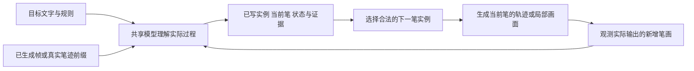

# UMM 能否解决生成中的汉字笔顺问题：专项证据与研究方案

本文研究**实际生成过程中的笔画先后顺序**，梳理相关证据、任务定义与实验方案。文献检索截至2026-10-15；所提方法尚待实验验证。

## 1. 中文笔顺生成的UMM研究现状

**在本次核查到的公开研究中，尚未找到同时完成“统一理解与生成、面向中文书写过程、显式控制实际执行笔顺、严格评测输出视频笔顺”四项要求的工作。这个结论限定于检索和核读范围，不是全领域不存在此工作的证明。**

但如果把问题放宽为“一个模型同时读字和输出有序笔迹”，答案已经是**有**：InkSight 就是非常接近的前作，而且其训练包含中文。若放宽为“生成器注入笔顺知识”，XMP-Font、DP-Font、有序轨迹生成与恢复研究也早已提供了多种机制。因此，不能把“首次把理解与生成结合”“首次加入笔顺损失”“首次逐笔生成中文”作为未经限定的创新点。

目前较有依据的研究切口是：

> **在生成过程中，把理解分支识别出的实际笔画事件与生成分支的下一步动作绑定，减少“计划笔顺正确、实际画面错序”的问题，并验证共享理解与生成能力相对专门轨迹模型及外部 VLM 流水线的收益。**

这里的“事件”必须对应一笔在空间中的具体实例及其发生时间，而不是一句“接下来写横”。

## 2. 哪些前作真正接近，做到哪一步？

| 工作 | 实际研究对象与机制 | 已有证据 | 对本题的边界 |
|---|---|---|---|
| [InkSight，TMLR 2025](https://arxiv.org/html/2402.05804v4) | 同一 VLM 接受图像和任务提示，输出文字、数字笔迹或二者；识别与去渲染多任务训练 | 含中文训练数据；去掉识别任务会损害部分去渲染质量指标 | 是直接的读写联合前作；主要任务是静态手写图像转笔迹，未建立中文规范笔顺视频的严格评价 |
| [UniCalli](https://arxiv.org/abs/2510.13745) | 中文书法列级识别与生成的统一扩散框架 | 基础生成模型 FID 52.90，加入联合任务后 46.42，完整方案 37.69 | 输出静态书法作品；联合训练改善外观不等于实际书写顺序正确 |
| [XMP-Font，CVPR 2022](https://arxiv.org/html/2204.05084) | 图像与有序笔画标签跨模态预训练；用 LSTM 笔顺预测器的特征约束生成字形 | 去掉 stroke loss 后，未见字体 FID 从完整模型的 36.80 变为 41.60 | 明确有“笔顺预测损失”前作，但输出仍是静态图像 |
| [LVGM](https://arxiv.org/abs/2511.11119) | 笔画编码为离散表征，微调 DeepSeek LLM 预测下一笔，生成中文矢量字词及诗句 | 公开描述了 907,267 个样本的笔画级 SVG 数据集及续写能力 | next-stroke 生成已经存在；未见其证明通用 UMM 能从实际视频识别错序并约束执行 |
| [Autoregressive Ordered Stroke Instance Prediction](https://arxiv.org/abs/2609.02251) | 从字图自回归预测有序笔画实例，再恢复笔内轨迹 | 严格整字 Order Acc. 67.03%；MaskDINO＋排序器为 65.90% | 很强的直接相关前作，但任务是图像到轨迹，参考顺序来自记录数据，不自动等于规范笔顺 |
| [Hierarchical O2O with Dual-domain Priors](https://link.springer.com/article/10.1007/s44443-026-01050-5) | 结构编码、笔画区域及顺序规划、分层向量解码、视觉与书写先验 | 加入双域先验后 LDTW 2.45→1.95，写字综合分 78.5→91.2 | 91.2 不是严格笔顺正确率；仍有草书过度分笔及伪轨迹偏差 |
| [Think in Strokes, Not Pixels](https://arxiv.org/html/2604.04746) | 在 BAGEL 上训练计划、草图、检查、修改的图文交错生成 | 对象关系及知识型图像生成基准改善 | “stroke”在这里主要对应场景增量和图像编辑过程，并非汉字的一笔及其规范次序 |
| [UM-Text](https://arxiv.org/html/2601.08321) | VLM 设计文字内容、布局和属性，条件融合后驱动扩散编辑；字形区域监督 | 包含中英文视觉文字生成与编辑实验 | 是文字领域理解辅助生成的直接前作，但监督和输出是静态字形 |

这些方法的指标、数据、任务不同，不能把表中数字横向排序后称为“笔顺能力排行榜”。

### 2.1 InkSight：不能绕开的读写联合前作

InkSight 的任务混合包含两类去渲染、两类识别与一种识别加去渲染任务。共享输出词表包含文字与数字墨迹 token。模型能利用文字信息改善笔迹恢复，因此“理解辅助产生书写轨迹”本身已有实证。

需要修正一个容易产生的印象：**它不只是英文工作。**原文 §4.1.2 列出 SCUT-Couch；内部数字笔迹数据约 37% 为 Mandarin；附录还明确公开模型训练包含中文、英文、越南语。不能以“没有中文”为由排除它。

但它也不能作为“汉字视频笔顺已解决”的证据。其主要评测并非中文规范笔顺；附录 O.3 对空图或图文不匹配的测试还表明，去渲染模型不能直接当作任意文字的开放生成器使用。**从图像恢复一个合理过程，与按要求生成并验证真实过程，是两个任务。**[原文](https://arxiv.org/html/2402.05804v4)

对我们的要求：至少比较 InkSight 式“识别＋轨迹输出”联合训练。只把模型替换成更大 UMM、加一个“判断笔顺”的文本任务，创新性和归因都不充分。

### 2.2 XMP-Font：已有笔顺损失，但它约束的是什么？

XMP-Font 接受字图和按序排列的笔画标签，做掩码预测与字图重建。下游生成阶段，用预训练 LSTM 笔顺预测器的倒数第二层特征，对齐生成图与真实图；并非直接监督视频中每笔的出现时间。其消融支持这个损失有助于静态字形结构与风格。[§3.3、§3.4、表 2](https://arxiv.org/html/2204.05084)

本文推导：若两个绘制过程得到完全相同的最终字图，任何只读取最终字图的损失，对两个过程都给出相同值。因此，这类损失不能单独区分真正执行过的先后顺序。

对我们的要求：监督对象必须从“最后的字像不像正确笔顺的字”，推进到“实际第 k 次新增的是哪一笔”。

### 2.3 有序笔画实例恢复：最值得借鉴的任务分解

[Ordered Stroke Instance Prediction](https://arxiv.org/abs/2609.02251) 把问题分成“哪一笔先出现”和“这一笔内部怎么走”。其严格指标要求笔画数相同、所有实例一一匹配且 mask IoU≥0.50、完整顺序一致；漏笔、多笔、拆笔、并笔均记整字失败。

表中已见类别 67.03%、未见类别 52.06%，表明在论文的图像恢复设置下，严格过程恢复仍不容易。提供真实笔画实例给 Transformer 排序器时达到 92.27%，而预测实例再排序的结果明显更低，提示**笔画实例分解与身份绑定**是关键困难；不能只研究抽象笔顺排列。

对我们的启发是借用分解方式和严格评价；不能把恢复器的预测直接当作无误差的生成视频裁判。

### 2.4 双域先验论文：机制值得借鉴，指标需要拆开

这项 [2026 年中文 O2O 研究](https://link.springer.com/article/10.1007/s44443-026-01050-5) 使用笔画区域和顺序先验，再生成向量命令；训练融合形状、布局、轨迹和双域对比损失。它直接支持“视觉几何＋书写先验”的组合路线。

但其公式 (28) 为：

\[
S_w=(\mathrm{Acc}_{sp}+\mathrm{Acc}_{seg}+\mathrm{Acc}_{len})/3,
\]

分别检查整体起点、笔画数及总轨迹长度。保持第一笔不变而交换后续两笔，就可能使顺序错误、这三项却不变。因此文中 91.2% 不能写成“笔顺正确率 91.2%”。

作者还报告强先验在行草书上可能过度拆分连续笔势；部分印刷字轨迹来自骨架与启发式分笔，伪标注的偏差没有被消除。我们需要避免用自身规则生成的伪轨迹，同时证明自己恢复了真实书写。

### 2.5 UMM 的过程推理前作已经走到了哪里？

Think in Strokes 的过程单位由场景图增量、对象关系和图像修改构成，支持“未完成不等于错误”的过程判断。它没有把汉字笔画实例、起落笔和规范先后作为输出及评价单位。[方法 §3](https://arxiv.org/html/2604.04746)

对本题需要区分两种错误：

- **决策错误**：选了不应当先写的笔画。
- **执行错误**：选对下一笔，但生成器实际画了别的笔、同时出现两笔，或重画历史区域。

这两者必须独立记录。否则，文本计划正确会掩盖实际视频失败。这里是本研究的任务分解，不作为已有中文实验结果。

## 3. 为什么“最终字正确”不能推出“笔顺正确”？

### 3.1 一个能直接说明问题的反例

设横笔为 H、竖笔为 V，在同色、不透明、无交叠纹理差异的画布上：

\[
\mathrm{Render}(H,V)=\mathrm{Render}(V,H).
\]

两个“十”的最终像素、OCR、静态字形嵌入均可相同，但写法顺序不同。只优化最终帧 OCR、FID、CLIP、字图重建，无法识别这种交换。这个反例只需在一类合法场景成立，就足以说明静态监督不能普遍保证过程正确。

真实墨水交叠有时会留下顺序线索，但不总是存在或可见；不能将其当作通用可靠依据。完整字图能帮助推断**常见／规范写法**，却不能唯一恢复**实际发生过的写法**。

### 3.2 需要区分四种“顺序”

| 层次 | 例子 | 能否作为本课题主目标 |
|---|---|---|
| 笔画类型序列 | “三”的横、横、横 | 不够，交换三条横仍是同一类型序列 |
| 笔画实例顺序 | 上横→中横→下横 | 是；必须绑定具体空间实例 |
| 笔内方向与连续性 | 一横从左到右；折笔内部连续 | 是相关质量项，但应与笔间顺序分开统计 |
| 模型内部生成顺序 | 自回归 token 次序、扩散采样步数 | 不等于视频中的物理时间顺序 |

折笔也不能按任意线段数计笔。应使用选定书写规范中的笔画单位，否则模型可以通过随意拆分得到“看起来排序正确”的分数。

### 3.3 为什么加一句“严格按笔顺”仍可能失败？

模型可能知道规则，却没有把规则绑定到艺术字中的具体局部；可能选对动作，图像／视频生成却没有执行；也可能训练只约束最终帧，过程错误没有独立代价。这是三个不同瓶颈，不能用一次提示词改写共同解决。

另一方面，**扩散模型没有机制上的禁令使它必然不能学笔顺**。有正确时序训练数据和合适条件，扩散也可以拟合有序过程。UMM 的价值需要实验比较，不能由“扩散不理解、UMM 理解”这一简单二分推出。

UMM 与 diffusion 也不是互斥类别：前者强调理解与生成任务如何统一，后者描述生成建模方式。一个 UMM 完全可以在生成分支使用扩散或 flow matching。因此更准确的比较是“相同生成基础上，加入并共享过程理解是否有效”。

## 4. 先确定任务，否则很容易做成没有必要的复杂系统

### 4.1 已知字库、固定字形的规范动画

如果输入是已知汉字、字形来自已有笔画模板，按有序路径逐段渲染就能给出指定顺序。这类能力在 [Hanzi Writer](https://hanziwriter.org/docs.html) 与 [Make Me a Hanzi](https://github.com/skishore/makemeahanzi) 的数据和工具生态中已有明确基础。

在这个任务上，把“查笔顺”交给大模型通常没有充分必要性。严格顺序若由外部程序保证，论文就应把保证归因于程序约束。

### 4.2 中文艺术字／风格化字形的书写生成

难点变成：标准笔画如何对应到变形、相连、宽窄不一的字形中；哪些装饰属于笔画，哪些不是；生成过程中新增的区域是否真的对应当前笔。这更有理由使用视觉理解。

**建议主任务**：输入汉字文本、风格参考及明确采用的笔顺规则，输出逐笔过程与可审计的笔画事件；同时评价输出视频中的实际先后关系。

固定目标艺术字图与自由生成目标字形应分成两个设置。前者检验既定几何的笔画绑定，后者还包含字形设计能力；混在一起会难以判断收益来源。

### 4.3 看一段已有过程再续写

这最能检验理解端：给模型一个真实已生成的前缀，让它识别已发生的笔画，再决定下一笔。前缀可以包含偏移、重复、遗漏或错误次序。模型不能只读取原本计划或外部送来的“当前第几笔”。

如果此前已经错序，那么继续添墨不能使已经发生的历史变正确。在线任务应报告错误；离线视频生成可以回滚尚未发布的片段再生成，但需要记录回滚次数及代价。不能把擦掉重写的最终好看画面算作原过程从未出错。

### 4.4 艺术字与行草书不能混为一谈

保留标准笔画结构的颜色、纹理和几何变形，可以继续使用确定笔顺。行草连笔、减省或不同合法写法则需要合法顺序集合／偏序关系，必要时以专家标注为准。仅有一张艺术字成品图，通常不足以建立唯一真实笔顺。

第一阶段优先研究**保留可辨笔画结构的艺术字**；自由行草作为后续扩展。这样兼顾艺术性与可验证的顺序目标。

## 5. 建议主线：根据实际过程识别笔画，再生成下一笔

以下是待实验验证的设计，并非现成模型已具备的能力。



### 5.1 共享的是可执行状态，而不是一段长解释

一个状态可写成：

\[
z_k=(\text{已观察到的实例序列},\ \text{活动实例},\ \text{完成状态},\ \text{错误位置}).
\]

下一步动作可写成：

\[
a_{k+1}=(\text{实例 ID},\ \text{笔画区域／路径},\ \text{笔状态},\ \text{时间区间}).
\]

“实例 ID”需要通过空间结构绑定到目标字形。不是让模型自己写出任意编号，再用同一编号自证正确。对已有模板可直接建立对应；对自由艺术字需学习绑定并评估其误差。

共享模型接收真实前缀帧及其时间信息，输出观测到的顺序、是否合法、合法下一步。生成端利用同一状态表征产生更新。结构化事件比每笔生成一大段自然语言更直接，也便于定位首错。

### 5.2 建议把离散排序与连续形状生成分开

- 离散部分决定下一笔的身份，以及是否起笔、收笔或结束。
- 连续部分生成该笔的几何、粗细和风格，可以使用 flow matching／diffusion。
- 时间条件规定当前笔的显现进度，控制从笔首到笔尾的累积过程。

这并非声称“分层自回归＋扩散”是新架构。LVGM、有序实例恢复和 DiffInk 等都提供相近要素。可能的增量在于**用共享的过程理解表征，持续校验动作与实际输出的对应关系**。

### 5.3 规则应该放在哪一层？

把规范表示成笔画实例上的有向图 \(G=(V,E)\)，边 \(i\to j\) 表示 i 必须先于 j。已完成集合为 C 时，合法候选为：

\[
\mathcal A(C)=\{j\in V\setminus C:\operatorname{Pred}(j)\subseteq C\}.
\]

规范顺序唯一时它退化为一条链；有多种合法写法时用经过核定的规则或候选序列，不能随意删边扩大“正确”范围。

若字、实例绑定和完成状态全部已知，合法下一笔几乎由规则直接给出。这时 UMM 的研究价值应落在**从实际画面读出状态、处理风格变形、执行指定笔画**上，而不是包装成复杂笔顺推理。

规则过滤只能保证“选出的动作在当前估计状态下合法”。如果状态识别错，或图像生成没有执行动作，最终视频仍可能错序。

### 5.4 两种实现路线，各自能证明什么？

| 路线 | 实现 | 优点 | 必须承认的边界 |
|---|---|---|---|
| 结构化轨迹路线 | UMM 读取图像／前缀，输出实际事件判断与下一笔几何；确定性或可微渲染成帧 | 易获得清楚的事件监督和精确过程标签；适合先研究笔顺 | 受约束渲染保证的顺序属于执行器贡献；仍须与专门轨迹模型比较 |
| 原生视觉更新路线 | UMM 直接产生下一笔关键帧或短片段，同时读取实际结果 | 能直接研究理解—视觉生成之间的相互作用 | 更难保证历史保持、局部性和连续运笔；只有关键帧时不能宣称完整视频笔顺已解决 |

建议先用第一条路线查清数据、状态理解和评价，再开展第二条路线。两条路线均以可见的书写过程为输出，文字笔顺列表仅作为中间表示。

**底座选择**：BAGEL 的交错图文接口可作为下一状态关键帧研究的候选，Think in Strokes 已给出此类训练先例。但不能据此假设它原生支持连续视频。如果视频由外部 Wan／VACE 类系统生成，应明确称为组合系统，并独立检验视频是否遵循轨迹；采用视频 UMM 则需核实具体公开权重的时序输入输出接口及训练支持。

这里不根据模型名宣称哪个最好，也不在没有硬件与训练试验的情况下承诺训练成本。

### 5.5 防止“规划正确，执行错序”需要什么条件？

仅把最终字图作为 condition 太弱。可同时给生成器：已完成笔画的累计区域 \(M_{k-1}\)、当前笔区域 \(S_k\)、当前笔显现进度 \(u\)。目标过程为：

\[
M_k(u)=M_{k-1}\cup\mathrm{Prefix}(S_k,u),\quad u\in[0,1].
\]

这是过程条件的定义，不是“给了条件就保证正确”。需要在最终 RGB 输出中检查当前笔是否提前、遗漏、跨笔出现，以及历史区域是否被改写。毛笔晕染、阴影和手部遮挡不应简单等同于新增笔画，评价最好针对有标注的墨迹层及可见事件。

若把输出严格裁剪到已允许的墨迹区域，可以获得更强执行约束，但会限制纹理扩散、笔锋及自由外观。应分别报告约束带来的顺序收益和视觉代价，而不是把两者都归因于模型理解能力。

### 5.6 时间表示本身也可能成为瓶颈

同一笔的实例身份、视频时间和扩散采样时间需要分别编码。把若干帧无序池化成一张视觉表征，或者只输入最终帧，会丢掉所需信息。过程理解训练只提供该决策之前的可见前缀，不能让未来帧泄露下一笔答案；这不意味着视频生成器内部必须在所有位置使用同一种因果注意力。

首先检查输入采样和潜空间重建能否保留短小、快速出现的笔画。如果原视频中的两笔在抽帧后只能看到同时出现，就不能要求模型从不存在的观测中恢复唯一顺序。使用笔画边界关键帧可做有利条件的上界，实际任务仍需报告固定采样条件下的表现，不能把真值边界当作免费输入。

## 6. 训练：什么监督真正针对顺序？

### 6.1 三个核心任务

1. **读过程**：输入一段实际前缀，恢复其中按时间发生的笔画实例序列；另行判断是否符合所选规则。
2. **预测下一笔**：从实际状态和规则生成下一笔身份及空间目标。
3. **执行与对齐**：生成下一笔后，让实际新增墨迹与动作一致，并保持已有笔迹。

“恢复观察到的顺序”和“输出规范顺序”必须使用不同目标。错误视频的观察答案应当忠实描述其错误，不能训练模型把它自动改写成标准答案。

### 6.2 最关键的数据：最终图相同、过程不同

对同一字形与同一组笔画构造两个过程：合法序列 \(V^+\) 与违反规则的序列 \(V^-\)。在可交换的渲染条件下，两者最终帧完全相同，唯一区别是实际事件次序。

可选负例包括：交换相邻的不同实例；同类笔画错位，如“上横／中横”；提前写后续笔；重复一笔而遗漏另一笔。纯换序与数量错误要分组，否则模型只靠计数就能通过。

要注意：

- 若交换后的顺序仍合法，不能标为负例。
- 正负样本匹配字、风格、时长分布和抽帧策略，避免靠速度或水印猜答案。
- 不向被测理解模型提供真实事件编号、生成时使用的当前笔索引等答案信息；这些仅作训练标签或 oracle 对照。
- 保持真实出现过程；简单倒放包含擦除的录像不是纯笔顺负例。

这类样本是否会提高 UMM 的过程敏感性，需要实验。它的作用是排除静态 OCR 和规范背诵捷径，而非保证模型一定学会。

### 6.3 一个可实现的训练目标

从基础生成损失出发，加入过程事件和动作监督：

\[
\mathcal L=\mathcal L_{gen}
+\lambda_e\mathcal L_{event}
+\lambda_a\mathcal L_{next}
+\lambda_x\mathcal L_{execute}
+\lambda_c\mathcal L_{contrast}.
\]

| 项 | 监督对象 | 它不能单独保证什么 |
|---|---|---|
| \(\mathcal L_{gen}\) | 图像／轨迹的基础生成分布 | 正确的最终外观不能保证实际笔顺 |
| \(\mathcal L_{event}\) | 从实际过程识别实例身份和时间 | 理解正确不等于执行正确 |
| \(\mathcal L_{next}\) | 下一笔及结束动作 | teacher forcing 下正确不等于自由滚动正确 |
| \(\mathcal L_{execute}\) | 生成的新增墨迹与选定实例对齐 | 若依赖有误的过程读出器，可能误判 |
| \(\mathcal L_{contrast}\) | 同终图、不同顺序过程的区分 | 对比分类变好不自动意味着生成改善 |

例如可定义 \(\max(0,m-s(V^+,G)+s(V^-,G))\) 的顺序对比项；也可直接做事件分类。没有必要一开始堆齐全部项：先做基础生成＋事件／下一笔监督，再加入能针对已观察失败的对比项和执行项。

需要落实梯度路径：对比分类若只训练独立裁判，未影响共享表征或生成参数，就不能称为生成已学会笔顺。对生成画面做可微监督时，应先使用可控的解码状态和可靠标注；离散 OCR／轨迹后处理的分数不能直接声称可反传。首轮宜用有监督学习建立因果证据，后续才考虑奖励训练。

### 6.4 训练前缀不能永远是完美的

先用真实标签前缀建立基本能力，再收集当前模型实际生成的状态，包括选错笔、执行错位和没写完整等情况。在生成器自身错误状态上继续训练时，监督要区分可继续完成、需要重生成当前片段、此前历史已错三类。

把错误状态一律配上“继续下一笔”的目标，会掩盖错误；把正确但未完成的状态一律判错，则会导致重复写笔。

## 7. 数据应该怎样准备？

### 7.1 规范过程与真实过程分开建库

| 来源 | 可以提供 | 不应默认具有 |
|---|---|---|
| 规范笔顺＋有序矢量笔画 | 可控的实例顺序、区域、方向及合成前缀 | 真实毛笔动力学、全部艺术风格 |
| CASIA 等在线笔迹 | 人实际书写的坐标与笔段顺序 | 每条都符合所选规范；所有文件都有真实时间戳、压力 |
| 风格化字图／字体 | 丰富的几何与纹理 | 唯一真实笔顺、逐笔对应和起落笔 |
| 真实书写录像＋同步笔迹 | 可核验的执行事件和视觉变化 | 无遮挡、无标注成本 |

规范采用哪个地区／字形标准应明确。中国大陆规范汉字可参考[《通用规范汉字笔顺规范》（GF 0023—2020）](https://hudong.moe.gov.cn/jyb_sjzl/ziliao/A19/202103/W020210318300204215237.pdf)；具体模板还需核对对应关系。不能把不同地区、繁简形体或行草变体混合后统一判错。

数据与工具的具体来源及许可记录见此前综合报告。这里关注的是标签含义，不把收集数据与已经完成标注混为一谈。

### 7.2 艺术风格先做保留笔画对应的变换

对单笔路径与轮廓作受控变形，变换后仍保存原实例身份；加入粗细、墨色、纹理和背景变化。合成过程中保存每笔事件与可见墨迹层，这比从成品艺术字反推“真实过程”更可靠。

但如果形变造成笔画粘连、消失或变成新的装饰结构，需要重新标注可接受对应，不能机械沿用旧标签。跨渲染器与真实样本评测用于检验是否只学到了合成痕迹。

### 7.3 建议保存的最小标签

```json
{
  "character": "三",
  "order_convention": "明确版本的规范或专家标注",
  "stroke_instances": ["top_horizontal", "middle_horizontal", "bottom_horizontal"],
  "required_precedence": [[0, 1], [1, 2]],
  "observed_events": [
    {"instance": 0, "start_frame": 3, "end_frame": 12},
    {"instance": 2, "start_frame": 15, "end_frame": 25}
  ],
  "first_violation_event": 1
}
```

这是标签示例，不是模型输入格式的硬性规定。观察标签记录实际错误，规范标签记录应该怎样写。两者不能互相覆盖。路径、区域及可见性数据可单独存储并引用。

## 8. 怎样证明收益来自 UMM？

### 8.1 必须有的对照，而非模型名称排行榜

| 对照 | 关键设置 | 回答的问题 |
|---|---|---|
| B0：规范路径＋确定性渲染 | 采用相同文字、规则及可用风格条件 | 任务是否仅靠已有模板就能解决？ |
| B1：专门轨迹生成器 | 使用与主方法相同的顺序标签及过程数据 | UMM 是否优于任务专用方案？ |
| B2：生成器＋外部理解模型 | 与主方法相同前缀可见性、规则、反馈次数 | 共享是否优于模块组合？ |
| B3：同一 UMM，仅生成训练 | 尽量匹配样本、生成 token 与训练预算 | 联合理解任务是否带来收益？ |
| B4：UMM＋实际过程理解 | 加事件读出及下一笔监督 | 实际观测理解是否改善生成笔顺？ |
| B5：B4＋同终图错序训练 | 只增加这一主变量，控制样本预算 | 排除静态捷径后是否继续改善？ |

规则门控和强制渲染约束不能只给主方法。应至少选关键两组做“同规则”“无硬规则”比较，并披露参数量、训练计算、生成采样量、重新生成次数；无需一开始做无意义的全排列。

外部 VLM 若只是未经适配的提示调用，不能用它的失败证明“统一必然优于分离”。要说明它获得了什么监督、信息和计算预算。

### 8.2 判断机制是否成立的关键干预

- **过程被打乱**：固定最终帧和目标文字，改变中间顺序。如果判断不变，模型可能依赖规范记忆。
- **状态来源替换**：真实视频／轨迹前缀、仅最后一帧、计划日志、真实状态上界分别评估。模型自报日志不能替代实际观察。
- **关闭理解反馈**：生成设置、数据尽量不变，只断开过程状态的使用。如果结果不变，共享理解未发挥预期作用。
- **teacher forcing 与自由滚动分开**：每步在正确前缀上成功，不代表整字自回归成功。
- **未见字与未见风格分开**：字形类别、书写者、字体家族和渲染器分别划分，避免把同一模板的颜色变体当作泛化。

这些干预直接针对“模型利用了什么信息”，比再增加几个最终帧感知指标更能检验核心命题。

## 9. 评测怎样才算真正测了笔顺？

### 9.1 主指标：实际输出的整字严格成功率

建议定义：在固定规范、笔画实例定义及可见性协议下，所有必要笔画均存在、没有额外或非法重复笔画、实例匹配成功、顺序符合规范，才算一字成功。

笔内方向与轨迹连续性单独报告，并另给“顺序＋方向＋连续性”的联合成功率，避免“方向改善”被含混地表述成“笔间顺序改善”。

对自由视频输出，排序依据应来自新增墨迹的实际时间；若存在手部遮挡或跨帧同时出现、不能唯一判断，单独报告无法判定比例，不能静默剔除后抬高准确率。主任务先采用无手部遮挡的画布，有助于得到可信结论。

### 9.2 辅指标与它们的作用

| 指标 | 用途 | 常见误用 |
|---|---|---|
| 先后关系准确率／Kendall 类指标 | 诊断哪些关系容易错 | 只统计匹配成功的笔画而忽略漏笔，会虚高 |
| 首个顺序错误的位置及定位准确率 | 检查理解是否发现真实首错 | 把模型文字计划中的首错当成视频首错 |
| 笔画覆盖、重复、拆分、合并率 | 分开解释排序与实例识别错误 | 只看笔画总数，相同总数仍可一漏一多 |
| 指令—执行一致率 | 区分选笔错误与绘制错误 | 给了正确条件就默认执行正确 |
| 前缀保持与非法提前显现 | 捕捉历史重写及多笔同时出现 | 光流平滑并不能证明逐笔绘制 |
| 最终字 OCR、几何和风格质量 | 检查为守顺序是否损伤可读性与艺术性 | 把 OCR 当成笔顺分数 |
| 时延、生成步数、回滚次数 | 衡量改进是否只是多次重采样 | 只报成功样本，不报失败与重试成本 |

实例匹配尽量先依据几何与结构完成，再比较时间顺序；如果直接用“第 k 笔”的时间编号完成匹配，评价会循环论证。交叉、重叠和近似相同笔画要设置明确的歧义处理规则。

### 9.3 裁判需要独立证据

合成过程可以用渲染器真实事件作精确标签；实际生成的 RGB 视频仍需检查是否忠实于这些事件。真实录像可用同步数字笔迹与人工标注。自动恢复器可辅助，但目前严格恢复仍有明显错误，不能独自作为金标准。

不要只由同一个 UMM 生成、解释、评分，再据其自评宣称成功。独立过程标签与抽样人工核查应针对实际容易误判的样本，而不是无意义地反复验证文件哈希。

## 10. 从哪些实验开始，结果如何决定后续方向？

### 阶段 A：先测过程理解是否真的存在

构造同终图、不同顺序的诊断集，覆盖简单交叉、重复同类笔画、包围结构与风格变形。让候选 UMM／VLM 回答实际顺序、首错、下一笔，比较完整过程与最后一帧输入。

建议先用规模可控、每例能审计的集合确定瓶颈，不把某个样本数包装成已证明足够。平衡正负例；二分类中 50% 仅是平衡设置下的随机参考值，最终应报告置信区间和分组表现。

如果过程输入没有带来有效差异，优先改进时间表示和事件标签；不要直接大规模微调视频生成后希望理解自然出现。

### 阶段 B：建立“规则已知”的生成对照

所有方法提供同一规范，先完成单字、无手部遮挡、可辨笔画的艺术字生成。比较模板渲染、专门轨迹模型、外部理解流水线与联合模型。

该阶段故意降低规则记忆难度，以观察真实瓶颈是否在实例定位、状态辨认或动作执行。若 UMM 不优于小模型，就应如实收缩“UMM 优势”的主张。

### 阶段 C：检验共享过程学习的增量

按 B3→B4→B5 的顺序逐项比较；收集真实模型错误前缀，并在自由滚动整字生成上评估。先证明严格笔顺提升，再研究更复杂纹理与视觉呈现。

### 阶段 D：再扩展多字及复杂风格

多字不只是重复单字：还包含字间次序、未完成字回跳、错把邻字笔画合并等问题。应新增整行严格成功率及字间事件指标。布局、速度和颜色是条件维度，不宜同时引入导致实验无法归因。

若单字已有高严格成功率，再针对多字失败结构扩展；若单字只是在 OCR 上高分，尚不能据此跳过单字过程问题。

## 11. 哪些创新表述站不住，哪些值得验证？

| 表述／方案 | 判断依据 |
|---|---|
| “首次让模型同时理解和生成书写” | InkSight、UniCalli，以及更早识别—生成研究已覆盖宽泛主张 |
| “首次加入笔顺损失” | XMP-Font 已明确使用笔顺预测器约束；更多有序轨迹研究存在 |
| “首次预测下一笔／多字笔画” | LVGM 与在线手写生成已有相关能力 |
| “把 OCR 损失换成笔顺识别器就保证正确” | 最终图的过程不可辨识性，以及识别器自身误差均未解决 |
| “原生 UMM 的共享过程表征是否提高实际执行笔顺” | 有清楚对照和可证伪指标；是值得检验的机制问题 |
| “同终图错序条件下的真实事件理解能否迁移到生成” | 能排除静态语义捷径；仍需对照证明生成收益 |
| “艺术字实例绑定＋规则条件下的过程生成” | 与通用字形生成不同，但必须超过模板、轨迹恢复和专门生成器 |

建议把论文主问题写成：

> **共享的多模态过程理解，能否帮助生成器在风格变化和不完美前缀下，持续执行正确的汉字笔画实例顺序？**

可配套三个待验证假设：

1. 真实事件监督使模型能区分同终图的正确与错误过程。
2. 这种区分能力能提升自由生成中的严格笔顺成功率，而不只提升解释或 OCR。
3. 在相同规则、过程标注与计算预算下，联合模型相对专门模型／外部理解系统仍有收益。

三项若只成立第一项，可以形成过程理解研究，但不能宣称解决了生成。若第二项成立、第三项不成立，则可报告有效的过程监督方法，不宜把收益全部归于 UMM。

## 12. 公开机制参考与材料边界

公开的 Timage、BoxTuning、ORVOS 可分别提供空间呈现、对象区域表示与在线历史理解参考；详见[公开预印本补充分析](../../../docs/evidence/public_preprint_reviews.md)。其原始任务不直接证明中文笔顺生成收益。未公开稿件内容保留在本地原版。

## 13. 本轮结论与证据边界

1. UMM 风格的读写联合、有序中文轨迹生成、笔顺知识注入都已有直接相关前作；方向不是完全空白。
2. 本次未找到明确以“中文书写视频实际笔顺的严格正确性”为目标，并通过统一理解—生成机制验证增益的完全匹配工作。
3. 最有价值的区别是：从“识字／知道规范”推进到“读出实际发生的笔画事件，并约束下一笔执行”。
4. 已知模板的规范动画可以由规则完成；研究必须展示在艺术字变化、非理想前缀或实际视觉执行方面超出这个基线的能力。
5. 本文提出的是可检验方案，尚无我们自己的训练结果证明 UMM 更好。是否值得继续押注 UMM，应由阶段 A–C 的受控实验决定。

相关原始来源、额外前作及核查定位见同目录《新增文献与证据核查.md》。此前 117 项综合总表仍作为广度索引；本报告不把其中所有条目重新宣称为本轮全文精读。
