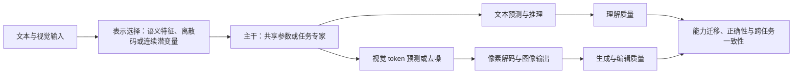

> 历史调研的公开整理副本；原始阅读口径不升级为本轮重读。最新整合见[项目状态](../../../docs/project/STATUS.md)。原始材料和缓存保留本地。

# UMM（统一多模态模型）研究综述

调研日期：2026-10-15。本文以公开原始论文及作者项目材料为依据，重点讨论视觉理解与视觉生成的统一，并说明它与音视频、动作建模的关系。文献从 2022 年早期统一任务模型延伸到 2026 年 10 月的自改进、长期交错生成研究。本地候选库有 573 篇去重题录与摘要，中文矩阵评议 144 条，其中 1 条已撤回并排除出结论依据；49 篇论文保留原始正文文本，按相关方法、实验与消融开展重点阅读。候选数量不等于精读数量。这是一份问题导向的研究综述，不声称穷尽全部论文，也没有重新运行模型建立排行榜。

配套材料：[核心文献矩阵](文献矩阵.md)、[扩展文献矩阵](扩展文献矩阵.md)、[深度专题分析](深度专题分析.md)、[候选文献总索引](候选文献总索引.md)、[检索与证据说明](检索与证据说明.md)。

## 1. 这个方向究竟在研究什么

UMM 要解决的核心问题是：**怎样让一个模型既能从多模态信息中理解事实、关系和指令，又能把知识和推理结果转化为图像等模态的输出，并让这些能力相互支持。**

以图像为例，传统任务包括“看图回答”“根据文字画图”“按指令改图”。统一模型进一步希望连续完成：看懂一张房间照片，识别家具与空间关系，按约束重新布置，生成结果，再检查是否满足要求。这里涉及的困难不只是输入输出格式，而是视觉细节、语义、世界知识和生成控制之间能否传递信息。[领域综述](https://arxiv.org/abs/2505.02567)

“UMM”并不是边界完全固定的模型类别。阅读论文时，应把“统一”拆成几个可核实的维度：

| 维度 | 应当问的问题 | 不能直接推出的结论 |
|---|---|---|
| 模态 | 支持文本、图像、视频、音频、动作中的哪些？ | 支持很多输入不代表能生成同样多的模态 |
| 任务 | 理解、生成、编辑是否由同一部署模型完成？ | 同一模型家族不一定是同一检查点 |
| 表示 | 理解与生成是否使用同一视觉编码器、tokenizer 或潜空间？ | 同一编码器不保证各层使用相同信息 |
| 参数 | 共享整个主干，还是部分层、注意力上下文或专家？ | “单一模型”不等于所有参数都共享 |
| 目标 | 使用统一预测目标，还是联合优化多种损失？ | 多种损失不妨碍形成统一系统 |
| 能力 | 学会理解某种关系后，能否在生成时正确使用？ | 同时会理解和生成不等于发生知识迁移 |

因此，三个相关概念应分清：

- **MLLM/VLM**：常见形式是多模态输入、文本输出，重点是视觉理解。单凭这个名称不能认定它具有图像生成能力。
- **视觉 UMM**：本文主线，同时具有图像理解与图像生成，部分模型扩展到编辑、视频和交错输出。
- **Omni/any-to-any**：强调更广的模态覆盖，仍需逐项核实实际输入输出。例如 Qwen3-Omni 接收文本、图像、音频和视频，主要输出文本与语音；这与图像生成型 UMM 的任务范围不同。[Qwen3-Omni](https://arxiv.org/abs/2509.17765)

本文的综合判断是：**研究已经从“把两种功能放进一个系统”推进到“确定哪些信息应共享、哪些计算应专门化，以及何时会产生可测量的协同”。**这个判断来自下文架构论文、受控实验和反例评测的共同证据，而非某一篇论文的宣传性结论。

这个方向也不是从 2024 年才开始：OFA、Unified-IO 在 2022 年已统一视觉和语言任务；Versatile Diffusion、UniDiffuser 从扩散角度统一图文生成。2023 年的 Emu、DreamLLM、SEED 等把 LLM 与交错图文建模推到前台，2024—2025 年进一步形成离散 AR、混合生成和全扩散路线，2026 年大量工作转向协同机制、像素建模和闭环评价。这是重心变化，不表示旧路线被新路线淘汰。[OFA](https://arxiv.org/abs/2202.03052)、[Unified-IO](https://arxiv.org/abs/2206.08916)、[Versatile Diffusion](https://arxiv.org/abs/2211.08332)、[UniDiffuser](https://arxiv.org/abs/2303.06555)

## 2. 理解论文需要掌握的基础知识

### 2.1 视觉 token 不只有一种

**语义特征**由视觉编码器产生，常用于判断图里有什么、对象之间是什么关系。**重建特征**需要保留足够细节，以便恢复像素。**离散视觉 token**把图像映射为码本中的索引，可以像文字一样预测；**连续视觉潜变量**保留向量表示，适合扩散或流匹配。

理解往往需要对光照、纹理等变化保持一定不变性，生成却需要具体决定这些细节，所以一个有限容量的表示不容易兼顾两者。但这不等于两个任务在理论上必然冲突：UniTok 的实验指出，部分冲突可以由离散表示容量不足解释，扩大多码本量化容量能够改善兼容性。[UniTok](https://arxiv.org/abs/2502.20321)

还要区分三个部件：视觉编码器把图像变为特征，tokenizer 规定建模单位，图像解码器把输出表示恢复成像素。论文中的“encoder-free”通常是在排除外部预训练视觉编码器，并不意味着输入完全不经过 patch 化或投影。

### 2.2 自回归：预测下一个 token

设序列为 \(s_1,\ldots,s_n\)，自回归模型学习：

\[
p_\theta(s)=\prod_{i=1}^{n}p_\theta(s_i\mid s_{<i}),\qquad
\mathcal L_{AR}=-\sum_i\log p_\theta(s_i\mid s_{<i}).
\]

如果图像也被编码成离散 token，文本和图像就可以进入同一序列，用同一种预测方式建模。优点是能够沿用语言模型基础设施，也方便交错生成；代价是图像序列较长时逐 token 解码耗时，而且量化可能损失信息。Chameleon、Emu3 是代表。[Chameleon](https://arxiv.org/abs/2405.09818)、[Emu3](https://arxiv.org/abs/2409.18869)

### 2.3 扩散与流匹配：逐步生成视觉内容

连续扩散通过学习去噪生成图像；流匹配学习把噪声运输到数据分布的速度场。以一种噪声到数据的线性路径为例：

\[
z_t=(1-t)\epsilon+t z_0,\qquad
\mathcal L_{FM}=\mathbb E\|v_\theta(z_t,t,c)-(z_0-\epsilon)\|^2.
\]

其中 \(z_0\) 为图像或图像潜变量，\(\epsilon\) 为噪声，\(c\) 为多模态上下文。不同论文的时间方向、噪声路径和参数化可以不同，不能直接混用公式。

混合模型可以让同一个 Transformer 对文本做下一 token 预测，对图像做去噪或流匹配：

\[
\mathcal L=\lambda_{text}\mathcal L_{AR}+\lambda_{vision}\mathcal L_{visual}.
\]

Transfusion 的关键价值是用实际缩放实验验证了这种组合的可行性；并非要求所有模态先转成同一种离散符号。[Transfusion，方法与受控比较](https://arxiv.org/html/2408.11039v1)

**离散扩散是另一种选择。**它可以对被遮蔽的文本和图像 token 进行恢复；不能把它理解为简单地给文字加高斯噪声。MMaDA 将文本推理与图像生成纳入离散扩散框架，并研究相应后训练方法。[MMaDA](https://arxiv.org/abs/2505.15809)

### 2.4 “共享”包括信息流与参数两个层面

文本预测通常采用因果注意力；同一张待生成图像的 token 可以双向交互。混合模型必须明确哪些内容可见、哪些内容待预测。BAGEL 的 MoT 则说明：理解与生成可以使用不同专家参数，同时在每一层通过联合注意力交换上下文。这里的 MoT 不应直接等同于常见的可学习 top-k token 路由 MoE。[BAGEL，模型部分](https://arxiv.org/html/2505.14683v3)

下面是一张阅读框架图，不是某个模型的精确实现图：

## 3. 主要技术路线：各自在解决什么问题

这些路线不是严格互斥的类别。一个模型可以在语义层自回归、像素层扩散，也可以同时采用独立编码器和共享专家上下文。

| 路线 | 主要问题与方法 | 代表工作 | 已获得的证据与代价 |
|---|---|---|---|
| 全离散自回归 | 把视觉也变成 token，以统一序列目标建模 | Chameleon、Emu3 | 图文交错及视频建模可行；长视觉序列带来解码成本，表示质量受 tokenizer 影响 |
| 自回归与离散去噪混合 | 文本保持 AR，图像通过并行恢复遮蔽 token 生成 | Show-o | 单个 Transformer 支持问答、生成、补全；需协调不同注意力与训练方式 |
| 自回归与连续扩散/流匹配混合 | 文本和图像保留各自建模方式，在主干内交互 | Transfusion、BAGEL、Show-o2 | 获得强生成与理解能力；需要联合训练和模态间损失平衡 |
| 全离散扩散 | 文本和图像共享离散去噪范式 | UniDisc、MMaDA、Lumina-DiMOO | 可统一理解、推理和图像生成的预训练/后训练；语言与视觉的解码需求仍有差异 |
| 全连续建模 | 在连续 embedding 中学习多模态流或扩散 | UniDiffuser、OmniFlow、Multimodal Flow | 提供联合/条件生成的统一视角；连续文本表示与解码仍需设计 |
| 原生像素建模 | 直接从像素 patch/tubelet 理解与生成 | Tuna-2、SenseNova-U1.5、PixelUMM | 减少外部压缩瓶颈；高维输出、训练效率与语义引导仍是问题 |
| MLLM 连接生成器 | 用语义特征或可学习查询为扩散模型提供条件 | SEED-X、MetaQueries | 能复用成熟模型、保留理解能力；不能据此认定整个系统实现双向能力迁移 |
| 混合视觉接口 | 共享部分视觉表示，对理解与生成做不同输出适配 | UniTok、MANZANO | 表示容量与适配方式可缓解任务冲突；不支持“编码器越统一越好”的无条件判断 |

来源：[Show-o](https://arxiv.org/abs/2408.12528)、[Show-o2](https://arxiv.org/abs/2506.15564)、[MetaQueries](https://arxiv.org/abs/2504.06256)、[MANZANO](https://arxiv.org/abs/2509.16197)，以及前文所列原始论文。

## 4. 代表工作应当怎样理解

### 4.1 Janus / Janus-Pro：通过解耦接口缓解任务冲突

Janus 针对理解与生成所需视觉信息粒度不同的问题，为两者设置独立视觉编码路径，再接入同一自回归 Transformer。Janus-Pro 进一步改进训练策略、扩大数据和模型规模。[Janus](https://arxiv.org/abs/2410.13848)

Janus-Pro-7B 报告 MMBench 79.2、GenEval 0.80、DPG-Bench 84.19；原论文图像分辨率为 384×384，并明确指出细粒度 OCR 和图像细节仍受限制。它证明了这一设计在相应训练条件下有效；由于同时改变数据、策略和规模，Pro 相对早期版本的全部收益不能归因于某个架构部件。[Janus-Pro，表 3—5 及结论](https://arxiv.org/html/2501.17811v1)

### 4.2 Transfusion：用受控比较研究建模范式

这项工作的研究价值在于比较离散视觉 AR 与连续视觉扩散时控制了数据、计算等因素。在其比较范围内，Transfusion 达到相近图像生成表现所需的计算量少于 Chameleon 式基线的三分之一；其大模型实验为 7B 主干、2T 多模态 tokens。这个结论适用于文中的基线和训练设置，不能外推成所有 AR 模型都劣于所有扩散模型。[Transfusion，§4](https://arxiv.org/html/2408.11039v1)

### 4.3 BAGEL：把交错数据和跨任务上下文作为核心

BAGEL 采用理解与生成两个 Transformer 专家、联合注意力，以及大规模图文视频交错训练。论文所述主要模型为约 7B 激活参数、14B 总参数；交错数据覆盖连续帧、网页和编辑关系，使研究从孤立图文配对推进到连续视觉操作。

其 GenEval 为 0.82，使用 LLM 提示词改写后为 0.88；启用 thinking 后，WISE 从 0.52 提升到 0.70。后一个结果支持“推理可以帮助知识相关生成”，但不等于增加推理步骤对所有任务都有益。论文中的未来帧预测和导航展示也不足以独立证明具有通用物理世界模型能力。[BAGEL，表 5—6 和 §7](https://arxiv.org/html/2505.14683v3)

### 4.4 Show-o / Show-o2：统一方式也在演变

Show-o 采用 AR 与离散去噪组合。Show-o2 转向文本 AR 与连续流匹配，并在 3D causal VAE 空间构建空间/时间双路径融合表示，以扩展到图像和视频。其 7B 模型在论文设置下报告 GenEval 0.76、DPG-Bench 86.14；GenEval 使用了改写提示词。应将这种变化理解为对表示和建模折衷的持续探索。[Show-o2，表 5—6](https://arxiv.org/html/2506.15564v3)

### 4.5 MetaQueries：冻结理解主干也能扩展生成

MetaQueries 用可学习查询从冻结 MLLM 中提取条件，连接扩散生成器。它提供了一个有意义的工程和实验基线：不必重新训练全部理解参数，也可以获得图像生成能力。其作者报告 MetaQuery-XL 的 GenEval 为 0.80，使用改写提示词；理解结果应结合“主干冻结”的事实解释，不能算成生成训练改善理解的证据。[原论文](https://arxiv.org/abs/2504.06256)、[作者实现与结果说明](https://github.com/facebookresearch/metaquery)

### 4.6 UniTok / MANZANO：接口选择不只有完全共享或完全分离

UniTok 通过多码本量化扩大视觉 token 的表示容量，报告 ImageNet 重建 rFID 0.38、零样本分类准确率 78.6%。这里的 rFID 衡量重建，不是开放域文本生图能力。[UniTok](https://arxiv.org/abs/2502.20321)

MANZANO 从同一视觉编码器产生两种适配表示：理解使用连续特征，生成使用离散语义 token，再由扩散解码器还原像素。其 1B tokenizer 消融中，混合接口的 text-rich 理解均分为 73.3，纯离散方案为 62.3，二者 GenEval 均为 77（百分制）。这支持该设置下的兼容性改善，尚不足以建立所有规模下的最优接口结论。[MANZANO，表 1](https://arxiv.org/html/2509.16197v1)

### 4.7 MMaDA：把统一延伸到后训练

MMaDA 使用统一扩散架构、跨模态长思维链训练和 UniGRPO。其问题意识是：当生成机制从 AR 转为扩散，原有语言模型后训练方法不能不加修改地照搬。研究统一模型时，需要同时考虑基础模型、推理格式和奖励优化，而不能只看网络结构。[MMaDA](https://arxiv.org/abs/2505.15809)

### 4.8 2026 年的原生像素路线

SenseNova-U1.5 在 2026 年 9 月提出不依赖外部视觉编码器与 VAE 的视觉接口，结合 MoT、空间耦合像素重建及专家蒸馏，报告最高原生 4K 分辨率。其表 6 的 GenEval 为 0.92；表 7 的 GenEval2 为 0.55，加入 prompt enhancement 后为 0.71。两个基准及提示增强设置必须分别解释。文中的“8B-MoT”也不应被当作整个系统总共只有 8B 参数：配置表分别列出理解/生成分支约 8.2B。[SenseNova-U1.5](https://arxiv.org/html/2609.11929v1)

这一结果说明像素接口、空间重建和专门后训练已成为实际研究内容；论文自报分数仍需要在统一条件下评估，不能用单表排名宣布某条路线胜出。

Tuna-2、Representation Forcing 和 PixelUMM 提供了互补证据：前者研究去掉编码器后的规模效应，第二项通过先预测语义表示为像素生成提供结构引导，第三项把像素接口扩到视频。Representation Forcing 的受控消融中，像素生成 GenEval 从 0.25 到 0.76；但其理解表现仍未全面超过 VLM-only，故更准确的结论是缓解部分统一训练损失。[Tuna-2](https://arxiv.org/abs/2604.24763)、[Representation Forcing](https://arxiv.org/abs/2605.31604)、[PixelUMM](https://arxiv.org/abs/2609.38597)

### 4.9 不能遗漏的另两条发展线

**扩散主干继续扩展。**UniDisc 研究统一离散去噪和采样权衡，Lumina-DiMOO 强化多任务与高分辨率生成，LLaDA2.0-Uni 结合 MoE、语义离散 tokenizer 与扩散解码器；Multimodal Flow 则将文本和视觉 embedding 都连续化。它们说明“文本必须 AR、图像必须 diffusion”不是已经确立的唯一方案。[UniDisc](https://arxiv.org/abs/2503.20853)、[Lumina-DiMOO](https://arxiv.org/abs/2510.06308)、[LLaDA2.0-Uni](https://arxiv.org/abs/2604.20796)、[Multimodal Flow](https://arxiv.org/abs/2609.40362)

**从已有生成器反向获得理解。**FullFlow 用 LoRA 和文本插入机制扩展现成 flow 模型；OpenUni 则从另一方向连接现成 MLLM 与生成器。二者提供成本较低的研究基线，但不能用适配参数少推导全面理解能力已接近大型 VLM。[FullFlow](https://arxiv.org/abs/2605.20316)、[OpenUni](https://arxiv.org/abs/2505.23661)

## 5. 最关键的科学问题：理解与生成是否真的互相促进

这里至少有三种不同命题：

1. **训练迁移**：加入生成监督后，理解能力是否提升？只训练理解后，生成是否变好？
2. **推理辅助**：测试时先生成一张辅助图，最终回答是否更准确？
3. **跨任务一致性**：文字说对的事实，画出来是否也对？图文输出是否相互矛盾？

这三种现象可以独立发生。模型可能受益于生成训练，却不适合在测试时先画图；也可能文字和图像一致地犯错，因此“一致”必须同时结合正确性评价。

### 5.1 正面证据：特定生成目标可以改善理解

UniMRG 在后训练中增加像素重建、深度图和分割图生成，给模型提供外观、几何和结构监督。其 OpenUni-3.6B 配置的 VSR 从 66.69 提升到 73.90；推理阶段沿用原模型流程，不需要额外生成辅助图。这里支持的是**结构化生成监督对表征学习的作用**，而非任意生图训练都能提升推理。[UniMRG，表 1](https://arxiv.org/html/2601.21406v3)

### 5.2 跨方向迁移存在，但依赖具体模型

2026 年的 Transferability 研究只在一个方向训练计数能力，再测试另一个方向。在其 LoRA 微调设置下，Lumina-DiMOO 的生成计数准确率由 48% 升至 57%，而 Janus-Pro 对应结果由 38% 降至 32%。BAGEL 则出现一定双向迁移。

这比“理解和生成两个总分都上涨”更直接地测试了能力传递。但不同模型还具有预训练数据和优化历史差异，因此这些跨模型结果不能单独证明架构是唯一原因。[Transferability，表 1—2](https://arxiv.org/html/2607.04423v1)

### 5.3 受控实验表明：共享与专门化需要同时考虑

2026 年 9 月的 Synergy 研究比较了全共享、按模态分支和按任务分支。在其 AR+flow、原生视觉接口设置下，全共享偏向理解，按模态分支偏向生成；按任务分支并保持语义交互能更好地平衡两者。几何任务中，联合生成训练使 Geometry3K 从 59.90 升至 65.39；把同一额外数据改写为文字描述监督，结果为 63.56。

这增强了“生成目标具有额外作用”的证据。不过该任务分支方案还加入了重建训练，不能把全部收益视为纯路由结构收益；结果也尚未覆盖所有生成范式。[Synergy，表 1—2、§3.4](https://arxiv.org/html/2609.01607v1)

### 5.4 反面证据：先画图再回答并非普遍有效

UniG2U-Bench 覆盖 7 类任务机制、30 个子任务，评估了超过 30 个模型。研究发现，所测统一模型总体上经常落后于对应基础 VLM，Generate-then-Answer 也经常弱于直接回答；部分空间、视觉错觉和多轮任务存在收益。这是特定模型和任务集合上的结果，不足以否定全部 UMM，但足以否定“增加生成能力自然提高理解”的笼统说法。[UniG2U-Bench](https://arxiv.org/abs/2603.03241)

VGAU-Diag 在六类可验证视觉规划任务中加入难度分层和 oracle 辅助图。它发现：复杂度提高后收益不稳定，一些模型即使拿到忠实的辅助图也不能有效利用。由此可见，瓶颈可能位于“读懂和利用中间图”，不能总归咎于“图没画好”。[VGAU-Diag](https://arxiv.org/html/2608.22174v1)

### 5.5 为什么上述结果不矛盾

它们分别研究联合训练、单方向微调、测试时视觉辅助，实验单位不同。更紧的表示共享可能有利于某种能力跨方向迁移，也可能在联合优化中加重竞争；适当分支可以减少冲突，却也可能削弱某些迁移路径。

**目前更符合证据的解释是：协同取决于任务是否共享知识、表示是否保留相关信息、优化是否允许知识传递，以及推理流程能否使用这些信息。**“共享更多一定更好”和“解耦越彻底越好”都缺乏普遍证据。

### 5.6 更新的机制证据：入口、层次和诊断指标

Entry Point 用新实体和伪词只训练一个方向，再测试另一方向，发现“能够匹配候选名字”与“没有候选时主动说出名字”可以分离；层间干预也表明知识进入共享计算的位置很重要。Cross-Branch Steering 和 UniKE 分别从激活方向与知识编辑研究类似的不对称联系。[Entry Point](https://arxiv.org/abs/2608.17564)、[Cross-Branch Steering](https://arxiv.org/abs/2607.26411)、[UniKE](https://arxiv.org/abs/2606.00477)

对于常用的“梯度冲突”解释，证据也需要细分：GridUMM 受控审计发现常见冲突指标未可靠预测最终权衡；PAM 则在实际模型中对高冲突视觉 token 位置实施干预，取得任务指标改善。二者共同要求把梯度现象与最终行为连接起来，不能仅用更好的余弦相似度证明统一效果。[冲突指标审计](https://arxiv.org/abs/2609.38465)、[PAM](https://arxiv.org/abs/2609.38485)

## 6. 数据与训练：为什么不能只比较架构

UMM 使用的数据至少有四类，其提供的监督不同：

| 数据 | 提供的主要信息 | 示例 |
|---|---|---|
| 图文配对 | 视觉内容与语言描述的对应 | 图片与 caption |
| 多模态问答/指令 | 从视觉证据生成正确语言答案 | OCR、图表、数学、空间关系 |
| 编辑配对 | 指令造成什么变化、哪些区域应保持 | 原图—编辑指令—目标图 |
| 交错图文/视频序列 | 多步状态变化与跨图依赖 | 连续帧、教程、故事、多轮修改 |

训练通常涉及接口对齐、混合预训练、提高分辨率或上下文长度的继续训练，以及指令/偏好/强化学习后训练；具体模型并不一定遵循完全相同的阶段。[Janus-Pro](https://arxiv.org/html/2501.17811v1)、[BAGEL](https://arxiv.org/html/2505.14683v3)

研究时应特别关注三个混淆因素。第一，增加一种任务往往也增加了数据，收益可能来自额外知识。第二，模型扩展了专家参数后，总容量与激活计算可能改变。第三，推理时的提示改写、thinking、多次采样和结果筛选都可能带来额外收益。这些改进本身有价值，但应说明收益来自哪里。

对长序列任务，训练上下文通常更干净，部署时模型却需要接着自己生成的图像继续工作；误差可能累积。IMUG-Bench 因而把评估扩展到多轮、图文交错的理解与生成，采用动态评价，使后续理解问题及其正确答案与模型实际生成的视觉上下文相适应，用于分析跨轮一致性和误差累积。[IMUG-Bench](https://arxiv.org/abs/2606.09169)

后训练还包括同源偏好对齐、联合 RL、语义配对与自生成监督。HermesFlow、CoRL、PairUni 分别体现这些思路。PairUni 的消融尤其提醒我们：配对数据带来的收益，不能全部归因于新增的 advantage 加权公式。自训练中的同模型评判也可能共享盲点；可执行图表等任务提供了独立验证生成数据的途径。[HermesFlow](https://arxiv.org/abs/2502.12148)、[CoRL](https://arxiv.org/abs/2505.17534)、[PairUni](https://arxiv.org/abs/2510.25682)、[RSI](https://arxiv.org/abs/2610.03002)

## 7. 怎样评价结果，才能回答“统一有什么价值”

### 7.1 常用指标能证明什么

| 评价层面 | 常见指标/任务 | 能支持的结论 | 主要边界 |
|---|---|---|---|
| 理解 | MMBench、MMMU、MathVista、OCR/空间任务 | 相应问题的回答能力 | 总分不直接说明图像生成或知识迁移 |
| 重建 | rFID 等 | tokenizer 保留和还原视觉信息的能力 | 不等于文生图能力 |
| 生成分布 | FID、感知或人工偏好 | 某种参考分布下的视觉质量 | 不充分检验每条指令是否正确 |
| 组合遵循 | GenEval、DPG-Bench | 对象、数量、属性和关系等约束的满足情况 | 不能覆盖全部美学、文字、物理和编辑能力 |
| 知识生成 | WISE 等 | 世界知识能否转化为图像内容 | 需核实是否使用 thinking 或额外提示处理 |
| 编辑 | 指令遵循、主体和非编辑区域保持 | 修改是否准确且不过度 | 应同时考虑多轮累计误差 |
| 统一能力 | GapEval、XTC、Unison、UniG2U、IMUG | 一致性、迁移或闭环行为 | 不同基准测量的“协同”仍不完全相同 |

GenEval 本身针对对象共现、位置、数量和颜色等可分解属性设计，所以一个更高的 GenEval 分数不能替代整体图像质量评价。[GenEval 原论文](https://arxiv.org/abs/2310.11513)

### 7.2 2026 年评测研究的重要推进

- **GapEval**：同一问题用文字和图像两种输出回答，检测能力差距与知识不一致。所测模型仍存在显著方向差异。[论文](https://arxiv.org/abs/2602.02140)
- **XTC-Bench**：从同一场景图生成匹配的理解问题和生成指令，在原子事实层衡量跨任务一致性。研究指出，单任务高分不意味着跨任务高度对齐。[论文](https://arxiv.org/abs/2604.25072)
- **Unison**：使用 2,169 个统一任务样本，覆盖内部一致性、理解引导生成、生成引导理解和互相增强，并提供统一与解耦评测轨道。[论文](https://arxiv.org/abs/2606.26984)

这些基准共同推动了评测对象的改变：从“会回答多少题、会画多少图”，转向“同一知识在不同输出中是否正确、能否跨任务利用，以及连续执行是否稳定”。但一致性指标仍需与事实正确性共同报告，不能奖励两种模态共同犯错。

更早的 RealUnify、Uni-MMMU 已强调双向耦合任务。2026 年的 UReason 进一步比较“完整推理上下文”与“只保留推理后提示”，VGUBench 则把文本作答、视觉作答和直接渲染拆开。它们分别帮助判断：模型是不会推理、不会画，还是无法把已经推理出的语义送入生成路径。[RealUnify](https://arxiv.org/abs/2509.24897)、[Uni-MMMU](https://arxiv.org/abs/2510.13759)、[UReason](https://arxiv.org/abs/2602.08336)、[VGUBench](https://arxiv.org/abs/2602.23711)

### 7.3 一个能区分原因的最小比较框架

以下是基于现有证据提出的分析框架，不是本次已经运行的实验：

| 要检验的命题 | 必要比较 |
|---|---|
| 生成训练改善理解 | 理解基线；加入生成目标；将相同新增数据转为理解监督 |
| 理解训练改善生成 | 原模型；只训练目标理解能力；直接训练目标生成能力 |
| 辅助图改善回答 | 直接回答；等预算文字推理；模型生成辅助图；oracle 辅助图 |
| 统一系统优于组合系统 | 尽可能匹配知识、输入、模型能力与计算预算的 planner–generator 流程 |

应报告成功率、分任务结果和计算开销。对模型间排名，先检查提示改写、采样次数、分辨率、总/激活参数、评测集版本及人工/模型裁判设置。只核对影响结论的条件，不把无关重复检查当作研究严谨性。

## 8. 向视频、音频和动作延伸到什么程度

**视频**增加了时间一致性、运动、遮挡和长期状态保持问题。Show-o2 将视觉潜空间扩展到视频；Emu3.5 使用超过 10T 交错视觉语言 tokens，并通过 DiDA 把逐 token 解码适配为并行预测，作者报告每图推理约 20 倍加速。该加速属于论文特定设置，不是通用部署速度保证。[Emu3.5](https://arxiv.org/abs/2510.26583)

Lance、HYDRA-X 和 PixelUMM 进一步研究图像/视频共用主干与时空表示。长交错生成还需要主动管理历史：UniLongGen 通过筛选视觉上下文减少干扰，LongMIG 相关工作加入持久参考、场景检索与自生成历史训练，并提供逐项消融。[Lance](https://arxiv.org/abs/2605.18678)、[HYDRA-X](https://arxiv.org/abs/2606.13289)、[UniLongGen](https://arxiv.org/abs/2603.07540)、[LongMIG](https://arxiv.org/abs/2610.17080)

**音频与语音**额外要求时间同步和低延迟。Qwen3-Omni 通过 Thinker–Talker 和语音 codec 建模处理多模态感知及流式语音输出；AnyGPT 则探索文本、图像、语音和音乐的离散序列统一。模态覆盖应按论文实际任务核实，不能由“Omni”名称推导任意模态转换都已成熟。[AnyGPT](https://arxiv.org/abs/2402.12226)

**动作与具身任务**可以把动作、框、坐标等纳入输出空间。Unified-IO 2 使用统一 encoder–decoder，处理视觉、语言、音频和动作，并在超过 35 个基准上报告结果。它表明统一建模的范围可超出图文，但不能凭静态问答和生成结果证明闭环控制能力。[Unified-IO 2](https://arxiv.org/abs/2312.17172)

“世界模型”则需要更强的证据：模型是否能在动作条件下持续预测状态、保持未观测对象、支持干预与规划。生成看似合理的下一帧只覆盖其中一部分。本文将相关展示视为扩展能力证据，不直接把它等同于完整物理或因果理解。

## 9. 尚未解决的问题，以及值得重点关注的研究空间

下面是本次综合分析得到的问题优先级，不是对尚未完成实验的结果预测。

**第一，理解与生成之间到底共享了什么。**现有计数、空间和文字能力迁移结果提供了切入口，但还缺少跨数据、跨规模和跨架构的稳定规律。比新增一个连接模块更有解释力的问题是：在相同监督下，哪些层、哪些视觉表示承载可迁移能力？

**第二，如何在参数共享与任务专门化之间取得平衡。**完全共享可能竞争容量；高度解耦可能削弱知识传递。需要把路由方式、模型容量、训练数据配比与辅助重建目标分开研究，避免把一组同时改变的设计包装成单一机制解释。

**第三，生成什么中间表示才有用。**深度、分割、几何图或状态图比任意自然图更接近某些任务的瓶颈。UniMRG 和 VGAU-Diag 分别从训练和推理角度提供证据；开放问题是如何选择表示、何时使用生成，以及如何识别错误中间图。[UniMRG](https://arxiv.org/abs/2601.21406)、[VGAU-Diag](https://arxiv.org/abs/2608.22174)

**第四，跨任务一致性与多轮保持仍不足。**模型需要同时做到答案正确、输出一致、修改精确和长序列状态稳定。只优化单轮视觉质量，不能覆盖这些要求。[GapEval](https://arxiv.org/abs/2602.02140)、[IMUG-Bench](https://arxiv.org/abs/2606.09169)

**第五，质量、成本与可复现性必须一起评价。**AR 的串行解码、扩散的多步采样、高分辨率和长视频的序列成本都存在实际代价。模型权重公开也不等于数据、完整训练过程和评测配置都可复现；比较路线时应保留这些信息。

这些问题已经存在相关工作，不能直接宣称为空白或创新点。若进入具体课题阶段，还需要围绕一个明确问题做更窄的查新，而不是仅靠本综述选择“尚无人研究”的方向。

## 10. 推荐的学习顺序

1. **先理解预测对象。**阅读 Chameleon 与 Transfusion，弄清离散视觉 token、连续潜变量、AR 和扩散各自如何工作。
2. **再理解接口与共享。**对照 Janus、UniTok、MANZANO，回答为什么有的模型分开编码，有的扩大共享表示容量，有的使用混合接口。
3. **研究联合系统。**阅读 BAGEL 与 Show-o2，重点看注意力、交错数据、训练阶段和评测条件。
4. **补上另一种建模范式。**阅读 MMaDA，理解全扩散及其后训练，与 AR+flow 区分。
5. **用正反证据形成研究判断。**把 UniMRG、Transferability、Synergy 与 UniG2U、VGAU-Diag 放在一起阅读，分别讨论训练迁移和推理辅助。
6. **最后学习怎样证明统一的收益。**阅读 GapEval、XTC、Unison 和 IMUG，检查正确性、一致性、预算和闭环误差。

读每篇论文时固定记录六件事：实际要解决的失败现象、变化了哪些部件、用了哪些数据、对照控制了什么、结果支持多大范围的结论，以及尚未排除什么解释。配套文献矩阵已经按这一思路给出了起点。

本次调研没有重新训练或运行这些模型。表中数值来自相应作者论文或官方项目材料，属于对原始实验报告的整理；正文中的综合判断与建议均已按其性质表述。
