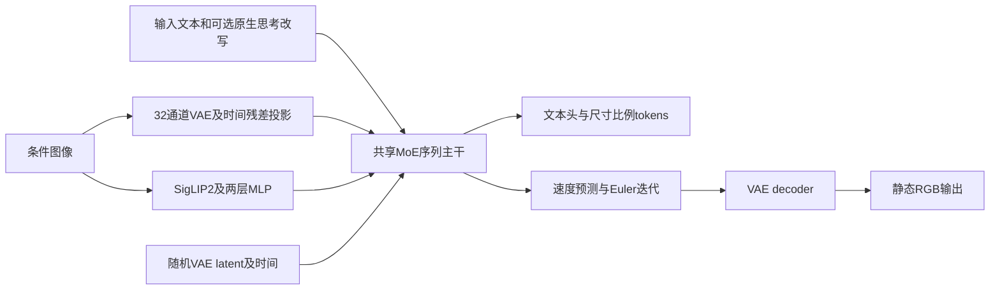

# HunyuanImage 3.0：原生MoE、GSB净胜与公开制品审查

第一百三十四批完成[L120](../reviews/L120.md)明确范围核心三遍和五项书面记录。[结构化证据](../../data/hunyuanimage_native_moe_gsb_and_release_audit_2026-10-22.json)。357目录（330论文／研究、27资源），243核心/246书面含未通过项；未确认核心87论文／研究+27资源，资源另审。无新增目录、删除文件、下载权重、执行模型或独立复现。

来源：[v3报告](https://arxiv.org/abs/2509.23951v3)、[完整17页PDF](https://arxiv.org/pdf/2509.23951v3)、[固定GH6e9113a](https://github.com/Tencent-Hunyuan/HunyuanImage-3.0/tree/6e9113a692a27a0751d82aba3b2015a876646c03)、[GenEval正式原文](https://proceedings.nips.cc/paper_files/paper/2023/hash/a3bf71c7c63f0c3bcb7ff67c67b1e7b1-Abstract-Datasets_and_Benchmarks.html)。按技术报告，不把后续模型发布状态倒写成原始版已验证能力。

## 问题与系统贡献

把大规模MoE语言先验扩展到图文理解、推理和静态图生成，改善复杂提示遵从、知识概念、图像真实感与文字渲染。报告评估重点是T2I；后续Instruct具静态编辑/多图融合与原生CoT。未提出规范笔顺/手写视频/绘画动作执行，视频挖帧只是编辑/交错训练数据来源。

闭源强图像模型限制社区复用，单纯图文对齐难保复杂属性、长提示/知识和真实感，工程上还需大容量与部署预算。作者以原生LLM框架保留知识/AR推理，加入连续图像建模并系统改善数据和后训练；各机制贡献仍需独立控制，不能从总系统强表现推出每一部件必需或共享理解生成必然协同。

Hunyuan-A13B共享MoE骨干上，文本next-token、图像latent速度预测/连续去噪；条件图同时用VAE与ViT表示，两种projector、generalized causal attention/兼容1D的2D RoPE及自动尺寸token。四阶段渐进预训后接指令/SFT、DPO、MixGRPO、SRPO与ReDA；MeanFlow扩展的采样蒸馏及TMP剪枝另述。创新主张集中系统配方/原生接口/后训练扩展，未给新理论定理或充分因果消融。

## 方法流程与模型结构

文本→Hunyuan tokenizer与特殊tokens→共享decoder-only MoE；理解/编辑输入图分别经32通道16倍VAE和SigLIP2 ViT、残差timeprojector与两层MLP，作为序列两组图像tokens。理解输出词概率/AR回答；生成先可选AR think→recaption和尺寸/比例tokens，再将随机VAE latent及timestep送同MoE输出velocity，Euler迭代后VAE decoder到RGB。各去噪步图块内部双向，文本按因果，生成图完成后才可变clean条件；多noisy图训练遮蔽其对后续段的影响。latent去噪时间、文本CoT步骤、编辑原子操作均不能当物理笔画事件。实际PDFp4/6/7/9/11/12六页核F2–8/T1。

论文80B以上总参数/每token约13B活跃，64路由专家top8+共享MLP；HF32层/hidden4096/32Qheads/8KVheads、词表133120，gate fp32/softmax-topk归一化，任务共用注意力及专家库，无手工理解/生成两套完全独立骨干。VAE32channel/ffactor16，1024²时未额外patchification（配置类默认patch_size1）为64²空间latent；条件ViT SigLIP2so400m-naflex，27层/1152/16heads/patch16，MLP到4096。报告训练ViT512anchor，公开processor最大1024patch，不能把outer vit_input_resolution224字段当实际训练/全部推理尺寸。VAE源码/配置出现Conv3D、temporal4和video特殊tokens，只说明底层复用，未构成生成视频能力证据。共享序列concatenate不等VAE/ViT已变成一个相同tokenizer。

## 训练数据、指标、对比及实验条件

原池>10B图，技术清洗（短边不足512/损坏/曝光等）与MD5、文字/水印/logo/拼贴/AIGC过滤、美学/清晰度和embedding去重约.5%，主要筛后保留<45%，再补知识/文字/风格/设计图，最终近5B。额外>100M编辑对/多图，来自聚类关系判别及镜头/相机运动/检测分割/模糊过滤的抽帧；不等有视频连续过程监督。双语层级caption四档/风格/实体，训练组合30–1000词；OCR/IP agent双向核验，未公开所有教师/阈值/通过率。T2T/T2TI和TI2TI推理trace、Wikipedia信息图及阶段高质子集；规模/采样比/语种字体去重/污染审查未齐，无法把多阶段复用相加为独立样本。早期去大量文字/AIGC和后期专门补文字是分阶段选择，不能概括全程排除文字或证明AI数据一律无效。

SSAE：500提示、3500语义点、12字段，另一LLM校验并人工修正，固定点后由未具名CoT MLLM做0/1匹配；MeanImageAccuracy先每图平均再平均，GlobalAccuracy按所有点汇总，点数不同则权重不同。F6中/英雷达含12字段+2总体轴，不从无数值标签雷达编精确总分。GSB人评：1000提示、>100专业评者、每prompt每模型一次生成、其他模型默认设置；Better/CompetitorBetter/EquallyGood/EquallyPoor，净优势=W−L。无公开judge版本/提示/人一致性、blind/randomization分配/CI、逐项原始分数或等FLOPs协议。F8为1000T2I提示的专家模态激活频数/归一化偏好与KL；非任务准确率。无独立文字OCR/CER/拓扑、笔顺/视频时序或理解标准主表。

F6 SSAE对Seedream4/NanoBanana/GPTImage；F7人评另HunyuanImage2.1。对比采用当时商业版本/默认配置，精确接口日期、prompt重写/CoT、采样/NFE、尺寸与预算未完全对应；单次输出避免该次挑选，仍不等训练/推理等计算或完整复现。报告把GenEval/T2ICompBench笼统归为依赖CLIPScore不准确：GenEval原研究为检测器确认对象/计数/位置，CLIP只作局部颜色分类，不能照搬作者对相关工作的概括。本文未提供等容量dense/MoE、纯T2I与联合模型等强受控基线。

T1四阶段VAEanchor256/256/512/1024，ViT始终512；训练Transformer/ViT/两者/两者，任务分别T2I+LM+MMU、MMU、再加INTL、再加CoT，保纵横比；SFT/DPO/MixGRPO/SRPO/ReDA及蒸馏/TMP只给策略，无完整原optimizer/lr/batch/steps/硬件/总FLOPs/奖励模型与权重。发布Base默认50Eulersteps/CFG5/shift3；Instruct50/CFG2.5/shift3/en_unified/think_recaption/maxnew2048；Distil8/CFG2.5/shift3且use_meanflow/cfg_distilled true，加入r与guidance嵌入，可单条件分支，不能将同8步等同未蒸馏8步或端到端只有8次计算。AR文本采样默认topk1024/topp.95/temp.6；Base maxlen12800，Instruct/Distil22800。README Base建议≥3×80GB、Instruct/Distil≥8×80GB；不是实测最小显存/延迟。Base PE默认推荐外部DeepSeekv3.1 thinking API重写，Instruct原生CoT需区分。

## 主图结果与消融缺失

实际F7：对NanoBanana W23.00%/L20.36%/双方好40.81%/双方差15.83%，净+2.64个百分点；对Seedream4 W20.01/L18.84/双方好39.30/双方差21.85，净+1.17个百分点。GPTImage净+5.00、Hunyuan2.1净+14.10，未给这两对完整四格。2.64/1.17等非绝对胜率也非已证显著性，不能由此写全面超越闭源。F6总体相近但英文secondaryaction/composition等轴存在对手更高，不支持所有字段都最佳。报告没有数字主结果表或独立理解成绩；T1仅训练阶段表。4–8NFE、TMP80→20B/单24GB4090为作者效率主张，未给本报告质量曲线/实测端到端延迟与对应20B固定制品。HF公开Distil仍32分片/80B级，索引total_size168611084748bytes，非20B剪枝。

报告没有分别去双encoder、改变MoE/dense、去CoT、逐项加DPO/MixGRPO/SRPO/ReDA、换VAE8×+patch/16×、阶段数据与去噪蒸馏的受控消融表。T1说明训练计划，F8说明路由统计，二者不能代替因果消融。F8视觉KL总体随深度变大但多次局部下降、末层明显下降，不能称逐层严格上升；其支持存在模态专门化观察，未排除token数/层位/噪声t/提示分布混杂，也没证明专门化造成收益。公式写k0到64但称64experts，按64项实际体系理解并保留端点排版疑问。读懂检查中“解释消融”记录这一缺失及补验设计，不伪造一组消融。

## 局限与公开边界

报告无独立Limitations节，§6仍称I2I未来但§2/4已描述编辑配方、Jan26/26当前仓库已发布Instruct；版本时间线与能力必须分开。内部数据/奖励及未公开训练使独立复现受限，SSAE内部集/未具名裁判外部效度不明，GSB小净差无CI/盲法。大规模联合理解/互促、文字准确与真实事件未实证。HF Base/Instruct索引各168539748812bytes、32分片/5161tensors；Distil168611084748/32/5169，仅元数据非下载或参数实测，13B活跃不等13B驻留内存。官方author=tencent+同名模型查询仅返回三者，未找到TMP20B独立制品；结论限本次源范围。77项GH树以推理/app/PE/vllm为主，未见完整预训/RL/SSAE评分/人评原始数据管线。许可为Tencent Hunyuan Community（HF other），有地域/用途条款，不能称无条件宽松许可。

## 优势假说、验证方案与写作学习

海量高质双语数据与语言知识可能提升长提示、概念/文字静态渲染，MoE在固定每token活跃量下增加总容量、联合条件ViT+VAE可能兼顾语义和细节；原生CoT有望在组合任务多花推理计算换遵从。优势须与固定数据、同预算非共享/外部重写/单编码器对照；后训练的奖励偏好可能牺牲多样性/小众风格/笔画拓扑。16倍VAE仍可能损细笔，编辑静态ID/未编辑区保持不推出连续笔顺、长期动态一致或机器人执行优势。

以同底座/数据曝光分别控制MoE路由与等活跃/等总参数dense、ViT/VAE/联合、四阶段及CoT开关；与外部重写在等最终prompt长度/语言模型调用和生成FLOPs下比较。逐项SFT/DPO/MixGRPO/SRPO/ReDA单独和累积，公布奖励/噪声区间/多样性代价与训练多seed。SSAE公布500prompt/点/裁判/错误校准、独立人标和中英同义/OOD，按prompt与评者做配对层级CI；GSB随机盲测并固定商业版本，分净胜/平局/绝对胜率及每类。Base/Instruct/Distil/TMP逐个固定权重、精度/offload/CFG/taylor/步数，含AR思考、PE网络调用、去噪/VAE测端到端速度/显存；发布TMP20B再核4090。字形先oracleVAE重建与OCR/细笔拓扑，再给同终态不同真实过程，加入SVG、VideoSketcher/逐笔强基线测事件顺序/可见性/执行；以上未执行。

Intro明确开放强生成模型的目标，Method用数据治理→原生架构/attention/position→渐进训练和后训练组织，T1让每阶段目标可追溯，SSAE的macro/micro定义和GSB四格值得学习。Claim需把系统成绩与单机制因果、代码/权重开放与数据/训练开放、观察与证明分开；不以模态KL、caption抽帧、CoT原子编辑替代互促/动态实证。补写Limitations应列裁判校准/统计、数据与奖励缺失、训练预算、版本已过时段和TMP制品边界；“最大/最强”限定到当时比较范围。

## 实际阅读范围

arxivv3完整17页PDF（17560429bytes，首次超时后续传完整），Abstract/§1–6全部研究文字、§2.1–2.3/§3.1.1–4/§4.1–4.4/§5.1–5.3.1、T1全表、F1–8图注、RoPE/专家偏好KL表达；§7仅角色与参考文献选择追引，无独立附录。实际p4/6/7/9/11/12六页核F2–8与T1、GSB四格。GH6e9113a完整77项树，README新闻/开放计划/介绍/安装/三版用法与默认/模型表/评测，config主要默认；model构造1730–1806/图像嵌入1806–1854/forward接口与输出/路由1092–1165/2DRoPE403–484/attention2859–2885/prepareinputs开头/CoTgenerate3237–3305/采样调用3195–3214选段；pipeline时间表258–299/Euler351–439/采样829–876、imageproc464–512/545–584、PE外部API53–113。三HF固定revision API、config/generation全字段与权重index元数据、卡用法/评测/许可元数据选段；根LICENSE关键授权范围，不做法律适用判断。未读全仓/全部模型卡重复展示、VAE全部源码、权重/训练日志/原评分输出；未执行模型/外部API/独立复现。

## 结合F3/4与实际推理源码的数据流

理解和编辑的条件图用两组表示；生成latent是连续变量，并没有将每个像素或VAE格点作为离散next-token逐个采样。序列级因果与图块内双向注意力共存。生成采样步数、CoT文本步数与真实书写时间需分别定义。

## 结果图的可复核解释

| 对手 | Hunyuan更好 | 对手更好 | 双方好 | 双方差 | 净优势W−L |
| --- | ---: | ---: | ---: | ---: | ---: |
| Nano Banana | 23.00% | 20.36% | 40.81% | 15.83% | 2.64个百分点 |
| Seedream4 | 20.01% | 18.84% | 39.30% | 21.85% | 1.17个百分点 |

F7另给对GPT-Image净5.00、对Hunyuan2.1净14.10，未给完整四格，不补造。平局比例很高；这些净差支持作者所采人评下结果接近，尚无充分统计证据确认小幅差异的显著性。每模型每提示一次与未挑选输出可以同时成立，但各模型默认采样预算和外部提示改写仍可能不同。

SSAE令第i幅图有m_i个语义点，s_ij∈{0,1}，MeanImageAccuracy=(1/N)Σ_i[(1/m_i)Σ_j s_ij]，GlobalAccuracy=(Σ_ij s_ij)/(Σ_i m_i)。后者让语义点多的图权重更大，不能称两个等价总分。实际雷达只提供曲线，不推测小数；公开逐点结果、裁判版本与人标校准才能判断差异及文字/OOD有效性。

本文没有传统受控消融表。T1是阶段计划，F8是路由观察：归一化图像使用频率p_v与文本频率p_t的p_v/(p_v+p_t)热图，以及两分布KL。高值表示更偏图像，非图像任务更准确；p_v+p_t为零的处理、KL平滑和方向未完整说明。总体深层差异增加但局部与末层会下降。需随机/固定/模态路由干预并等容量比较，才可检验专门化是否带来收益。

## 公开版本逐项对照

| 项目 | Base | Instruct | Instruct-Distil |
| --- | --- | --- | --- |
| HF固定revision | 36f21fe74b65614451cc50ffd8a35a5f662dac70 | 2ec2c78bee7d4b94157341fba86c4c2c7b1858b2 | c8ffd07206f1b843697606968196e8f59f8ff38c |
| 发布用途 | T2I | 原生思考改写、静态编辑/多图 | 同Instruct，减少去噪步 |
| 默认steps/CFG/shift | 50/5/3 | 50/2.5/3 | 8/2.5/3 |
| 默认bot_task | image | think_recaption | think_recaption |
| 提示增强 | 官方推荐外部DeepSeekv3.1 API | 自身AR思考及改写 | 自身AR思考及改写 |
| MeanFlow/CFG蒸馏 | 配置类默认关闭 | 配置类默认关闭 | 两项显式开启 |
| 权重索引分片/张量数 | 32/5161 | 32/5161 | 32/5169 |
| 索引total_size bytes | 168539748812 | 168539748812 | 168611084748 |
| README建议显存 | ≥3×80GB | ≥8×80GB | ≥8×80GB |

[Base](https://huggingface.co/tencent/HunyuanImage-3.0/tree/36f21fe74b65614451cc50ffd8a35a5f662dac70)、[Instruct](https://huggingface.co/tencent/HunyuanImage-3.0-Instruct/tree/2ec2c78bee7d4b94157341fba86c4c2c7b1858b2)、[Distil](https://huggingface.co/tencent/HunyuanImage-3.0-Instruct-Distil/tree/c8ffd07206f1b843697606968196e8f59f8ff38c)。索引为元数据，未读权重或测参数/显存。蒸馏保留32层大MoE，主要减少采样调用，不能等同报告另述TMP20B剪枝。指定官方作者/同名查询只返回这三项；因此TMP20B/24GB4090目前记为报告主张，待独立制品、量化/offload及端到端协议核实。

所读FlowMatchDiscreteScheduler使用sigma从1到0、shift3、Euler：x_next=x+(sigma_next−sigma)*v。源码证明所用推理更新形式；报告未公开完整训练插值/采样分布和loss细节，不以标准RF习惯替填确认事实。Distil还传r和guidance嵌入，含CFG蒸馏，8步数字不包含额外AR思考、输入编码和VAE解码。Taylor cache默认关闭，不能把开启后的速度与原始质量直接配对。

## 与现有知识及文字视频问题的联系

共享专家库的学习路由与UniFork人工晚层分叉都允许不同表示，但训练目标、tokenizer、规模、数据差异巨大，不能靠两张专门化曲线比较优劣。ReDA用参考和生成图的特征差，报告没有把该差定义为真实视频动力学；TI2TI的原子编辑trace也没有规范书写事件标注。

早期自然图清洗AIGC与BLIP3-o/OpenUni采用小规模AI指令集并不直接矛盾：数据阶段、目标分布和比例不同。需在固定真实/合成prompt和预算的实验中判断，不能将某一论文的筛选动机推广为所有AI训练数据的规律。

追引：已有E01/E02 MeanFlow记录不重复新增；MixGRPO2507.21802、SRPO2509.06942与TMP/ReDA原工作和独立制品需要后续全文核，不因本报告引用便记精读。继续L121 DeepGen1。
