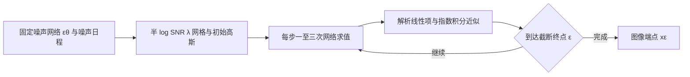

# 潜空间、Transformer、一致性与数值采样：第四十四批

深化[LDM](../reviews/G003.md)、[DiT](../reviews/G004.md)、[Consistency Models](../reviews/G007.md)、[DPM-Solver](../reviews/G008.md)，新增[HF VAE ft-EMA／ft-MSE资源组](../reviews/R10.md)。主目录343项＝318论文／研究＋25资源；新增四项明确版本的核心三遍，累计104项，五条书面检查106项。资源协议审查不计论文三遍。未训练、推理或独立复现，全部剩余任务仍在继续。

## 先区分各项工作的技术接口

| 工作 | 解决的具体问题 | 输入输出和学习对象 | 不能直接推出的能力 |
| --- | --- | --- | --- |
| LDM | 像素扩散计算与感知压缩的折中 | 图像压缩空间中的条件噪声网络；输出静态图 | 无损字形、规范笔顺、真实视频时间 |
| DiT | 潜扩散Transformer的条件注入与扩展 | 类别／噪声时刻条件的latent patch Transformer | 文本理解、书写视频、执行动作 |
| Consistency Models | 少步映射与教师蒸馏／直接训练 | 同噪声ODE轨迹端点映射；输出图像 | 静态stroke-guidance产生有序绘画过程 |
| DPM-Solver | 已训练扩散ODE的少NFE数值积分 | 固定噪声网络＋schedule，输出近似端点 | 新模型训练、学习误差消除、真实笔事件保证 |
| HF VAE组件 | 保持潜空间兼容的decoder适配 | RGB／4通道潜图的编码／解码 | 独立文字生成完整图像或视频pipeline |

## LDM：同训练步数并未固定所有预算

实际读[2112.10752v2](https://arxiv.org/html/2112.10752v2)，[CVPR2022页](https://openaccess.thecvf.com/content/CVPR2022/html/Rombach_High-Resolution_Image_Synthesis_With_Latent_Diffusion_Models_CVPR_2022_paper.html)确认正式身份。原论文文本条件使用BERT tokenizer与共同训练的Transformer，不能用后来的Stable Diffusion CLIP配置替换。VQ正则模型将量化并入decoder，扩散仍学习连续prequantization潜表示。

T13在f=1/2/4/8/16/32下batch为7/9/40/64/112/112，lr也随配置变化，参数约391–396M。因此压缩扫描支持特定配置的折中，同2Msteps不等相同图像数／总计算。Fig6/7用5K FID，主生成表通常50K、COCO为30K，参考统计与样本数分别保留。A100计算折成V100-day依假定2.2倍率；不能当作所有模型实际同硬件墙钟。第一阶段预训练与摊销成本需另列。

T2 COCO文本FID由23.31降到CFG1.5的12.63，但GLIDE12.24、Make-A-Scene11.84更低。T3 ImageNet FID10.56→3.60伴recall.62→.48。修复T7 FID1.50好于LaMa重算2.23，LPIPS.137差于.134。SR50步带perceptual guidance仅.38sample/s，100步无该guidance为4.62；少步不保证更快。布局T9 LDM4 OpenImages微调与LDM8 COCO从零训练还改变步数／压缩，不当作仅f的受控消融。

原文Limitations已承认精细像素任务的压缩瓶颈。文字笔画是否被E丢失应先做重建OCR／拓扑，再解释生成；不能只看自然图像FID或把感知压缩叫无损。固定[官方a506df5](https://github.com/CompVis/latent-diffusion/tree/a506df5756472e2ebaf9078affdde2c4f1502cd4)eval YAML为base_lr5e−5，与论文文本训练lr1e−4来源不同，未拿它覆盖主协议。

## DiT：骨干、解码器和guidance要分别记账

[2212.09748v2](https://arxiv.org/html/2212.09748v2)在ImageNet类条件潜扩散上系统比较block、patch、容量。adaLN-Zero通过零初始化调制和残差gate使block初始恒等。patch变小增加token和计算，近似不增加参数；结构表近似等GFLOPS但参数不等，cross-attention的计算还更高。

| 256²、CFG1.5的解码器 | 生成FID | sFID |
| --- | --- | --- |
| 原始 | 2.46 | 5.18 |
| ft-MSE | 2.30 | 4.73 |
| ft-EMA | 2.27 | 4.60 |

这是DiT附录T5对decoder的对照。最佳2.27不能全部归因Transformer；扫描用ft-MSE，最佳用ft-EMA。denoiser GFLOPS与参数未含约84M的E/D。256最佳recall.57低于unguided.67；512 FID3.04仍高于StyleGAN-XL2.41，256 sFID4.60也高于StyleGAN-XL4.02，必须保留负指标。Fig10计算对照用FID10K，主表50K，不能混排。

论文JAX／TPUv3与[官方ed81ce2 PyTorch移植](https://github.com/facebookresearch/DiT/tree/ed81ce2229091fd4ecc9a223645f95cf379d582b)分开。当前sample默认vae=mse、CFG4，主最佳为EMA／1.5；models.py默认只对前三个**潜噪声**通道做CFG，第四个潜噪声通道及variance保持其他输出，不能误称前三RGB通道。作者移植核验结果为作者报告，本次未执行。

## Consistency Models：CD、CT与公开命令的初始化

[2303.01469v2](https://arxiv.org/html/2303.01469v2)的CD通过预训练EDM教师把相邻ODE点配对；主CT用同一x、同一z的两个噪声级，从随机初始化训练。CT仍使用预训练VGG LPIPS；附录连续时间比较有EDM初始化，范围单列。Thm1的端点误差界相对经验教师ODE，并需零一致loss等条件；Thm2是理想真score／平滑条件下的细网格渐近关系，不能当作所有有限CT严格等价CD。

| CIFAR10配置 | 一步FID | 两步FID |
| --- | --- | --- |
| CD，LPIPS | 3.55 | 2.93 |
| CT，主实验 | 8.70 | 5.83 |
| Progressive Distillation，L2 | 8.34 | 5.58 |

不同loss构成混杂，需结合Fig3/4同距离对比，不能把整张表差距仅归算法。EDM35NFE FID2.04仍更低；IN64的CD6.20／4.70和CT13.0／11.1也未达到EDM79NFE2.44。官方model-card指出VGG LPIPS与Inception指标共享ImageNet预训练可能造成评价偏乐观，后续增加独立OCR、域外识别／人评，不能反过来宣称所有收益已被否定。

[固定e32b69e代码](https://github.com/openai/consistency_models/tree/e32b69ee436d518377db86fb2127a3972d0d8716)的CT示例带teacher_model_path；cm_train.py在路径非空时把教师参数复制进待训练模型，和主CT scratch协议不同。CT IN64示例lr1e−4而主表8e−6，LSUN示例lr5e−5／b256而主表1e−5／b2048，CD LSUN示例也为b256。记录该差异用于复现选择，不把README命令直接叫主表原实验。target EMA与评估online EMA、τ的FID搜索成本分列。

stroke-guided editing为LSUNBedroom静态图编辑，Alg4通过加噪／去噪及条件替换工作，没有规范笔事件／绘画视频评价。扩散时刻与真实书写时间仍需分离。

## DPM-Solver：理论阶数、函数调用与代码默认

[2206.00927v3](https://arxiv.org/html/2206.00927v3)以变分常数公式解析处理线性项，在λ=log(α／σ)下近似噪声积分。下图依据Eq3.4及Alg1/2**自绘整理**；原文提出数值算法，没有新增神经网络架构。

理论全局O(hmax^k)误差针对**学得的ODE**，依Lipschitz、连续高阶总导与步长条件。二阶每步2NFE、三阶3NFE，不是阶数等于总步数。T1固定12NFE二阶FID5.28优于三阶6.03；18NFE三阶2.90优于二阶3.43，低预算最优阶需要实验。连续CIFAR4.70@10NFE与2.87@20分别用ε1e−3／1e−4，不能忽略终点变化。离散Type1／2时刻映射与fractional embedding假设也要记录。

E7单A40、8批、CIFAR batch128：10NFE DDIM.956±.011s与DPM.923±.006s接近；LSUN为batch64。4–16×主要来自相似质量所需NFE减少，非每次网络求值加速4–16倍，也不是单图延迟。[官方52bc3fb](https://github.com/LuChengTHU/dpm-solver/tree/52bc3fbcd5de56d60917b826b15d2b69460fc2fa)包含后续++，constructor默认dpmsolver++。原DPM和[后续DPM-Solver++](https://arxiv.org/abs/2211.01095)单独追引；dynamic threshold不适潜空间的说明不能省略。未运行求解器。

## 无独立论文组件同样进入研究目录

R10将[ft-EMA固定模型卡](https://huggingface.co/stabilityai/sd-vae-ft-ema/blob/f04b2c4b98319346dad8c65879f680b1997b204a/README.md)与[ft-MSE固定模型卡](https://huggingface.co/stabilityai/sd-vae-ft-mse/blob/31f26fdeee1355a5c34592e401dd41e45d25a493/README.md)作为一个相关资源组。两版均为AutoencoderKL组件、4通道f8潜空间，只微调decoder，均使用EMA。数据含未公开LAION-Humans，卡缺少完整optimizer／lr／seed／precision，不能叫完整可复现训练配方。

| 重建分布 | 原rFID／PSNR | EMA rFID／PSNR | MSE rFID／PSNR |
| --- | --- | --- | --- |
| COCO2017 val5K、256² | 4.99／23.4 | 4.42／23.8 | 4.70／24.5 |
| LAION美学5+子集10K、256² | 2.61／26.0 | 1.77／26.7 | 1.88／27.3 |

MSE像素指标更高，rFID比EMA差；原→EMA→MSE还增加训练步数／改变loss，不能仅归MSE。重建rFID与DiT生成FID分别列，组件的MIT字段不外推全部训练数据或整pipeline许可。没有独立论文也保留实际卡、配置、训练历史和不能支持的结论。

## 科研假设与实验组织

固定encoder、decoder、扩散checkpoint、guidance与参考统计，按压缩率／通道、骨干／patch、训练目标／初始化、solver／NFE分别控制；对照需并列等样本、等墙钟、等质量，而非只同steps。教师、LPIPS、decoder预训练、τ与ε搜索及VAE解码均进入成本。多训练seed与重复采样／逐图标准差分开。

面向文字视频，先测压缩重建上限，再测静态生成OCR／细线拓扑，最后测事件身份、先后／方向／落笔状态、真实帧可观测性与工具执行。相同终帧的乱序、覆写、瞬间出现可检验FID盲区；以上自然图像研究未验证过程能力。后续Improved CT（2310.14189）、DPM-Solver++（2211.01095）、Retrieval-Augmented Diffusion（2204.11824）和视频／时间压缩研究需去重后独立读，不能以引用出现算作完成。

写作学习：问题定义对应机制，Method按压缩／骨干／学习目标／数值求解接口组织；实验主结果外保留decoder、loss、初始化与负指标。Claim写清版本、分布、预算和指标，Limitations区分数值误差、学习误差与信息瓶颈。核心公式先讲输入输出／作用，关键假设再精读；全部附录／源码和正式PDF未逐条通读，所读范围在逐篇sections_read注明。无文件删除。
