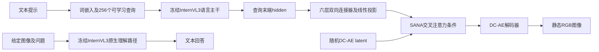

# OpenUni：轻连接器、提示分布与公开训练协议审查

第一百三十二批完成[L118](../reviews/L118.md)明确范围核心三遍和五项书面记录。[结构化证据](../../data/openuni_light_connector_template_shift_and_release_audit_2026-10-22.json)。357目录（330论文／研究、27资源），241核心/244书面含未通过项；未确认核心89论文／研究+27资源，资源另审。没有新增目录、删除文件、下载权重、执行模型或独立复现。

来源：[arXiv v3](https://arxiv.org/abs/2505.23661v3)、[完整13页PDF](https://arxiv.org/pdf/2505.23661v3)、[GH固定d1703fc](https://github.com/wusize/OpenUni/tree/d1703fc87669a573de2d0685e0c1a979639853b3)、[HF固定42f2472](https://huggingface.co/wusize/openuni/tree/42f24723a270a722b96a5b7b5f289017032a3036)。按技术报告阅读，未核正式会场。

## 研究问题与贡献

以最小连接模块把既有MLLM和预训练扩散生成器组合，保留图像理解并获得文字到静态图像生成，提供公开工程强基线。未提出视频、笔顺或绘画过程任务；§5明确生成文字仍困难、图像重建/编辑留未来。

从零统一训练成本高且任务可能冲突，冻结成熟模块再学连接可降低新增优化参数和工程复杂度。其“轻量”主要指连接器54M/225M和冻结策略，MLLM、SANA、DC-AE的预训练、运行与冻结模块内部梯度传播仍有成本，不能由新增参数少直接推出全系统等质量更快/更省总计算。

明确承接MetaQuery设计：256learnablequeries追加到prompt，经冻结InternVL3语言主干一次前向取hidden，六层Transformer connector和线性投影给SANA crossattention。第一阶段仅query/connector/projection训练，第二阶段解冻SANA transformer而MLLM/DC-AE仍冻结。主贡献是较小连接器、训练配方/制品与透明对照基线，没有提出新的flow理论，也未证明两任务互促。

## 数据流与模型结构

T2I：caption模板+imgstart→词嵌入追加256query→冻结LLM最后256hidden→六层双向connector→线性projection到SANA条件通道→随机DC-AE latent的flow/diffusion积分→DC-AE decoder RGB512²或1024²。256query一次主干前向，非256次逐token生成；connector是确定条件变换，与BLIP3-o随机CLIP特征flow不同。理解走冻结InternVL3原生图文回答，生成路径不经过其视觉encoder。论文没有整体架构图，本批依据§3与所读源码重建数据流；实际p1/3/4/5/6五页核F1和全部T1–6。

B512用InternVL3-1B+SANA.6B，connector6层/hidden896/14heads/FFN3072，T1约54M；L512/1024用InternVL3-2B，connector6层/1536/24heads/FFN8960，约225M，SANA1.6B512或SANA1.5-1.6B1024。§3正文把L512写.6B，T1/README/实际模型配置均1.6B，应保留文内矛盾并按有交叉证据配置记录。Connector借SigLIP encoder结构，源码随机初始化全连接/attention，并未load预训SigLIP视觉权重；两层preLN残差/selfattn+MLP，全query双向。DC-AE为f32c32，512→16²/1024→32²空间latent，不能把256query与像素latent数混同。摘要activated1.1/3.1B与F1横轴LLM参数、T1connector参数的分母不同，不用单一数字代表全系统驻留/活跃/可训预算。

## 数据、指标、基线与实验条件

PT约23M：text-to-image2M/LAIONaesthetic6M/Megalith10M/RedCaps5M，公开图文与LLM重caption；SFT用BLIP3-o60K。按T2曝光PT100000×512=51.2M样本、SFT10000×256=2.56M，若原库23M/60K且均匀则约2.23/42.7次等效曝光，非新增独立图数量。GH明确LAION/RedCaps仅URL+caption不能转发图，RedCaps下载困难可换CC12M，此替代改变数据分布，不能与原23M结果等同。所读Megalith指南cap_source=caption_internlm2_short；未核所有caption教师/过滤/原图去重和失效URL损失。

GenEval六类对象/计数/颜色/位置/属性组合；DPG五类及overall；WISE六知识领域；理解MMBench/SEED/MMVet/MMEP/MMMU/RWQA/TextVQA/POPE八项。TextVQA是识别回答，不能当生成文字准确率。无OCR渲染/CER/笔画拓扑/连续帧指标，无人评、训练多seed/CI、实际端到端延迟或等FLOPs比较；参数-GenEval散点并非速度/成本曲线。

MetaQuery/BLIP3o/Janus/JanusPro/Harmon/BAGEL/ShowO/Emu3等统一模型与SD/SDXL/DALLE/PixArt/FlowGRPO等生成器。T3明确†蒸馏、‡prompt rewrite、§RL，BLIP8B*私有30M另标；比较必须保留这些条件。MetaQuery与OpenUni的MLLM、生成器、连接器、数据和训练步不同，轻连接优势未被单因素隔离；理解分数继承InternVL，不能当生成训练提升理解或全量模型SOTA。

T2 PT100K/b512/lr1e-4/warm1000，SFT10K/b256/lr1e-5/warm100；AdamW betas.9,.95/wd.05/clip1/cosine。GH B配方CustomAdamW/Amp bf16、accum1、seedNone/非deterministic，单进程batch32；TRAIN示例PT2节点×8/SFT1×8与表globalbatch一致，L1024示例PT4×8/SFT2×8，但未读全部datasetbatch，不能据此确认原硬件/FLOPs。PT离线DC-AE latents可减少重复encoder计算；完整预提取成本仍计。SFT默认maxinput128并在模板后截断，0.1无条件。原文未列采样步数/CFG；GH eval默认20步/CFG4.5/seed42，GenEval每prompt4张、DPG4张拼2×2，WISE每prompt1张；官方bench另算最终分。默认不等原论文完整生成命令，训练seedNone也不是多seed报告。

## 六表结果和消融支持范围

T3 B512 GenEval.84、L512.85、L1024.86；BAGEL无rewrite.82但rewrite.88，FlowGRPO.95为不同协议，不称所有方法最优。L1024计数.76低于L512.77/BAGEL.81，非各类全优。T4 DPG80.29/81.54/83.08；L1024低于JanusPro7B84.19与SD3M84.08/DALLE3 83.50，超过表中MetaQueryXL82.05/论文BLIP8B81.60。T5 WISE B.43/L两版.52，L等于公开BLIP8B/BAGEL.52但低于MetaQueryL/XL.55、私有BLIP.62。T6 B/L MMVet59.5/62.2、MMEP1491.22/1626.88、MMMU43.4/48.6、TextVQA74.1/77.0、POPE90.7/89.6；L非全部高于B，SEED64.6弱于多基线，继承能力不等协同证明。

主要可解释对照为B有无60K：GenEval.62→.84（+.22绝对/22百分制点），DPG79.04→80.29（+1.25）。GenEval位置.25→.77、属性.42→.73，但DPGGlobal88.21→85.87/Relation87.01→86.91下降，不能写全维提升。该对照同时改变数据分布/额外训练和生成器解冻，无法独立证明蒸馏质量、模板重合或轻连接器的因果作用。作者指出约10K训练样本同GenEval提示模板，这与已见BLIP3o卡的“test不重叠”可同时成立：模板重合不等具体测试项泄漏；没有独立泄漏审计。没有query数、连接器深度、初始化、冻结/联合、等计算或完整scaling消融；B/L更换多个模块，L512→1024也换SANA1.5，非纯分辨率控制。

## 局限与需要纠正的表述

§5直接承认渲染文字困难和i2i未来；公开TRAIN称i2i开发中不保证，不能把函数/配置存在写成已获编辑能力。理解以冻结InternVL3保留，缺共享对生成/理解互促的实验；强基础模型与SANA/DC-AE先验使小连接器贡献难独立归因。原文23M全开放措辞需结合URL发布/原图获取和S-Lab非商业许可限定。T1BLIP8B30M/50M与自家后表*额外30M、已核BLIP v1 25M公开+30M私有不一致，不能沿抄50M为精确总数。SFT描述把DALLE/Midjourney当合成器，而BLIP原文为GPT4o生成、JDB/DALLE来源prompt，应分别保留作者说法与原始核查，不混成同一教师。无统计不确定性/OOD结构文字测试、完整运行日志或端到端成本。

## 优势假设、可证伪实验与写作学习

预训练MLLM已理解prompt、SANA的crossattention条件可被少量query桥接且目标图分布接近其先验时，小connector可用有限新增训练保持理解能力并取得较好静态对齐。冻结参数降低优化状态和参数更新成本；但query梯度仍需穿过冻结LLM操作，推理含LLM/CFG/SANA/DC-AE，节省比例要实测。固定模板组合可能受益于相似蒸馏分布，跨模板/语言与细字未有同等保证。

先固定同InternVL/SANA/DC-AE/数据/样本曝光，控制query64/128/256、connector2/6/12层、线性vs双向Transformer、同预算decoder解冻；分等参数与等FLOPs报告完整生成和理解变化。60K有无采用四组：原PT继续同步数、真实匹配prompt、AI匹配prompt、AI跨模板，固定生成器解冻和候选预算；按对象组合/模板/语言分离ID/OOD并核近重复，避免把模板泛化与泄漏等同。L512/1024保持同SANA版本只改尺寸再与换SANA1.5分开，测细字oracle DC-AE重建/预测端OCR及形近字拓扑。计全系统含预提latents、冻结LLM反传、CFG与decode时延/显存/训练GPU时，多seed和bootstrapprompt CI。书写视频另需过程监督、真实笔画事件/时长与SVG/绘画强基线，全部为未执行设计。

Intro主动承接MetaQuery和冻结模块路线，把工作定位简洁强基线；Method按连接器/变体/模板→两训练阶段→各benchmark组织，清楚可复用。T3标蒸馏/rewrite/RL及§4.1公开GenEval增益集中，是值得学习的协议透明表达；Limitations明确文字渲染与i2i未来。Claim仍应去掉不限定的best、把参数分母、L512型号、训练库授权/可获取性与细粒度消融欠缺说清；不把工程组合误写独创概率框架或动态文字能力。

## 实际阅读范围

arxivv3完整13页，Abstract/§1–5全部研究文字、全部T1–6/F1–3图注；无方法公式或独立附录，参考文献只选定追引。实际PDFp1/3/4/5/6五页，含参数散点与六表，定性F2/3未逐图核。GHd1703fc完整123项树，README/LICENSE/INFERENCE/EVALUATION/DATASETS/TRAIN全文，三模型配置及B预训/B与L1024FT指定超参、B PT/SFTdataset/processor；主模型33–136/184–216/249–300/344–438、connector414–511、CaptionDataset112–172及BLIPdataset全文，三评测主要采样/保存与CLI选段。五数据指南仅来源/下载/配置关键段，未全读提取脚本；HF42f2472七文件元数据和五数据API元数据，未下载pth/tar/parquet、逐检所有训练源或执行模型/评分/复现。

## 依据方法与源码重建的数据流

原报告没有整体方法框架图。下图由§3与所读源码重建，明确区分理解分支与生成分支。

连接器输出为确定条件，噪声在SANA图像latent采样引入。本篇没有BLIP3-o那层随机CLIP特征生成器；相近的query接口不能据此把两种方法写成相同模型。

## 原报告未写出的训练目标如何理解

所读diff_loss定义z_sigma=(1−sigma)x+sigma*eps，以MSE监督v_theta(z_sigma,c,sigma)≈eps−x；sigma由scheduler.timesteps映射，推理经SANA pipeline的DPMSolverMultistepScheduler。x为冻结DC-AE图像latent，c为query/connector条件。此处是根据实现解释公式，原报告没有提供新的公式定理。第一阶段扩散权重冻结，但其可微前向仍把梯度传给条件；query也需通过冻结LLM操作反传。可训参数、优化器状态和总前后向计算须分别统计。

## 对照与开放范围

| 项目 | 可核证据 | 应保留的限制 |
| --- | --- | --- |
| 轻连接器 | 六层，B54M/L225M | 未固定其他模块单独控制深度/预算 |
| B有无60K | GenEval.62→.84；DPG79.04→80.29 | 加数据、步数与解冻策略合在一起 |
| GenEval模板 | 作者称60K中约10K同提示模板 | 没有独立证据证明具体测试项泄漏 |
| L512扩散型号 | T1/README/config为1.6B | 正文.6B矛盾保留 |
| L512到1024 | 生成器也换SANA1.5 | 非纯分辨率受控消融 |
| 模型公开 | HF七文件含六个pth，PT/SFT变体 | 无模型卡，不是包含所有外部底座的一键包 |
| 训练数据 | 图文源、重caption、处理指南 | LAION/RedCaps/CC12M仅URL或caption，实际取图会漂移 |
| 代码许可 | S-Lab License1.0非商业用途 | 不把fullyopen写成无限制商业许可 |
| 评测代码 | 产生图像，默认20步/CFG4.5/seed42 | 最终计分转官方bench，未运行重算 |
| i2i | 开发代码/指南 | §5未来、TRAIN不保证工作，未有论文定量验证 |

复用资源：[LAION重caption](https://huggingface.co/datasets/wusize/laion6m_recap)、[RedCaps重caption](https://huggingface.co/datasets/wusize/redcaps5m_recap)、[Megalith索引](https://huggingface.co/datasets/wusize/megalith-10m)、[text-to-image2M索引](https://huggingface.co/datasets/wusize/text-to-image-2M)、[60K处理索引](https://huggingface.co/datasets/wusize/BLIP3o-60k)。API元数据与版本已记录，未逐读所有索引/parquet或下载图像。底层来源drawthingsai/megalith-10m、jackyhate/text-to-image-2M及DC-AE、SANA模型的独立论文/许可仍按追引去重审查，不能凭本篇完成它们的精读。

## 对本研究的具体意义

强静态生成器加小接口可作为检验共享UMM必要性的基线。若一个新笔顺模型只胜过弱的从头模型，却无法胜过相同过程监督下的冻结MLLM+SANA/视频生成器，就不足以支持共享结构的贡献。应先用DC-AE oracle重建和文字OCR/拓扑测小字细笔是否可恢复，再加入真实过程监督检验事件顺序；OpenUni当前文字渲染局限已经提示该迁移风险。

后续追引：FlowGRPO2505.05470（须先核原ID）、SANA/DC-AE原论文与正式版、RedCaps/LAION重caption配置及实际URL成功率；主目录按题名/原ID去重后处理。本批不把参考文献出现或资源元数据获取计作独立精读完成。
