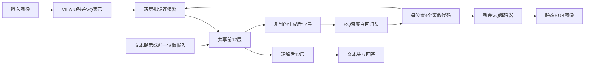

# UniFork：对齐邻域、分叉容量与训练发布审查

第一百三十三批完成[L119](../reviews/L119.md)明确范围核心三遍和五项书面记录。[结构化证据](../../data/unifork_alignment_neighborhood_and_fork_capacity_audit_2026-10-22.json)。357目录（330论文／研究、27资源），242核心/245书面含未通过项；未确认核心88论文／研究+27资源，资源另审。无新增目录、删除文件、下载权重、执行模型或独立复现。

来源：[v1全文](https://arxiv.org/abs/2506.17202v1)、[完整15页PDF](https://arxiv.org/pdf/2506.17202v1)、[固定GH2c5b757](https://github.com/tliby/UniFork/tree/2c5b75750e880589aacf2ab5f25efafb37477272)、[Qwen配置](https://huggingface.co/Qwen/Qwen2.5-0.5B/blob/main/config.json)。ICLR2026 under-review检索命中不作为已读/正式录用证据。

## 研究问题、观察与创新

研究单一自回归next-token体系中图像理解与静态图像生成的任务干扰，检验共享前层、分离后层是否比完全共享更合适。没有文字视频、规范笔顺或绘画过程任务，视频/音频/3D及交错长序列明确列Future Work。

作者在GenEval和MJHQ各500条提示上比较逐层图像/文本特征邻域一致性：生成专家大体先升后降，理解专家总体上升；Emu3-base两任务曲线相近，任务专用微调后分离。该观察提出晚层表示需求不同的假说，尚未证明所有模型存在不可避免的根本冲突，也没有直接测梯度冲突或高频重建。

VILA-U残差VQ图像表示配Qwen2.5-.5B，前半Transformer层共享，后半复制为理解/生成分支；理解用文本head，生成用逐空间位置再逐RQ深度的AR imagehead。先冻结LLM做视觉对齐，再联合PT/SFT，最后冻结共享参数独立微调任务分支。核心是对齐观察驱动的结构与训练折中，非新扩散/flow或笔画时序理论。

## 输入输出、框架与参数口径

理解：图像→VILA-U tokenizer特征→1024到896的两层GELU connector并插BOI/EOI→共享12层→原LLM后12层→文本head/回答。生成：提示与BOI→共享12层→复制后12层→RQ imagehead依次预测每位置4个离散code→累加code嵌入作为下一位置输入→RQ decoder得到RGB。主实验384²为24²=576空间位置，消融256²为16²=256；空间扫描次序和残差量化深度均不表示真实落笔事件。实际PDFp3/4/5/6/7/8/9/11八页核F2/3/4/5/8、公式和全部T1–5。

Qwen2.5-.5B公开底座配置24层/hidden896/14Qheads/2KVheads/FFN4864；源码num_shared_layers=24//2，理解走完整原24层，生成走前12+gen_fork12，独立norm_gen，初始化复制后半权重。单一VILA-U256 tokenizer，词表16384/空间16倍压缩/RQ深度4。论文称总backbone1.21B、理解活跃.5B/生成.76B，消融生成.57B含.07Bhead；预算口径未提供参数清单。发布RQ配置head6层/attention3584/32heads/输入输出896，代码每层先896→3584做完整Q/K/V/out再→896，FFN896→3584→896；仅六层四个注意力矩阵即6×4×3584²=308281344参数，尚未计其余head/主干，与“生成较.5B仅增约.26B”不能直接对应。保留版本/计数疑问，不把源码配置当已复现的.76B。F8层号超过30，而底座24层，特征是否含imagehead/其他层未说明，不据此确认分叉点。

## 数据、指标、基线与实验条件

StageI先ImageNet类名模板的双向caption/T2I，再LAION-En30M+COYO10M，只训connector/imagehead。StageII PT生成32.5M（JourneyDB/SAM/Unsplash/内部数据）+理解16.5M InternVL1.5PT；SFT生成5M为前32.5M子集并加BLIP3o60K，理解3.8M InternVL1.5SFT。StageIII重用StageII指令数据，不能把各阶段相加当独立图数。内部分布、各源比例、去重、AI教师/筛选及原数据清单未完整公开。公开loader的StageII/III生成dataset_names仍your/dataset/name/list，需用户补齐。

理解MME-P/POPE/SEED-I/VQAv2/GQA；生成GenEval六类及Overall、MJHQ30K参考分布FID。对齐用500样本的mean-pool视觉/文本特征mutual-kNN邻域一致性；该量既非样本对余弦/距离，也非互信息、梯度冲突、笔画正确率或直接语义理解。未给k、距离/归一化、完整hooks脚本、随机种子/CI。F5理解曲线有明显上下波动，只能写总体上升，不能复述为严格单调。无OCR/CER、连续帧、规范笔顺/执行或训练多seed/端到端时间结果。

受控结构消融GenExpert/UndExpert/FullyShared/UniFork，同Qwen.5B和256²、StageI/II数据子集、声明保持每任务activated参数及训练配置一致；总驻留参数与全部训练FLOPs仍不相等。主表含LLaVA/MobileVLM/IDEFICS、ShowO/VILA-U/LWM/Chameleon及SD/LDM/LlamaGen等。多为较早版本，缺少同时期多项强统一模型；不能宣称当前全领域SOTA。M=0只称结构类似BAGEL，不能据此说与BAGEL的MoT/flow目标完全等价。

论文T1：16A100/bf16/context1350/AdamW/wd0；StageI lr1e-4/125K/global384，StageII PT5e-5/170K/384，SFT5e-5/23K/384，StageIII gen3e-5/17K/384与und2e-5/15K/256；除und cosine外constant。T1把warmup.03标steps，脚本表明为ratio；发布gen脚本.02而表为0。全部公开脚本2节点×8GPU、perdevice24/accum1得到global384，und与表256不符；epochs1而无maxsteps，ImageNet4epochs，未给原日志不能认定等于T1。生成短边384中心裁剪，理解长边384/127RGB pad；训练10%空prompt，推理CFG4。发布GenEval默认4图/prompt/seed666，576位置×4RQ深度，温度1/top-p.96/top-k900硬编码于RQ采样；CLI温度未传入该实现。发布forward_gen训练label切片硬编码256位置，推理576，384训练是否另有修改未解决。

## 完整主表及消融支持范围

T3主模型理解MMEP1208/POPE85.8/SEED55.2/VQA70/GQA55.1；相对ShowO1097.2/80约+10.1%/+7.25%，非绝对百分点；GQA仍低于ShowO58/DDiT59.2等。T4主模型GenEval六项.95/.50/.22/.73/.19/.17，平均.46；LWM Overall.47高于.46，不能说总体超越LWM。消融行.83/.24/.16/.62/.06/.62原PDF确如此，六项算术均值约.4217却列Overall.33，错误所在未确认，保留整行和矛盾。按报告Overall .33→.46为+.13/约39.4%相对；FID16.3→10.6约−35%。模型/分辨率/数据规模同时变，不能将全部增益归因活跃参数.57→.76。T5主10.6优于表内ShowO15.18/VILA-U12.81/LWM17.77，但没有等预算同期全面比较。

T2完整：GenExpert GenEval.36/FID15.1；UndExpert MME1177/VQA69.7/SEED56.6；FullyShared1203/69.6/53.9/.28/17.2；UniFork1229/69.9/55.1/.33/16.3。Y型在这五项均优完全共享，支持该配置结构折中；仍弱于生成专家.36/15.1，SEED55.1低于理解专家56.6。作者“可比或更好”必须按指标限定，不能说冲突消除或全面优专家。未扫分叉层比例、未等驻留/FLOPs、没有去StageIII/固定数据量等消融；T2只用I/II子集，主实验三阶段收益不能单独定位。F2/5/8相关曲线支持动机而非独立因果验证，500条MJHQ平均32.9词对GenEval7.3词仅扩一个提示分布。

## 局限与未解决的证据矛盾

§5承认tokenizer质量/小模型/训练数据限制，VILA-U256训练却384输入可能空间错配，最优共享比例未探索，交错及视频未来。额外审查：k/特征层与文本参照不清，理解公式仍T而 prose说eachlayer；F8层号、T4聚合、参数总额与源码、warmup/globalbatch/256标签存在未解差异。没有公开独立checkpoint链接（本次tliby+UniFork HF API搜空仅限该查询），完整111项树未见对齐指标脚本或根LICENSE；部分继承文件Apache头部不能替全项目或外部权重授权。源码/基础模型可获取不等原始全数据和原日志可复现。本批未下载权重、执行模型或独立计分。

## 优势条件、可证伪实验与写作学习

若任务的低层跨模态语义可共享、晚层输出表示与梯度方向更不相容，且共享训练有足够互补数据，前共享后分叉有望相对完全共享取得更好理解/生成Pareto；它以更多总参数换较接近单任务的活跃路径，优势应在固定预算和多分布测得。mutual-kNN下降也可能反映空间/词汇细节而非有害冲突，对齐最大化不天然最优。静态字形重建上限、严格事件和真实执行尚未测，不能由此推导规范笔顺优势或UMM双任务必然互促。

固定tokenizer/底座/数据比例与总曝光，比较共享0/6/12/18/24层，并分别等总参数、等每任务活跃和等训练FLOPs；加入参数相等adapter/完全分离专家及冻结/不冻结StageIII。每组联合测理解/生成/训练多seed、时延/显存和Pareto，报告gen优und退等负迁移。固定同一真实/生成图与caption，在同层/末层文本两协议下扫k/距离/归一化/池化和prompt长度，保存hooks；直接测共享层梯度cosine并对晚层对齐或去冲突进行干预，检验曲线改变是否预测任务收益。锁定256/384与imagehead容量、同数据规模核T4原始逐prompt计分。文字迁移先oracle tokenizer细字拓扑/OCR重建，再给定同终态不同真实笔顺过程，加入规则SVG/逐笔绘画强基线检验事件、时间和执行；均为未执行设计。

Intro由常见统一NTP→晚层需求的实测疑问→Y型假说，Method先观察/指标再架构、三阶段、CE，Experiments先受控消融再主表与更多分布，是可学习的问题驱动组织。需在Claim区分观察、机制解释和因果证据，逐项列专家残余差距、相对/绝对改进及LWM反例，图曲线不用严格单调。Limitations应补对齐协议、未扫分叉、私有数据和代码/参数/分辨率差异；尚未测的动态文字能力列假说，不写既有贡献。

## 实际阅读范围

arxivv1完整15页，Abstract/§1–5全部研究文字，mutual-kNN两式与Eq1、T1–5全表、F1–8图注和Limitations/FutureWork；参考文献仅选追引，无独立附录。实际PDFp3/4/5/6/7/8/9/11八页核曲线、框架、训练与五表，定性F1/6/7未逐图审。GH2c5b757完整111项树、README全文；configs/config、六训练脚本主要超参、train.py数据组合345–410/初始化/冻结526–558，projector全文，modeling_qwen2构造/生成共享分支1250–1358/理解后段/生成CE1640–1695，llava_llama88–194、RQTransformer77–178与attention15–172、GenEval采样17–55/99–177/CLI及infer_t2i主要采样/CLI选段。Qwen公开config与tliby HF查询元数据；未读全仓库、基础tokenizer全源码、OR挑战版、权重或实际训练日志，未运行/复现。

## 依据实际F3与源码解释分支

生成回馈使用connector.forward_generate，不再次加BOI/EOI。384²输出依次处理576空间位置，每位置4层残差代码；这一离散自回归机制不提供物理书写时间轴。

## 关键消融逐项比较

| 模型 | MME-P↑ | VQAv2↑ | SEED-I↑ | GenEval↑ | MJHQ FID↓ |
| --- | ---: | ---: | ---: | ---: | ---: |
| 生成专家 | — | — | — | .36 | 15.1 |
| 理解专家 | 1177 | 69.7 | 56.6 | — | — |
| 完全共享 | 1203 | 69.6 | 53.9 | .28 | 17.2 |
| UniFork消融 | 1229 | 69.9 | 55.1 | .33 | 16.3 |

五指标胜完全共享支持该数据/256分辨率下的结构收益；与专家比，生成两项和SEED仍有差距。主模型的数据量、分辨率、head预算和第三阶段均改变，不能用主模型结果单独确认分叉的因果效果。

T4消融六项原值为.83/.24/.16/.62/.06/.62，和为2.53，均值约.4217；Overall写.33，与T2一致但与该六项不一致。实际PDFp9已核，不能未经作者/逐prompt结果确认便改为推测的某个单元格。主模型六项均值.46自洽，而LWM总体.47仍高于.46。

## 公式和曲线应该说明什么

对齐分析先对每样本所有视觉token与文本token均值池化，再在500个样本间比较两个特征空间的近邻关系。它支持讨论表示几何相似性，无法直接证明某层识别语义、高频细节或梯度有害。正文先定义末层文本T，理解段又说eachlayer但公式无层号；k/距离/归一化及hooks未明确，需公开分析脚本。F2总体趋势和F5更长提示结果可以保留，F5理解曲线局部下降明确，不能称严格单调。F8横轴超过30而Qwen底座24层，是否混入视觉head层或其他分析模型需澄清。

Eq1是标准条件next-token负对数似然。i为目标token序号，x小于i为上下文；生成只监督图像code，理解只监督assistant响应。所读实现用各任务CrossEntropyLoss默认均值，再将两个任务loss相加；与把所有token无条件相加的简写在有效任务比例上有差别。无显式可调权重不能推出每任务实际梯度或曝光均衡。分叉减少后层共享参数的梯度叠加，StageII前层仍同时承受两任务梯度。

## 发布资源与可复用范围

| 制品 | 可确认内容 | 复现限制 |
| --- | --- | --- |
| 固定源码111项树 | 模型、训练、生成/理解评测脚本 | 仅核指定关键段，无整仓执行 |
| 任务路由 | 原24层理解，前12+新12生成 | 最优共享比例未扫 |
| 最后阶段冻结 | gen只开fork/norm/imagehead，und只开后12/norm | 不代表前联合阶段从无冲突 |
| RQ head | 6层，896外通道/3584注意力/32heads/4code | 注意力矩阵下界308.28M，与论文参数口径待对齐 |
| 训练设置 | 16进程×batch24、epochs驱动 | 理解global384与论文256、gen warmup.02与0不同 |
| 生成切片 | 训练forward固定256，评测576 | 对应384训练配方未给 |
| 训练数据 | 类模板、LAION/COYO、InternVL配方 | 私有生成库、占位dataset列表及原日志缺失 |
| 基础权重 | Qwen.5B和VILA-U visiontower链接 | 未见独立UniFork权重链接；HF指定作者查询空不能证明全站不存在 |
| 对齐分析 | 论文公式/曲线、部分feature可视化代码 | 未见完整互kNN复现实验入口 |
| 许可 | 部分文件Apache2头部 | 根LICENSE未见，须分别核底座和数据许可 |

本批追引：Huh等Platonic Representation Hypothesis原文及mutual-kNN实现、生成/理解梯度冲突与分叉比例研究；先按主目录题名/ID去重再读。本批参考文献定位不计这些研究精读。下一主目录继续L120 HunyuanImage3.0。
