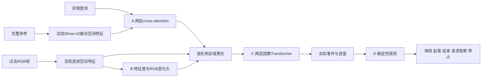

# H1-v3方法与接口

本批固定完整Show-o2视频理解权重，只训练独立小模块，称为UMM特征辅助的事件读取。新模块的256维表示还没有通过联合训练改变UMM主干；H2只预留接口，不训练生成器。

输入为目标与规范查询、完整参考、过去4—8个RGB观察和时间戳。参考掩码与生成日志只在监督／oracle条件可用。D0查询含类型、规范实例索引和粗空间提示，提示作为共享任务条件明确记录；不能把精确笔画mask作为主方法查询。

A投影1536→256，2层4头query-conditioned decoder；动态Q≤16，输出每query一张软mask和置信度。ID来自查询绑定，参考监督采用BCE＋Dice。B预测新增和消失墨迹；特征差用于语义变化，RGB差用于精细变化，两者对齐空间网格，BCE＋Dice监督。

C每笔每时刻聚合当前、相邻变化、参考差以及时间输入，hidden256／4头／2层／dropout0.1。注意mask仅允许过去时刻；所有笔画的同一时刻可以交换信息。输出observed_ids、event_order、active_id、progress、stroke_start、stroke_complete、direction、observation_confidence。stroke_complete表示几何覆盖判断，另设pen_lift_evidence，当前无笔尖数据只能unknown。实际onset次序监督相对顺序；合并事件的顺序无标签可猜，必须保持不确定。

D接收统一事件状态和指定有序实例／约束图。真状态下的规则正确性、预测状态下的动作正确性分开评价。历史中发现错序、反向或未完换笔应报告首次冲突并停止错误过程；画面缺少历史时请求更多观察；可可靠定位未完成活动笔时继续；覆盖完成只能结束墨迹任务，不能声称观察到抬笔。未来生成器调用同一状态结构，历史错误不能靠未来添墨改变。

B0使用规范轨迹＋真区域＋原始像素；B1末帧；B2官方冻结直接回答；B3普通无时间头；B4完整新模块。B4的oracle区域和时间打乱条件必须分报。其余无变化分支／整图池化／无进度监督列入预算允许时的消融，首批若未执行明确标记。所有输入变更和训练预算在各阶段运行前另存JSON。
