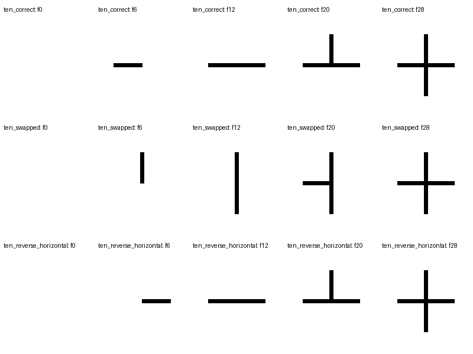

# 同终态、不同书写过程：像素级小实验

2026-10-16 在本地 CPU 完成。目的是检查反例数据和过程评价能否落实，**不是 UMM 或视频生成模型的能力实验**。程序、输出和全部 8 个构造案例均保留。

## 做了什么

用自行定义的直线模板构造“十”“三”“十三”。每笔分 12 步显示，笔间保留 2 帧；对照保持字形、线宽和墨色不变，只改顺序或横笔方向。另取“十”的空白帧和末帧，模拟过程被完全漏采的情况。“十三”的参考约定为先完成左字，再写右字。

观察器只接收帧像素与已知的规范笔画几何，不接收渲染顺序或事件日志。它是**模板辅助的受控观察器**，不是通用笔画识别模型：

1. 为各笔建立独占像素区域，排除交叉处同时属于两笔的像素。
2. 独占区域覆盖达到 5% 时记录首次出现，达到 98% 时记录完成。
3. 比较规范起端和末端各 20% 区域的出现时间，判定可见墨迹方向。
4. 比较实例顺序，并检查前笔完成是否早于后笔开始。
5. 首次出现时间相同或端点同帧出现时保留未知，不补猜笔顺。

这些阈值只用于本实验的清晰二值画布，没有经过真实视频标定。实际过程指标独立于末帧墨迹 IoU。

## 结果

| 案例 | 末帧墨迹 IoU | 实例顺序 | 笔内方向 | 综合过程判断 |
|---|---:|---|---|---|
| 十：横后竖 | 1.000 | 正确 | 正确 | 正确 |
| 十：竖后横 | 1.000 | 错误 | 正确 | 错误 |
| 十：横从右向左出现 | 1.000 | 正确 | 错误 | 错误 |
| 三：上、中、下 | 1.000 | 正确 | 正确 | 正确 |
| 三：上、下、中 | 1.000 | 错误 | 正确 | 错误 |
| 十三：依次完成两字 | 1.000 | 正确 | 正确 | 正确 |
| 十三：提前写右字再回左字 | 1.000 | 错误 | 正确 | 错误 |
| 十：仅空白与末帧 | 1.000 | 无法判断 | 无法判断 | 无法判断 |

三组正确过程、四种错误过程和一个不可观察案例得到预期区分。案例是人为选择的反例，没有统计代表性，不能写成“真实笔顺检测准确率 100%”。



[动态对照](../../examples/process_probe/comparison.gif) / [逐例结果与事件](../../examples/process_probe/results.json)

## 能支持什么，不能支持什么

**已支持的可行性结论**：可以廉价生成严格配对的顺序反例；在已知几何和清晰画布下，可以从实际像素中提取顺序与方向；仅看终态确实无法区分这些历史。三笔全是“横”的“三”还说明，需要实例身份，单独比较笔画类型序列不够。

**尚未验证**：UMM 能否读懂这些过程、联合训练能否改善生成、风格变化下实例能否正确匹配，以及真实视频上的准确率和成本。这些仍需[最小研究方案](stroke_order_pilot.md)中的 SO-01/02/03。

本观察器不覆盖未知字形、曲折笔、手遮挡、透视、背景干扰、墨迹晕染或非单调出现。端点时间不是完整轨迹验证；沿已有墨迹重描可能完全不可见。额外笔画、漏写局部和消失历史也未建立完整检测，因此脚本中的 `strict_process_correct` 仅指本实验已构造的顺序、方向、完成先后与覆盖条件，不能用作真实视频的完整合格判据。

如果输入过程已被 VAE 或抽帧压成同一观测，模型只能依据先验猜测，不能保证恢复真实历史。因此模型实验首先检查时序输入和压缩是否保留短笔，再讨论语言推理和共享训练收益。

## 复现

环境：Python 3.9.6、NumPy 2.0.2、Pillow 11.3.0，Apple Silicon，CPU。没有模型权重、训练、外部推理 API 或字体文件依赖；没有测量模型速度。

```bash
python -m pip install -r requirements.txt
python scripts/process_probe.py
python -m unittest discover -s tests -v
```

[脚本](../../scripts/process_probe.py)默认输出到 `examples/process_probe/`，也可用 `--output` 指定目录。[观察器测试](../../tests/test_process_probe.py)用手工像素帧检验换序、方向、未完成即换笔和采样歧义，不依赖渲染器生成测试输入。
