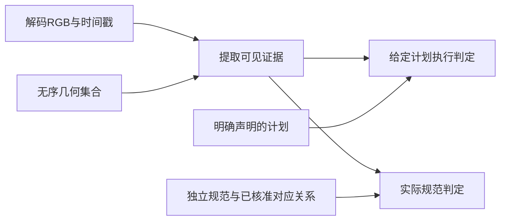

# P0规范参考与实际执行评价解耦修订方案

执行增补：用户已批准并完成本方案第一阶段D1–D4，实际结果见[执行报告](p0_decoupled_d1_d4_report_2026-10-29.md)。新保留集及后续阶段未启动。以下保留提交批准前的原方案。

2026-10-29。依据当前研究分支`research/p0-stroke-video-foundation`及提交`258512d3`。**本文为待批准的技术方案；尚未修改评分器、调整阈值、构建新保留集或新增人工任务。** 前一轮人工审核已完成，不因本方案重新计为待办。

建议先完成现有材料上的接口解耦和小规模交叉验证，再决定是否投入新保留集。最终分别报告：规范参考及其几何对应是否可信、RGB支持哪些可见事件、实际事件是否执行给定计划、实际事件是否符合规范。完整P0继续使用原契约，DATA-01/EVAL-01保持blocked，修订方案本身不构成验收通过。

**1. 修订依据与边界**

[本轮人审结果](p0_human_acceptance_2026-10-29.md)已保存两位独立真人的432项有效提交和441个原始版本。64份规范候选为34通过、23不通过、7未知；144份RGB经冻结规范门控后为32正确、103错误、9未知。原方法接受了25/63个确认负例书写者组，条件单侧95%上界50.82%；排除两帧控制后，覆盖率97.48%，误接受上界仍为53.10%。

耦合具体发生在三处：

| 现有位置 | 当前行为 | 修订要求 |
| --- | --- | --- |
| `scripts/p0/observer.py::observe` | 将`observed_order`与`range(n)`比较，数组下标同时承担几何身份和正确次序 | 几何集合使用稳定实例ID，期望次序单独传给判定层 |
| 同函数的`progress`及`ai_prereview.py::inspect_rgb`的`medians` | 根据源轨迹起终点定义forward，再把reverse视为错误 | 观察层只记录A/B等空间锚点的出现证据；规范方向由独立规范和对应关系给定 |
| 当前单一`decision` | 混合几何缺失、可观测性、参考一致性与规范正确性 | 输出独立字段和分项证据，保留unknown/invalid，不以单个布尔量承载全部含义 |

这是代码和失败分布共同支持的修订方向，尚未证明拆分后自动评分会达标。定位见[原观察器](../../../scripts/p0/observer.py)、[AI像素分析](../../../scripts/p0/ai_prereview.py)及[CASIA受控比较入口](../../../scripts/p0/final_calibration.py)。原方法的25组误接受均来自原记录顺序重建，表明“遵循源轨迹”不能直接证明“符合规范”。原0/64同源构造结果及所有旧阈值继续按原范围保存。

**2. 具体接口与数据结构**

建议新增模块，保留原`observer.py`、旧冻结入口和旧结果，用`legacy_v1`明确标识其语义。以下是拟议接口，并非当前已实现功能：

```python
# rgb_observation.py：只提取RGB证据
observe_rgb(frames, timestamps, geometry_set, observation_config) -> RGBEvidence

# normative_reference.py：静态参考及对应关系的准入
qualify_reference(norm_spec, geometry_binding, review_records) -> ReferenceQualification

# judgments.py：两个独立判定
judge_execution(evidence, declared_plan, execution_policy) -> ExecutionJudgment
judge_normative(evidence, norm_spec, geometry_binding, normative_policy) -> NormativeJudgment

# 可选诊断：给定计划本身是否合规范，不使用视频结果
judge_plan_normativity(declared_plan, norm_spec, geometry_binding) -> PlanNormativity
```



各对象只承担以下信息：

| 对象 | 必需字段与语义 |
| --- | --- |
| `GeometrySet` | `geometry_id`、`source_record_id`、实例ID到静态mask/空间锚点的映射。实例ID不按出现时刻命名；容器迭代顺序不代表正确笔顺。A/B锚点按固定空间规则命名，不以源轨迹起点自动定义规范起点 |
| `NormSpec` | `norm_ref_id`、字符/地区/版本、规范出处和页码、规范笔画身份、获依据支持的允许序列及方向、逐分项审核状态。只录入已查明的允许变体，缺项保留未知 |
| `GeometryBinding` | 几何实例ID到规范笔画身份的对应、方向锚点对应、对应证据及审核状态。允许一对一无法建立；连笔合笔、分笔或交叠不可辨时相应分项为unknown |
| `DeclaredPlan` | `plan_id`、计划实例次序、方向及所需完成关系。它是意图条件，可正确也可错误；不读取渲染器事后执行日志。无外显计划的T生成中，此指标为`not_applicable`，不从模型结果倒推一个计划 |
| `RGBEvidence` | 每个实例的首次出现/完成候选区间、锚点出现区间、可确认的先后边、增长重叠、额外或消失墨迹、可观测性及帧索引。输出实际证据，不输出“规范正确” |
| 两种`Judgment` | 判定、所核分项、引用证据、unknown原因；附观察器/阈值/规则/规范/对应关系版本。原始按钮、备注和AI意见分别保留 |

源记录的笔顺不符合规范，可能仍有可用的静态笔画几何。应分别保存`source_plan_normativity`和`binding_status`：前者不通过不必然使后者无效。反过来，源记录整体获“通过”也不自动建立逐笔对应金标。

观察接口不接收规范序列、计划、构造类型、渲染事件日志、人工答案或原预测。几何按无序集合传入；内部可使用固定空间坐标，但不能读取其数组位置作为正确次序。单独改变期望计划或规范序列时，原RGB证据应保持不变。

`RGBEvidence`先使用前后采样帧给出的事件时间区间及部分次序。跨越采样空隙的事件不强行赋予精确时刻；同帧首次出现不自动等同物理同时落笔。仅起终点可辨时，方向结论限于相应可见方向证据，不能声称完整折笔路径、接触状态或真实速度已验证。

最终输出示意：

```json
{
  "schema_version": "p0-decoupled-v1",
  "reference": {
    "norm_spec_status": "verified",
    "binding_status": "verified",
    "source_plan_normativity": "incorrect"
  },
  "execution": {"decision": "match", "against_plan": "recorded-source-plan"},
  "normative": {"decision": "incorrect", "evidence": ["order_conflict:g_a:g_b"]},
  "scope": "G1_known_geometry_synthetic_RGB"
}
```

这正是需要识别的情况：视频完整执行一个错误计划，执行一致性可以通过，规范正确性必须判错。

判定规则按证据范围冻结：解码失败记invalid；存在已证明的必要条件违反时，对相应分项判错；没有已证明违反、但任一必需分项缺证时为unknown；所有必需分项有足够依据才可通过。缺少可信规范/对应关系时，禁止仅凭“跟随源轨迹”给规范correct。清晰空白T终态等可独立确认的内容失败，仍可判错。两帧片段不能仅因时间证据不足判错；若已有可确认的内容违反，也不能用时间未知掩盖该违反。

允许序列集合还应标记`variant_coverage=closed/partial`。允许集未确认完整时，未命中已列序列不足以直接判错；需要能引证的规范违反，否则保留未知。

**3. 现有数据的复用方式**

| 现有材料 | 本轮后续可复用 | 禁止据此推断 |
| --- | --- | --- |
| 原640字、2,560动态片段＋192静态空白、全部141,423帧 | 解码/时间接口、几何集合、开发回归；既有构造案例定位同终态换序、方向、缺笔、增长异常 | 640字已具完整规范金标；同源构造通过即跨源通过 |
| CASIA80书写者、176份新受控媒体 | 全部作为已暴露的开发/诊断材料，复用源坐标、mask、解码帧、旧固定预测 | 原64验证书写者重新成为未见保留集；同作者换字即可恢复作者独立性 |
| 双人规范34通过候选 | 规范及几何对应的候选；优先选无备注冲突者进行开发 | 自动补成逐笔身份、方向、允许变体的完备认证 |
| 23不通过候选 | 区分身份/次序/方向等失败。仅次序或方向错误、静态身份仍可靠者，可在核准对应后保留为自然规范反例 | 全部删除；或把源数组重新编号后宣布原视频已变正确 |
| 7未知候选 | 参考缺失/分歧的弃判回归；可见事实仍分别记录 | 用AI填成人工通过；把未知当错误或负例组加入主误接受分母 |
| 16两帧控制及192静态空白 | 时间不可观察和明确内容失败的区分 | 对静态空白补造时长；由两帧推断全部中间顺序 |
| 榨V049-2、9条“通过附保留意见”等 | 固定的参考质量挑战；检查程序是否保留原文、疑点和证据范围 | 无授权改写两位真人原结论，或把此类疑点当干净金标 |
| 8份另次采集裁片、128记录交叉矩阵 | 已通过的气/建/宝/中仅作相应身份/裁切证据；矩阵保留前瞻划分和来源登记 | 4份身份通过代表完整规范通过；128条均可靠；2位作者等于128个独立作者组 |
| 犬/仓/穴等旧38试标、12＋6批次 | 历史原文、操作示例及开发误差记录 | 混入新保留统计或称为新的独立盲审 |

所有复用通过新清单的`analysis_role=development_exposed`等字段表达，不覆盖旧manifest、原训练/验证/字符保留角色或冻结协议。尤其不能因评价器开发使用了旧模型保留字，就继续对同一材料声称评价器也未见；两类暴露分别登记。

最小开发集建议16个已有记录组：8个规范通过候选、4个规范失败候选、2个未知候选、榨1组、附保留意见1组，组间不重复。前8个尽可能覆盖四笔数层各2个；具体ID在执行获批后依据实际可用性固定。此为开发材料选择，不形成新的随机保留结论。既有两位真人无需重审这些材料；旧标签只在原覆盖范围使用。

**4. 最小验证实验及停止条件**

| 实验 | 规模及操作 | 验证目标与通过依据 |
| --- | --- | --- |
| D1：语义交叉 | 从开发8个可用组构成正确/错误RGB各一份，每份分别与正确/错误计划配对：每组4种条件，共32次判定。先复用已存在的换序/反向片段，缺失时最多补8段小视频 | 在规范和对应已核准的范围内，得到下表四种组合；证据不因换计划改变。未核准者仅检验接口逻辑，不计科学准确率 |
| D2：顺序与方向隔离 | 对D1几何集合置换存储顺序、替换等价实例ID；交换锚点A/B并同步对应；固定RGB，只切换规范/计划 | 归一到相同物理身份后，RGB证据与实际规范判断保持等价；只改变计划时仅执行判断可改变，只改变规范时观察证据及执行判断不变 |
| D3：失败及未知回归 | 运行选定16组的现有片段、16两帧控制与既有参考疑点；旧144份校准可完整回归 | 跟随错误源计划不能再直接产生规范correct；规范/对应未核准时不能伪造通过；时间不可判与明确违反分别输出。保留所有失败与未知 |
| D4：对照归因 | 相同已暴露材料上固定比较legacy、仅拆接口、完整解耦三个版本 | 说明改进来自去掉隐式正确次序、规范准入还是像素观察改变。开发结果只用于定位；不挑最好版本冒充保留验收 |

| RGB实际过程 | 给定计划 | 执行结果 | 实际规范结果 |
| --- | --- | --- | --- |
| 符合规范 | 符合规范且与视频相同 | match | correct |
| 违反规范 | 同样错误且与视频相同 | match | incorrect |
| 符合规范 | 与视频不同的错误计划 | mismatch | correct |
| 违反规范 | 符合规范但未被视频执行 | mismatch | incorrect |

上表适用前提是独立规范、身份对应和所需RGB事实均明确。参考未知及时间不可判另列unknown，不能为了凑齐四格赋真值。

D1/D2中出现任何语义串联或索引依赖，先停止进入新保留集。D3/D4若只靠大面积unknown改善误接受，视为尚未解决。最多补8段开发视频需纳入后续执行批准；不重建原大规模数据，不训练模型，不用GPU，不为这些变换堆砌大量边界防御测试。

**5. 新保留集的最小设计**

建议使用**64个新书写者组、64个不同字符，每组一条独立源记录**，来源优先沿用已核许可的CASIA轨迹。与全部既往实际接触过的作者、记录和候选试验做一次曝光集合排除，至少包含80位比较作者、两位试验作者及所有失败尝试中的已接触作者。先审计现有索引和曝光登记能否提供足量作者，不预先保证已具备资源。

64字同时避开前述评价器开发使用的原640字及本轮全部开发字符，以支持这次“新作者＋新评价字符”的有限主张。若合格交集不足，提交实际数量并另行决定扩展来源或缩小主张，不能默认为原保留字换个文件名即可。基础模型预训练字符暴露未知；这里的“新字”仅针对评价器开发。

| 分层 | 预定数量 |
| --- | ---: |
| 2–5、6–8、9–12、13–20笔四层 | 各16组，共64组 |
| 负例：换序、反向、漏笔、额外墨迹、多笔增长、提前开始下一笔、墨迹消失、空白终态 | 各8组；每笔数层每类2组 |
| 每组明确正确候选＋一个预分配错误候选 | 64＋64＝128段 |
| 时间不足控制，均匀取每笔数层4组，每组增加1段 | 16段 |
| 新增媒体总数 | **144段**，均为受控重建；实际标签待独立人审确认 |

规范/对应资格与生成计划分开准备。源作者原顺序不直接作为规范：先建立独立规范与静态身份/方向对应；若需重排/反向构造正确候选，保存原记录和修改说明，明确它是经规范化的合成过程，不称原作者实际按该顺序书写。仅笔数相等不足以准入；合笔/裁切/身份不清者按预定资格规则记录，不能看评分器输出再淘汰。

每组负例类型在评分前指定，不能运行多个错误再挑最易拒绝者。所有渲染变体、计划切换及未知控制保持同组。可在已有的换序/反向组上复用两段RGB做四格计划交叉，不增加人工视频量，也不把多条判定视为独立组。

此设计估计的是**固定八类错误混合下，每个作者组一个预分配负例的误接受**。它不等于每位作者整套八类变体都被拒绝的概率，也不能与旧多变体25/63直接做等口径提升比较。每类只有8组；即使0/8，常用单侧95%二项上界仍约31.23%，不能声称该类已低于5%。若要求八类分别达到同一统计门槛，所需独立组和人工量明显更大，不纳入本最小方案。

建议新种子`2026102901`用于抽样/错误指派，`2026102902`用于盲ID及顺序；此刻只是候选数值，未冻结。采样候选、按预定规则的排除、已暴露集合、来源及合法用途均保存。CASIA原始及衍生媒体保持private，继续沿用现有授权边界。固定源/固定渲染器/已知几何的通过，不构成跨字体、跨渲染器、原生书写录像或实际模型输出域通过。

**6. 冻结、人工量与统计要求**

执行顺序建议如下：

1. 在旧材料完成开发、选定唯一主方法，固定代码提交、阈值、必需分项、判定规则、统计口径、样本资格及缺失处理。legacy仅作对照，不在新结果中选方法。
2. 根据曝光清单选新候选；规范与对应的独立审核按预定规则进行。固定方法不据此继续调参。若预留替补，数量与顺序必须在评分前规定，保留全部候选分母。
3. 用非保留材料确认新字段和审核操作；冻结正式样本、144段媒体、种子、各审核者顺序及版本。之后进行一次固定预测和独立RGB审核；审核人只见必要规范参考、实际视频及填写工具，不见计划、构造类型、AI/评分结果或对方答案。
4. 两份原文齐全后一次性连接；分歧和不可判定分别保留。不自动要求第三轮。修改方法时，本批转为已暴露开发材料，另行申请新的独立验证。

规范审核需要确认身份/笔数、规范次序、所需方向及几何对应；RGB审核将内容、顺序、方向、增长/保留、时间证据分别记录。AI可准备官方对照、锚点和疑点，但建议与已确认结论分栏。RGB可以“一致确认并下一项”，判错/未知时记录原因及关键帧；不强制人工给所有笔画逐帧打点。没有事件级标签时，不宣称事件F1或完整逐笔时间精度已被独立验证。

新保留集的人工预算必须预先说明：**每人64份规范/对应核验＋144段视频＝208项判断，两人416项；涉及64字、144段视频。** 界面可把同组两段合为一张操作卡，总计每人64张规范卡＋64张视频对照卡＋16张未知卡＝144张卡，但判断数量仍为208，不能通过合卡声称工作量消失。实际耗时尚未验证，不承诺比上一轮明显轻松。此前已完成的432提交不需重做；本新批次只在用户明确批准后安排。

| 指标 | 拟议准入要求及分母 |
| --- | --- |
| 参考资格率 | 报告所有候选、准入、失败、未知和排除原因；只对资格充分范围作规范结论，不能只报挑出的成功候选 |
| 清晰参考覆盖 | 对人审确认清晰的正/负例，明确判定占比≥90%；invalid计未覆盖，不静默丢弃 |
| 正确视频接受率 | 人审确认正例的correct比例≥90%，另报误拒和弃判，避免全拒绝/全未知取巧；作为本次需批准的明确验收项 |
| 规范误接受 | 每作者固定负例被判规范correct计一次失败；以实际确认负例组数为分母，单侧95%上界≤5% |
| 时间不足与参考未知 | 单列，不混入确认负例分母；纯时间不可判且无确定违反者不得报规范correct，已明确违反的分项仍可判错 |
| 执行一致性 | 与规范指标分表；错误计划被正确执行可match，不能将其计入规范正例；四格接口验证必须成立 |

常用独立同分布二项口径下，零误接受时上界为`1 - 0.05**(1/n)`：0/64约4.573%，0/59约4.951%；有效负例组少于59时，零误接受也不足支持5%要求。1/64的二项上界约7.199%，不能通过。因此“抽64组”不保证验收成功，未知/分歧会降低有效分母；不足时报告证据不足，不在看过结果后继续加样本直至通过。

统计目标是冻结的均权错误/笔数层混合。固定配额带来组间风险异质性，不能无条件把一般非零结果的二项区间称为精确覆盖；零误接受时，上述界也可作为独立、均权固定混合平均风险的保守上界。仍须披露作者独立性、样本代表性及参考标签正确性的条件；共享采集库、系统性参考错误等不由此界消除。仅有双人一致不构成无误真值，榨的旧疑点须作为审核说明中的开发例，不能把它加回新保留分母。

**7. 拟改文件与资源**

| 拟新增/调整位置 | 目的 |
| --- | --- |
| `scripts/p0/rgb_observation.py` | 从现有像素计算抽取可复用观测，移除数组位置/规范方向的隐式判错 |
| `scripts/p0/normative_reference.py` | 规范、几何对应、逐项审核与准入；不依据源轨迹顺序自动认证 |
| `scripts/p0/judgments.py` | 实现执行、规范及可选计划规范性独立判定 |
| `scripts/p0/evaluate_decoupled.py` | 新版驱动、分表指标和一次冻结验证；旧驱动保留 |
| 新版审核schema/页面及独立存储目录 | 复用既有播放器、逐帧、进度及导入导出，实现分项记录，不覆写旧审核包 |
| 新数据清单与run目录 | 显式登记开发暴露、来源/对应版本、计划条件、实际标签、分母及失败 |
| 相关既有测试及必要的新语义测试 | 四格解耦、ID/集合顺序等价、参考未知及时间不足；不开展重复全量hash或额外无关冒烟 |

实现及验证均可先用本地CPU；D1最多补8段开发媒体，新保留集144段属于另批明确预算。无模型训练和GPU需求。新作者不足时先报告资源缺口；新增下载、授权范围或采集安排须按执行审批处理。版本依据使用Git提交、一次清单登记和来源ID，不做反复全量hash扫描。

**8. DATA-01、EVAL-01的验收路径**

DATA-01需要补足的是可用规范/几何对应的资格证据，以及来源/记录/字符/作者角色清楚的可靠子集；原128条前瞻矩阵不能因接口改好自动通过，也不要求现在训练模型证明泛化。若只有少量可靠记录，就交付该实际子集及排除清单，完整数据规模和科学范围由用户决定。

EVAL-01需要验证新版确实区分错误计划与错误执行，并在新的独立保留材料上满足获批门槛。现有34通过候选上0/33或0/30的事后子集，只能帮助开发定位，不能替换新保留校准。

推荐先批准D1–D4的本地CPU开发工作；其工程完成与P0科学验收分别记录。若开发结果仍不能支持可靠规范判断，可保留“已知几何下的计划执行一致性工具”作为有限成果，DATA-01/EVAL-01继续blocked。若要将此有限成果作为缩小后的阶段验收范围，必须另获用户科学批准，不自动修改P0契约。

本次仅新增本文一份方案文件，未删除或改写任何既有文件，未产生代码提交、推送、训练、评分或新人工任务。待用户决定实施范围后，再固定执行清单与交付验收。
