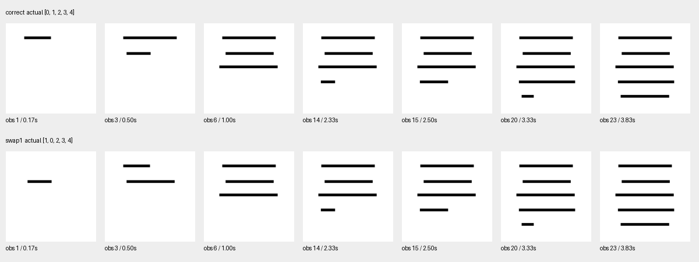

# T6：早期历史记忆，已完成

**决定：REVISE。** 主配对Full16.7%、预测Ledger77.5%，同头正确区域Ledger100%；自主视觉起笔与部分关系仍不稳定，完整H1未通过。训练已经停止，H2／H3未启动。

优先阅读[T6_DECISION.md](T6_DECISION.md)；[协议](../../../docs/experiments/h1_t6_early_history_protocol.md)在训练前固定，[方法](../../../docs/experiments/h1_t6_event_memory_method.md)解释输入、记忆和输出边界。

| 阶段／证据 | 文件 |
|---|---|
| T6-1 固定范围／划分 | preregistration.json、splits.json；实际数据[data/h1/early_history_v1](../../../data/h1/early_history_v1/README.md) |
| T6-2 零训练契约 | [报告](T6_2_REPORT.md)、data_contract_checks.json、pixel_states.json、oracle_ledger_predictions.json、feature_manifest.json |
| T6-3 接口与共享适配 | [报告](T6_3_REPORT.md)、preflight.json、interface_tests.txt、shared_spatial_input_checks.json、spatial_training.json |
| T6-4 固定比较 | [报告](T6_4_REPORT.md)、run_config.json、M1/M2_training.json与*_run.json、test_unlock.json |
| 实际结果 | metrics.json、paired_results.json、unknown_results.json、failure_cases.json |
| 所有主决策预测 | predictions.jsonl：M0/M1/M2/M3-K4/M3-K8/M4/M5与同头正确区域诊断 |
| 全前缀／原始输出 | history_predictions.jsonl：M1/M2/M4逐观察状态；raw_model_outputs.jsonl：基础头、短窗与正确区域的原始输出 |
| T6-5 分析与资源 | [决策](T6_DECISION.md)、failure_analysis.json、resources.json、timing.json、spatial_predictions.json |




20／8／20独立几何、每组5种过程；另2组三笔诊断，共248源视频。主测试40配对×3决策，置信区间按20个底层几何重采样；20不可观察场景，两个源顺序副本的全部输入相同。三笔诊断单列，不能把本批当作真实汉字／字体泛化。

复现须使用与T4相同的Show-o2完整检查点、资源和本地Python依赖。以下顺序用于全新的T6输出目录；既有正式训练／结果目录有防覆盖检查，不应原地重复训练：

```bash
checkpoints/Show-o-env/bin/python scripts/h1_early_history_data.py build
checkpoints/Show-o-env/bin/python scripts/h1_early_history_data.py contracts
checkpoints/Show-o-env/bin/python scripts/h1_early_history_contracts.py oracle
checkpoints/Show-o-env/bin/python scripts/h1_early_history_features.py
checkpoints/Show-o-env/bin/python scripts/h1_early_history_contracts.py features
checkpoints/Show-o-env/bin/python -m unittest discover -s tests -p test_h1_early_history.py
checkpoints/Show-o-env/bin/python scripts/h1_early_history_preflight.py
checkpoints/Show-o-env/bin/python scripts/h1_early_history_experiment.py spatial
checkpoints/Show-o-env/bin/python scripts/h1_early_history_experiment.py compact
checkpoints/Show-o-env/bin/python scripts/h1_early_history_experiment.py heads
checkpoints/Show-o-env/bin/python scripts/h1_early_history_experiment.py evaluate
checkpoints/Show-o-env/bin/python scripts/h1_early_history_score.py
checkpoints/Show-o-env/bin/python scripts/h1_early_history_analysis.py
```

新入口也可通过h1_event_experiment.py --early-history指定spatial／compact／heads／evaluate；不会改动T4路径。数据／特征目录常量位于h1_early_history_data.py；独立复现需在副本中使用新的目录，保留正式运行。仅重建统计和图示可运行最后两条，不调用神经模型或训练。补齐oracle计时的实际命令为h1_early_history_analysis.py --oracle-timing，仅对已保存RGB／oracle状态做一次确定性重放。

旧A+B新增ID覆盖不足，统一训练一次后冻结。新权重与约2.31GB几何分块缓存保存在忽略的checkpoints/h1_early_history_v1，未上传权重。所有T1—T5历史记录保持，没有删除文件或新建分支。

data_contract_initial_failure.json保留首轮前缀核对错误：第15观察只有前4笔，最初将它与5笔全序比较；修正为源日志的已出现子序列后通过。RGB、标签和实验门槛均未修改。interface_test_fixture_failure.txt保留评分测试夹具缺字段的代码错误，修复夹具后6项测试通过。训练中Dev损失上升的轮次、所有失败预测与原始数值均保留，没有据测试结果追加训练或改变正式判分。
