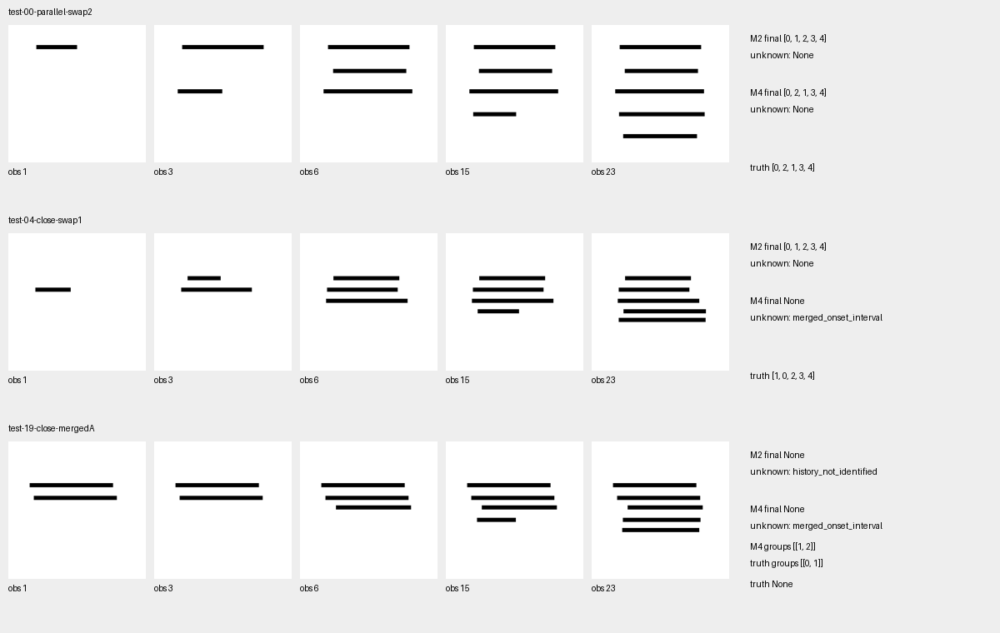

# T6决策：REVISE，优先显式事件记忆与早期实例读取

**T6-1→T6-5已按序完成。数据契约成立；当前完整历史Transformer没有稳定保存早期顺序，预测事件表更有效，但尚未达到本轮全部目标。继续冻结UMM，不启动H2、H3或主干训练。** 本批全部训练停止，后续修改需独立预注册。

## 研究问题

当目标、参考、实例查询、最近画面、相邻变化和绝对时间完全相同，怎样保留不同的早期实际笔画历史？重点比较完整历史Transformer与逐帧更新的显式事件表，分别评价顺序、未知和已确定的部分关系。

## 理论假设

- H-T6-1得到本轮支持：确定性局部函数面对相同输入只能给出相同答案。B3与4／8帧短窗在所有严格同输入配对上的两个答案均相同，配对同时正确率为0；这不妨碍它们读取当前完成状态。
- H-T6-2只得到部分支持：完整历史含有足够证据，oracle全部正确；预测Ledger配对77.5%，明显高于Full的16.7%，但低于80%目标，可观察回答覆盖83.3%也低于90%。不能宣布可靠长历史理解已经解决。
- H-T6-3需要分开判断：Full与Ledger的未知召回都为100%；Full没有保留任何正确偏序关系，Ledger保留了97.4%的确定关系，但未定组完全正确仅85%。答出unknown仍可能包含错误的确定关系。

## 实验设计

固定20／8／20训练、开发、测试几何，五种五笔结构，每组正常、两种早期换序与两种输入相同的合并源历史。另2组三笔“三”诊断不进入训练和主统计。每段24个实际观察，源24fps，固定每4帧抽样，无手部或遮挡；后两笔的共同后缀相同。

每个主决策40对，三个决策分别为第4笔写到一半、第5笔写到四分之一、全部完成。RGB字节、参考、查询、时间戳、最近8帧及前驱、冻结缓存和B3全部输入均精确相等；最近4帧包含其中。98个全数据配对／294决策全部通过；主测试为40对、20独立几何。50组源合并历史的整个输入相同，像素及oracle Ledger共5952个前缀通过。初次前缀判分代码错误的证据与修复见[零训练报告](T6_2_REPORT.md)。

早期差异距决策约2.00—3.67秒。本轮所谓长历史指在前3个事件之后保留穿过后2笔的状态，不能据此宣称分钟级视频记忆。所有置信区间按20几何组重采样2000次，正确历史被两个换序配对复用的相关性保留。单seed、单画风、D0几何不能代替未见汉字／字体验收。

## 方法比较

完整Show-o2 3063740640参数冻结。983张独立图编码2657.68秒，50个几何缓存约2.31GB；复用原生27×27融合空间特征。旧A+B新增ID3/4匹配10.7%，触发唯一共享适配：12轮、3456更新，Dev选第4轮。A+B为2122469参数，测试实例IoU≥.5为82/100，平均IoU71.86%。

M1普通头与M2因果Transformer共享A+B、196维输入和标签。M2仍为256维、2层、4头；两头均12轮、156更新、27600监督时刻，Dev分别选第12／11轮。M3复用M2权重，只限制4／8帧。M4以M1局部状态及共享B新增墨迹在线更新Ledger，.5／.02阈值预先固定，无额外训练或阈值选择。M0／M5使用正确区域／可观察起笔区间，单列特权上界。

oracle_region条件只把同一选定模型的实例区域换成正确区域，没有匹配重训；它是瓶颈诊断，输入分布改变也可能影响头。M1/M2保留既有排序分数＋可观察置信头，未知时无法表示细致的偏序；偏序能力差异同时包含输出结构的限制，不能全部归因于Transformer学习能力。

## 实际证据

| 方法 | 配对两个均正确（120配对决策） | 几何组95%区间 | 可观察单段严格顺序 | 未知召回 | 可观察回答覆盖 | 全字段动作 |
|---|---:|---:|---:|---:|---:|---:|
| M0 像素oracle | 100% | [100,100]% | 100% | 100% | 100% | 100% |
| M1 B3局部头 | 0% | [0,0]% | 31.1% | 6.7% | 93.3% | 21.3% |
| M2 Full | 16.7% | [9.2,24.2]% | 43.3% | 100% | 100% | 66.3% |
| M3 最近4帧 | 0% | [0,0]% | 16.7% | 50.0% | 50.0% | 30.0% |
| M3 最近8帧 | 0% | [0,0]% | 15.6% | 53.3% | 46.7% | 30.7% |
| M4 预测Ledger | 77.5% | [60,95]% | 81.7% | 100% | 83.3% | 89.0% |
| M5 oracle Ledger | 100% | [100,100]% | 100% | 100% | 100% | 100% |
| Full＋正确区域，同头 | 14.2% | [8.3,20.8]% | 42.2% | 100% | 100% | 66.0% |
| Ledger＋正确区域，同头 | 100% | [100,100]% | 100% | 100% | 100% | 100% |

Full−Ledger为−60.8个百分点，组区间[−75.9,−44.2]；Full−4／8帧为+16.7pp，区间[+9.2,+24.2]。完整过去确实有额外信息，本次没有发现指定Transformer优于简单事件表的证据。

| 决策 | Full配对 | 预测Ledger配对 | 当前画面 |
|---|---:|---:|---|
| 观察15 | 7/40 | 31/40 | 第4笔50%，第5笔未开始 |
| 观察20 | 8/40 | 31/40 | 第5笔25% |
| 观察23 | 5/40 | 31/40 | 五笔全部完整 |

Full第6观察可正确读出39/60条可观察历史；这些视频的117个后期决定中有44次转为错误。Ledger第6观察49/60正确，这些正确历史后期没有发生读出错误。Full后期错读为规范顺序79次，Ledger为3次。这是输出层面的历史保持证据，尚未识别Transformer内部何处丢失或覆盖信息。

三笔诊断仅2几何、每个3决策，Full配对2/6，预测Ledger0/6，同头正确区域Ledger6/6。三笔诊断未用于训练，结构、查询数量与五笔集合同时改变；不能据此得出“笔画越少越难”，也不能只报告五笔成功而隐藏“三”的失败。

Full状态准确99.53%、进度MAE0.0168；Ledger／M1状态99.67%、MAE0.0270。高当前状态成绩没有保证早期历史正确。Ledger／M1的1205个预测完整实例中95个连续进度低于95%；Full为1200个中的14个。动作采用离散类别转换值，不能以动作89%替代连续进度的一致性验证。首错位置Full44.4%、Ledger85.0%，与顺序分别保存。

不可观察场景独立20组、60个决定，两个合并源历史是同输入副本。Full的未知召回100%，确定关系召回0；Ledger确定关系精确率99.3%、召回97.4%，未定关系召回95%、精确率82.6%，未定组完全正确85%。Ledger仍在3个决定中错误确定了真实未定事件对；这与最终回答unknown可同时发生。

观察置信度监督预测可观察性，不能解释成排序答案概率。Full存在102个观察置信≥.9但顺序错误的测试决定；Ledger有3个证据标记为确定但排序错误的决定。两类数值的来源不同，均不应直接当作校准的正确概率。

缓存后CPU每次查询约：M1 0.171ms、Full 0.794ms、4／8帧0.403／0.470ms；Ledger估算0.226ms（局部头＋逐帧更新两个实测均值相加）。实例向量历史Full24帧94080字节，短窗15680／31360字节；Ledger序列化表均值1438字节，另需当前3920字节向量。上述不含共用UMM、A+B、前驱图像／特征、激活及Python对象开销；不能据此宣称端到端生成加速。像素oracle从已解码前缀读状态约10.294ms，oracle Ledger单步更新约0.012ms；这是一次确定性重放计时，不含解码、神经模块或特权输入的取得成本。完整预算与资源见[resources.json](resources.json)。

## 失败机制

1. **后段读出覆盖早期真实顺序。** test-00-parallel-swap2的Full在观察6答[0,2,1]，完成时答[0,1,2,3,4]，可观察置信0.999987。当前五笔状态正确，但首个真实违规仍在事件位置1。Ledger保留[0,2,1,3,4]。区域正确的Full仍仅14.2%配对，定位不足不能解释全部隐式排序失败。
2. **错过早期实例，之后误认为同区间出现。** test-04-close-swap1中Ledger把实例1的起笔从真实[0,1]记录成[2,3]，与实例0并列；最终五笔都判断完整，历史却被标未知。主可观察视频最终有21个实例起笔区间错误；Full和Ledger都没有读取隐藏源日志。Ledger正确区域诊断恢复100%，支持优先检查实例软区域混入近邻和局部存在检测。
3. **unknown掩盖部分关系错误。** test-19-close-mergedA应保留未定组[0,1]，Ledger却保留[1,2]并错误确认0早于1。unknown总召回100%仍不足以交给反馈生成器。
4. **近邻和重复形状仍有明显困难。** Ledger可观察单段顺序：横竖、交叉、折笔各100%，平行75%，近邻33.3%。这只是各4测试几何的条件性结果，不推成全部汉字类别的规律。完整失败与区间见[metrics.json](metrics.json)、[failure_cases.json](failure_cases.json)、[failure_analysis.json](failure_analysis.json)。

## 下一步判断：十个问题

| 问题 | 结论与依据 |
|---|---|
| 1 最近输入相同是否严格验证？ | 是。RGB、查询、参考、时间、冻结缓存及实际B3输入逐项精确相同，新的共享空间模块下也复核294项；378项确定输出约束通过。 |
| 2 完整历史能否恢复早期真实事件？ | 本批清楚D0可以。独立像素读出与源日志子序列相符，oracle全部通过；合并历史确实不可恢复唯一顺序。 |
| 3 B3是否符合理论限制？ | 是。配对0%，输入相同的预测相同，当前状态仍99.67%；信息边界与状态读取分开。 |
| 4 B4 Full是否稳定保存历史？ | 否。16.7%配对，早期正确后段失败44次；只有未知识别和当前状态较好。 |
| 5 Ledger能否以简单结构解决？ | 对大部分五笔D0有效，主配对77.5%，正确区域100%；自主视觉读出与三笔诊断仍不稳定。 |
| 6 B4相对Ledger有额外价值吗？ | 本批未显示。Ledger配对高60.8pp且保持确定事件，不支持继续加深当前C。仍不能据单seed否定其他学习式记忆。 |
| 7 主要错误来自哪里？ | Ledger集中在首次起笔漏检／实例混入及其未知关系；Full还有区域替换未解决的历史排序与后段读出覆盖。连续进度不一致单列。 |
| 8 能否进入D1正式测试？ | 当前证据不足以作为D0通过后直接进入正式汉字／字体验收。下一轮先独立固定重复／近邻与3／5笔混合的视觉事件读取检查；可靠后再预注册D1。不能在当前Test上继续调阈值。 |
| 9 支持训练UMM主干吗？ | 没有。相同冻结特征在正确区域＋局部头＋Ledger下已可完成本批任务；尚无主干信息瓶颈证据。继续冻结，保留数值与资源审计前置条件。 |
| 10 如何衔接未来H2？ | 以实例ID、起笔区间、已确认关系、未定组、当前几何／连续进度、证据置信与恢复要求形成[候选接口](../../../data/h1/early_history_v1/state_schema.json)。M1/M2的通用恢复标记尚不能分清读取失败与实际缺帧；先保证自主绑定、起笔和偏序可靠；不可恢复历史需停止／回退，未来添墨不能补回缺失先后。本轮不运行生成。 |

在已知精确实例区域的干净D0中，像素方法已足够读取过程；本轮没有证明UMM计算成本具有额外收益。UMM在自主绑定、字形变形与风格条件下是否有价值，仍需与专门方法公平比较。

**明确决定为REVISE。** 优先保留“冻结UMM空间理解＋在线事件表”，针对近邻实例绑定与首次可见事件提高可靠性，保留强像素／oracle基线；当前C不升级、不加轮数。D1、H2、H3、LoRA、第二seed均未启动，完整H1仍未通过。

## 文件改动说明

| 新增或修改 | 用途 |
|---|---|
| docs/experiments/h1_t6_early_history_protocol.md、h1_t6_event_memory_method.md | 训练前固定数据、预算、信息约束与记忆方法／理论边界 |
| data/h1/early_history_v1/ | 新增独立分组的源视频、真实采样PNG、参考与标签；T4数据不动 |
| scripts/h1_early_history_data.py、h1_early_history_features.py、h1_early_history_contracts.py、h1_early_history_io.py | 数据、分组缓存、零训练门槛和输入白名单 |
| scripts/h1_event_ledger.py | 在线预测／oracle事件表与可保留的部分顺序 |
| scripts/h1_event_train.py、h1_event_model.py | 去掉相关八帧固定逻辑，显式动态因果掩码；架构和历史输出兼容 |
| scripts/h1_event_experiment.py | 新增独立--early-history入口，T4默认路径保留 |
| scripts/h1_early_history_preflight.py、h1_early_history_experiment.py | 一次接口资源检查、唯一空间适配、两头固定训练及全部推理对照 |
| scripts/h1_early_history_score.py、h1_early_history_analysis.py、tests/test_h1_early_history.py | 预先固定判分、几何组区间、失败／资源分析及必要测试 |
| results/h1/early_history_v1/ | 预注册、契约、全部预测／原始输出、失败／曲线、阶段报告、资源与图示 |
| README.md、docs/project/STATUS.md、EXPERIMENTS.md、DECISIONS.md | 更新研究入口、阶段与REVISE证据，保留历史记录 |

没有删除文件，没有覆盖T1—T5结果或权重；大模型和新训练权重仅保存在本地忽略目录。全部工作继续现有研究分支，未新建分支或合并main。训练结束后只读取既有记录生成分析与图示，没有新增模型训练或测试调参。
