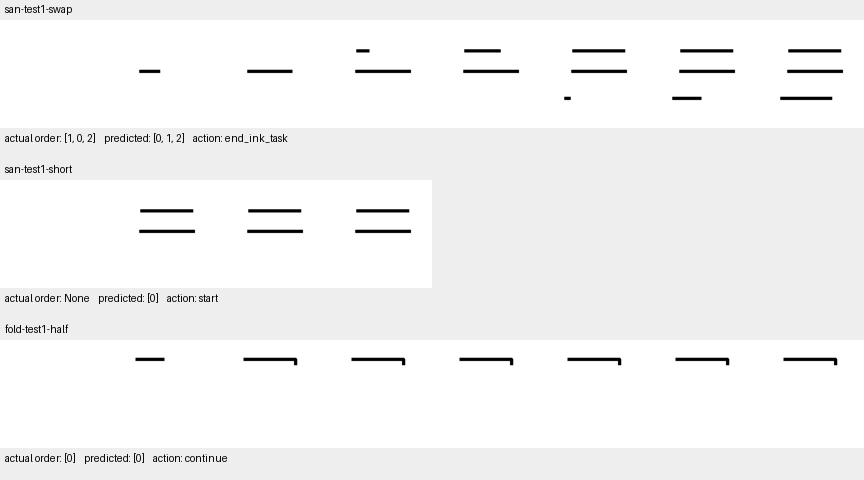

# T5：首批决策报告

**结论：T1→T5首批按序完成；完整H1尚未通过。当前不启动UMM LoRA、视频生成或额外训练。** 本批已证明冻结Show-o2融合特征可辅助读取受控事件；尚未证明指定时序Transformer全面优于匹配普通头，也未证明统一训练收益。

## 问题、假设、方法与对照

问题是“实际画面中发生了什么、判断了什么、下一步如何行动”，不能用规范顺序替代实际历史。假设为实例定位＋新增墨迹＋因果事件读取可改善这些判断。先完成无训练可观察性核查，再验证固定小集拟合，最后按预注册运行七个匹配预算头及像素、时间打乱对照。全部训练只更新独立A—C模块，UMM更新0。

[协议](../../../docs/experiments/h1_v3_protocol.md)、[架构](../../../docs/experiments/h1_v3_method.md)、[直接前作](../../../docs/experiments/RELATED_METHODS_AND_GAPS.md)与[T4全部结果](T4/REPORT.md)给出复核依据。状态接口见[state_schema.json](../../../data/h1/event_v3/state_schema.json)，暂未达到可驱动H2的可靠程度。

## 七个决策问题

| 问题 | 结果与判断 |
|---|---|
| 原始输入中的事件是否可观察？ | 本批清楚事件可以。T2像素顺序／未知30/30；T4真区域＋RGB在150个决定、5个终态对上全对。两笔同帧出现的历史确实不可恢复，增加抽帧数也不能恢复帧内先后。该结论仅覆盖干净D0与已知实例。 |
| 现有UMM表示保留了什么？ | 27融合特征＋旧冻结笔迹头能恢复28/30个T2顺序／未知。27和14序列都数值可分，旧头在14上15/30，含分辨率不匹配。原生冻结视频回答四个“三”反例均写规范[1,2,3]，与可读空间信息形成明确差距。 |
| 指定时序模块是否明显优于无时间模型？ | 没有全面优势。B4决定顺序95.33%，B3相同事件输入98%，差−2.67pp，几何组区间[−10,+2]；配对4/5对3/5。B4方向／动作有局部提高，但进度MAE更差、未知召回更低。B3有相邻差分，不能把它称作纯末帧模型。 |
| 主要错误来自哪里？ | A测试7/11实例达到IoU.5，oracle状态100%对预测区域95.45%，支持实例绑定瓶颈。同时oracle仍错三笔历史，说明定位不足不能解释全部排序错误。连续进度与几何类别也有不一致，未知错误接受4/25。 |
| 值得现在开启Stage3吗？ | 暂不建议。当前特征已有可读取证据，尚未证明错误主要来自冻结UMM表示。少量几何与读出设计、定位泛化、三笔历史和置信度都未解决；直接适配主干会同时引入更难归因的变量。 |
| 本机支持下一阶段吗？ | 支持继续冻结特征＋小模块研究；本次312新图编码约611秒，七个头的固定训练均完成。扩大D1时应分块缓存和按需加载，避免把数千幅1536维网格一次转换到fp32内存。视频UMM LoRA在M5／16GiB上的内存与数值路径尚未验证，不能保证可运行。Lance官方CUDA／至少40GB显存条件不满足，保持资源阻塞，不尝试极端量化。 |
| 最有科研价值的失败机制？ | 静态状态高分没有保证历史正确；局部差分已能解决大量简单顺序题；打乱帧未明显降分，当前实验不足以证明依赖实际时间。应围绕“实例绑定、真实可辨历史、状态接口可靠性”继续收敛，不能仅增加时序层或轮数。 |

## 三个具体案例：看到了什么、判断了什么、应当做什么

ID从0开始，上横0、中横1、下横2。

| 案例 | 实际画面／历史 | B4的判断与动作 | 应当判断／行动 |
|---|---|---|---|
| 三，交换上中，末帧 | 实际[1,0,2]，三笔都完整 | 实例与完整类别均正确，却答[0,1,2]，结束墨迹任务 | 保留实际[1,0,2]，报告第0个事件错序并停止错误过程 |
| 三，两笔合并出现，4帧前缀 | 上中横都已完整，帧内先后不可见 | 只认上横，认为历史可辨，准备开始中横 | 保留两实例已出现，历史未知，请求更多观察；当前输入无法补回帧内历史 |
| 折笔，半笔停住 | 第一笔50%，第二笔未出现 | 部分／未出现正确，连续进度约61%，动作继续第一笔 | 继续方向正确；进度估计仍有误差，没有观察到抬笔 |

这三个案例为解释性失败／成功实例，不用于估计总体比例。观测置信度预测“历史是否可辨”，不等于答案正确率；不能把可辨案例中接近1的分数当作排序答案一定正确。

## 理论解释与方法边界

同终态配对满足Render(S0,S1)=Render(S1,S0)，在相同目标／参考条件下，确定性末帧方法必然给出相同历史答案，两个成员不可能均正确。本轮B1的5个配对为0/5，符合该信息限制。

但“需要观察过程”没有直接推出“必须采用当前C”。干净累积墨迹满足M_t包含于M_(t+1)，许多无序中间画面仍可按墨迹包含关系重建部分顺序。B3还有相邻新增区域，可利用最后一笔识别两笔的先后。因此，B4打乱内部帧后仍5/5配对，既不能证明真实时间依赖，也不足以证明C完全忽略历史；打乱还制造了非正常消墨输入。下一次比较应区分历史可见性、帧排列和墨迹集合关系。

另一个扩展限制是采样：若从空白开始，T帧只有T−1个首次出现区间。N>T−1个笔画全部出现时，至少两笔会落入同一区间；在本任务的无深度单色墨迹假设下，不能保证区分其实际起笔次序。D1多笔字不能简单沿用全片8帧。需要固定时间采样、连续4—8帧窗口和保留已确认历史的事件表，合并事件仍标未知；不能免费读取生成器边界。

本批query包含模板粗位置，只有单一画风；没有200／40／40字、100终态对、两个未见字体，也没有真实书写者／艺术字／遮挡、漏笔、多笔或消墨正例。A的消失分支目前仅见负例。几何覆盖、连续进度、起止事件与抬笔证据分开；D采用几何类别转换值而非原回归值。所有这些限制都阻止把D0成绩当作完整H1。

## 下一步候选与停止决定

本轮支持优先检查实例定位与变化读取：移除变化分支后顺序降6.67pp，整图池化降40.67pp；精确区域使状态100%。这些结果仅支持本批模块作用，没有证明UMM胜过全部专门方法。B0拥有正确实例区域，不能用其满分单独否定UMM在艺术字自主绑定中的潜在价值。

后续若继续，应先固定一个有可追踪实例的D1集合与许可／大陆规范核对，保留字符、基础轨迹、字体来源的分组；以A的实例IoU、同图切换目标和oracle差距为主要指标。仍冻结UMM，先检验定位监督的针对性改动，避免把主干、数据和损失一起更换。

三笔及更长历史应专门设置“最后两帧相同、早期顺序不同”的配对；“三”现有失败已经支持这个检查方向。保留B3强基线，并增加能够利用全部历史的简单集合／事件表对照，区分更长观察范围与特定Transformer结构的价值。新实验须另行预注册，不在本批续跑。

连续进度、类别和未知应按字段评估，并在开发集检验与动作的组合可靠性。不要用格式约束或规则融合掩盖矛盾。只有在正式范围下读取可靠，才把状态交给H2生成，并用联合／分离与反馈消融验证H3。

Stage3作为有条件的后续选项：先定位冻结表示确实无法保留目标事件的证据，完成fp32或合适CUDA数值核查、模块范围与资源验证，再以r16普通LoRA与相同头做公平对照。Ketaba的静态OCR和集成成绩无法替代这些证据。

**本批到此停止训练。没有第二seed、额外epochs、LoRA、Lance迁移或视频生成。完整H1、H2、H3均保持未通过／未验证。**

## 文件改动与验证

| 文件／目录 | 改动目的 |
|---|---|
| README.md | 将当前入口切换到v3结果与决策，v2静态诊断保留为历史 |
| docs/project/MAINLINE.md | 增加v3执行调整与首批结束状态 |
| docs/project/STATUS.md | 更新当前阶段、关键负结果和未通过范围，保留旧轮次 |
| docs/project/EXPERIMENTS.md | 增加SO-01-V3，停止把旧配对训练写为当前任务 |
| docs/project/DECISIONS.md | 增加D34—D37，记录时间对照、实例瓶颈和停止依据 |
| docs/experiments/h1_state_gate.md | 增加v3适用说明，旧门槛及数据不改写 |
| requirements-h1-showo.txt | 增加已实际使用的PyAV19.0.1解码依赖 |
| docs/experiments/h1_v3_protocol.md、h1_v3_method.md、RELATED_METHODS_AND_GAPS.md | 新增实施协议、A—D结构与原始前作证据边界 |
| scripts/h1_event_data.py、h1_event_observe.py | 新增受控视频、官方采样适配、像素／冻结特征／原生回答诊断 |
| scripts/h1_event_model.py、h1_event_train.py | 新增指定A—C、D规则与小集拟合；完成后补充新输出／权重目录参数以保留历史 |
| scripts/h1_event_study.py、h1_event_experiment.py、h1_event_report.py | 新增固定分组数据、匹配训练与全部消融、分组区间与失败分析；训练入口阻止覆盖既有运行 |
| data/h1/event_v3/ | 新增原创数据、固定划分、过程标签、许可／范围和状态接口说明 |
| results/h1/event_v3/ | 新增资源审计、预注册、全部预测／指标／失败与T1—T5报告 |
| scripts/h1_state_pairs.py、data/h1/state_pairs_v1/、results/h1/showo2_video_1_5b/state_pairs_v1/ | 保留任务切换前已准备的静态研究，明确仅编码、未训练，保存中断原因 |

验证以真实模型编码／直接回答、固定训练与全部评价为主；另核对无损解码、同终态输入、分组、因果未来帧隔离、规则期望、张量形状及语法。增加训练输出路径后只检查CLI与语法，没有重跑模型训练。没有删除文件，未上传大权重或私人文件，没有新增分支／合并main。
