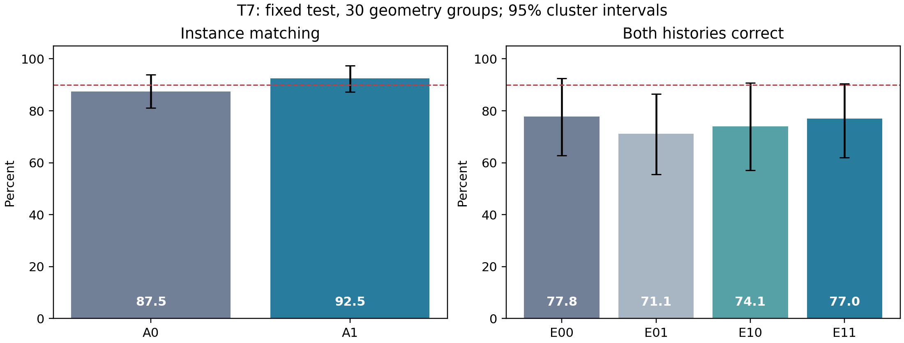
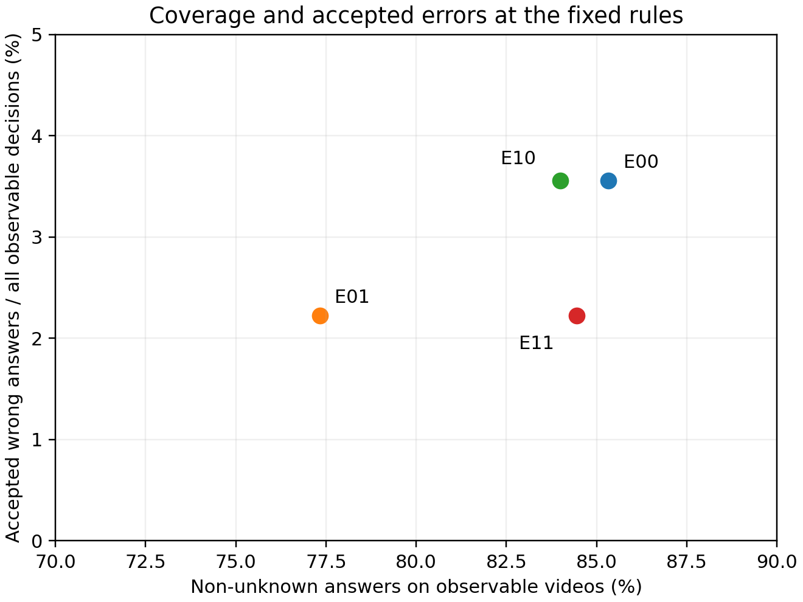
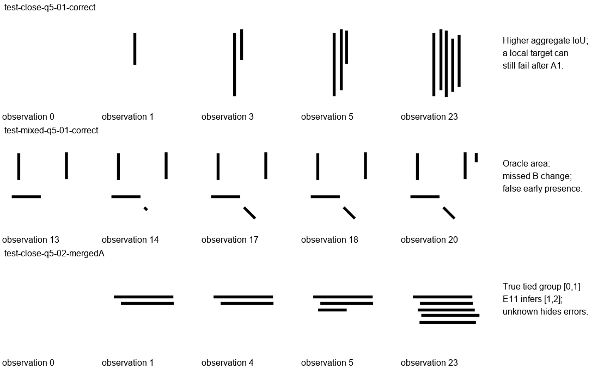

# T7决策：REVISE，先处理起笔证据冲突

**T7-1→T7-6已按序完成，本轮训练与规则选择结束。实例绑定的点估计达到目标，但组合方案没有提高主历史配对，尚不能提供可信H2状态接口。继续冻结UMM，暂停进一步优化A；下一项应单独研究“正确区域条件下，如何处理相互冲突的起笔证据和候选时间区间”。完整H1未通过，D1正式验收、H2/H3、额外seed和主干适配均未启动。**

## 问题与假设

在固定Show-o2空间特征、变化模块B和局部状态头M1时，同图目标区分监督能否提高实例绑定？多信号候选确认能否把更好的绑定转成可靠的实际顺序、当前状态和未知关系？只有A监督和L事件表两个变量。

T6历史归因显示，预测事件表77.5%配对、同头正确区域100%，存在首次误检被永久登记。该结果仅用于提出问题，不用于T7选择。T7以全新几何评价，不能把跨批百分比直接解释为提升或退化。

## 方法与对照

A0/A1结构相同，原生1536→256、两层四头query decoder、独立sigmoid实例掩码。A1增加固定.2目标区分loss，保留合法共享区域；A0无此项。两组同一T6初始化、同数据/顺序/seed、12轮、480更新、3840参考暴露，用共同Dev基础loss选择第8/12轮。只有各2,051,074个A参数训练，B的71,395、M1的1,104,653及UMM的3,063,740,640参数冻结。

L0原实现保留；L1无学习参数，使用presence、start、B新增墨迹，阈值.5/.5/.02。候选、确认、驳回审计、可能起笔区间和偏序明确分开。初版Dev发现已完成笔画不应继续要求新增墨迹，Test前只修订持续存在的确认条件；两版结果与[修订记录](ledger_rule_amendment.json)全部保留，没有搜索阈值。其余规则和评分在90bfee4提交后锁定，再一次解锁Test。

E00=A0/L0、E01=A0/L1、E10=A1/L0、E11=A1/L1。另两个正确区域条件使用同一M1，属于特权诊断；区域替换同时改变M1和B聚合的输入，没有匹配重训，不能当作可部署方法或无分布变化的因果上界。

## 数据与验证范围

90个独立D0几何，40/20/30训练/开发/测试；parallel、close、cross、fold、mixed各三笔/五笔，405段视频、9720观察。横竖平行、28像素近邻和合法交叉均覆盖。实际视频与PNG、可见起笔、最终RGB、最近8帧及前驱、冻结缓存、正式196维输入、合并全序列和分组全部验证。交点允许多实例归属，独有像素只用于标注可见事件。

Test共45个历史配对×3=135配对决定，75段可观察视频×3=225决定；30个mergedA×3=90未知决定。mergedB只作同输入核查，主状态/动作也去重，共315决定。六条件共2430条正式记录、19440个前缀，180项合并预测一致检查通过。14项针对性单元测试通过。Train/Dev读取器只打开对应几何标签，正式Test前有独立读取锁。

区间按30个几何整组重采样2000次，保留正常历史复用、三个决定和不同笔数的依赖。区间只反映固定seed下的几何抽样；本批单画风D0没有真实汉字、字体、书写者或艺术风格证据。

## 结果

| 指标 | A0 | A1 |
|---|---:|---:|
| 实例IoU≥.5 | 105/120，87.5% | 111/120，92.5% |
| 平均IoU | .7949 | .8544 |
| 同图目标身份正确 | 118/120 | 118/120 |
| 近邻实例匹配 | 18/24 | 19/24 |
| 交叉实例匹配 | 19/24 | 21/24 |
| 共享区域召回 | 66.7% | 71.4% |

A1实例匹配点估计超过90%，95%区间[87.29,97.41]%；相对A0为+5pp，配对区间[−.83,+10.91]pp。同图身份没有提高。可以报告本批匹配和面积的改善，不能声称近邻绑定已经稳定解决或收益具有统计显著性。

| 条件 | 两段历史都正确 | 几何组95%区间 | 可观察单段/正确可用覆盖 | 原始非未知回答 | 未定组完全正确 |
|---|---:|---:|---:|---:|---:|
| E00 | 77.78% | [62.79,92.42]% | 81.78% | 85.33% | 90.00% |
| E01 | 71.11% | [55.55,86.51]% | 75.11% | 77.33% | 83.33% |
| E10 | 74.07% | [57.05,90.70]% | 80.44% | 84.00% | 96.67% |
| E11 | 77.04% | [62.00,90.48]% | 82.22% | 84.44% | 87.78% |
| 正确区域/L0 | 87.41% | [74.30,98.37]% | 90.67% | 92.00% | 93.33% |
| 正确区域/L1 | 89.63% | [79.37,98.37]% | 90.67% | 92.00% | 93.33% |

E11为104/135，E00为105/135；净差−.74pp，区间[−9.85,+8.94]pp。A在L0下−3.70pp、L1下+5.93pp；L在A0下−6.67pp、A1下+2.96pp。交互+9.63pp，区间[−2.27,+21.97]pp。全部区间含零，当前无法判断哪个改进具有可靠的更大贡献，也无法支持额外协同收益。

E11三笔/五笔配对为97.78/66.67%；E00为100/66.67%。E11近邻/交叉配对仅55.56/59.26%。这些分项同时改变实例数、布局和事件安排，不能解释成单纯笔画数量效应。

各方法unknown召回均100%。E00/E10错误接受可观察历史各8/225，E01/E11各5/225。E11的确定关系precision/recall为97.75/89.89%，未定关系为74.36/96.67%；仍在3个决定中把真实未定关系确认成先后。E01没有这类错误确认，但确定关系召回仅80.46%、正确可用覆盖75.11%。提高保守程度不能单独算作可靠性成功。

L0→L1在A1下，435个去重实例的精确起笔区间377→396，提前11→5、延后47→9，但新增25个宽区间。区间保守化有局部作用，不能把宽区间计为精确恢复。L1的428个已确认实例中369个在真实首次可见当帧确认，另有延迟和错误提前，不能仅以平均延迟宣传实时可靠。

E11几何macro-F1 .8931、原始进度MAE .0366、首错位置88.89%、动作全字段87.30%；1305项实例状态里90项类别与连续进度不一致。全前缀状态准确率97.20%是另一项诊断，不能替代上述难例和首起笔评价。

## 理论解释：三个分数为何不能互相替代

完整实例mask记为M，最初可见的小段为S。即使预测区域恰好漏掉整个S，仍可有IoU=1−|S|/|M|；当首段占10%时，IoU仍能达到.9。因此完整mask达标无法推出起笔区域已经被可靠读取。UMM特征可能包含更广上下文，但这个几何事实足以说明需要独立评价首次事件。

实际新增墨迹记为C_t=I_t减去I_(t−1)。若两个实例M_i、M_j在交点共享像素，写j时就可能出现C_t与M_i相交，同时i尚未起笔。因而“目标区域有新增墨迹”不推出“目标实例开始书写”。T7正确区域下的82项共享变化验证了这个区别；变化预测和实例事件判断应分别承担责任。

可能起笔区间(a,b]只有在证据支持真实事件确已发生时，才可把b作为时间上界。若只有一个可能误报的存在提示，还必须保留“事件尚未发生”的可能性。提前把它压进已结束的区间，会使后来真正起笔落在范围之外。后续应研究这种未确认状态的区间含义与明确驳回机制，同时用审计保护已输出记录；这为下一项受控研究提供理论依据，本轮不据此修改Test方法。

## 失败机制：正确区域仍未解决什么

**1. 平均掩码提高会掩盖关键实例退化。** `test-close-q5-01-correct`实例1真实起笔(2,3]，A0/A1 IoU .649→.382，首次presence .471→.292、start .564→.069。A1在(4,5]才检测到它，与下一实例合并。新A整体更好，仍有决定历史的局部回退。配对接口诊断显示A1平均更接近正确区域，不能据此忽略个别分布变化，也没有通过重训M1隐藏问题。

**2. 正确区域下，M1仍可能漏掉清楚的新增实例。** 同例实例4在观察20已出现约25%，正确区域下B新墨迹 .139，但presence .164、start .085。L1未检测新实例，直接接受少一个实例的历史；后来才恢复。这说明当前存在门槛与起笔信号不够可靠，单靠A达到90%不足以解决。

**3. B有真实变化漏读，L1把冲突永久保留。** `test-mixed-q5-01-correct`实例3在观察14新增：完整目标像素新墨迹比例24.8%，同一27×27网格可读9.8%，B聚合仅.00693；presence/start都接近1，L1仍一直保留candidate。A1对此实例IoU为1。RGB支路本来含有变化信息，本例不支持“UMM已经丢失信息”的判断。它同时暴露B漏检和L1对start支持、B不足的候选缺少有效确认路径。

**4. 过早给不可信存在信号限定时间，会阻止后来纠正。** 同例实例4真实起笔(19,20]，正确区域下观察18误报presence .547、新墨迹近0，L1建立(17,18]的ambiguous记录。观察20三信号已经较强，却落在旧区间外，规则持续报冲突。L1能驳回部分早期假候选并保留审计，但此处未能区分“不可靠存在提示”和“已得到起笔支持的候选区间”。这一状态机限制有明确可检查的修订方向；本轮不在Test上修复。

**5. 多信号一致仍会共同指错实例。** `test-close-q5-02-mergedA`真实[0,1]同区间；A1实例1在观察1的presence仅.021，而start .9998、B .504。首次证据未被保留为可确认事件，观察5另一条线出现时，三信号变为.994/.887/.265，错误确认实例1起笔(4,5]。最终未定组变为[1,2]，同时错误确认0早于1。三个信号共享实例区域与特征，不能当作独立证据相乘。

**6. 合法交点的变化不能直接当作目标起笔。** 正确区域下，实例尚未出现时82项B变化过阈全部对应其他笔画在合法共享像素上新增墨迹；没有证据把这82项称为B凭空生成变化。全局变化本身可以正确，归属到目标事件的解释仍然错误。正式方法没有读取源日志；这些真实区域/RGB计数仅用于事后归因。

上述逐例原始概率、实际RGB变化和区间见[实例起笔证据](onset_instance_evidence.json)、[正确区域未出现信号](oracle_absent_signal_evidence.json)、[完整分析](failure_analysis.json)。不能把全部失败统一归到A、B或主干。

## 计算成本与局限

M5/16GiB完成。1396张独立图冻结编码3185.52秒，缓存3.326GB；两次A训练合计36.98秒，Train/Dev紧凑输入26.56秒，正式Test执行16.42秒，不含后续评分/画图/仓库写入。UMM编码仍占主要计算，未测得完整统一CPU/MPS峰值内存，不能用进程RSS替代。

缓存后L0单次表更新约.021ms，E11 L1约.039ms，均排除UMM、A+B、M1、解码和序列化。M1整24观察前向约.53ms，是缓存批量测量。E11事件数据含证据和审计均值3435字节，L0约915；另需3/5实例当前向量2352/3920字节。Python对象、视觉暂存和模型权重不在表大小内；审计会随候选事件增长，不宣称通用常量内存或端到端提速。

## 十个研究判断

| 问题 | 本轮回答 |
|---|---|
| 1 T6错误主要机制？ | 区域不足/混入导致早期存在漏检或提前，首次误记被永久保存；27个主测试实例时间错误，其中可观察21个。正确区域改善包含M1/B输入变化，不能完全分离责任。 |
| 2 目标区分能改善近邻绑定？ | 本批近邻18→19/24、总体105→111/120，点估计改善但配对区间含零；身份仍118/120。证据支持继续关注局部归属，不足以宣布稳定解决。 |
| 3 候选确认减少错误时间？ | 精确区间增加，提前和延后减少，但宽区间与未确认候选增加；部分错误候选可审计驳回，部分被过早区间锁住。改善不覆盖全部历史。 |
| 4 哪项对配对贡献更大？ | 依赖另一个因子，A在L0下负、L1下正，L也方向不同；配对区间均含零，无法可靠排序。 |
| 5 组合有额外收益？ | 交互点估计+9.63pp，区间含零；E11相对E00−.74pp。当前未支持组合增益。 |
| 6 未知更可靠且保持覆盖？ | 未达到。E11正确可用覆盖82.22%、未定组87.78%，仍错误确认真实未知关系；E01更保守也丢失确定关系。 |
| 7 能作为可信H2状态接口？ | 不能。实例漏读、未确认候选、错误确定关系及连续进度不一致仍可能误导下一动作。接口格式可保留，可靠性门槛未过。 |
| 8 继续冻结UMM？ | 是。已见问题可定位到绑定、B/M1证据与区间状态机，RGB支路还含有被局部模型漏读的变化；没有支持主干信息瓶颈或LoRA必要性的证据。 |
| 9 哪些需要真实字/风格解释？ | 字体变形后的实例对应、同字合法笔顺差异、连笔单位、笔刷扩散/遮挡/模糊、未见字结构和更细笔迹的泛化。目前D0错误已能解释，无需用尚未运行D1替其开脱。 |
| 10 支撑什么科学主张？ | 可复现的D0因子诊断：全字mask提高不足以保证首起笔和历史，相关信号一致也会绑定错误，unknown必须联合评价偏序与覆盖。未验证UMM原生回答、联合学习收益或生成协同，也未证明UMM优于专门像素/笔迹模型。 |

## 下一步决策与停止范围

**REVISE。** 下一项只围绕一个接口瓶颈：在正确实例条件下，未确认或冲突的证据应怎样约束、确认、驳回候选时间范围。先让“不可靠存在提示”保留适当不确定性，再检验后续实际证据能否使它被明确拒绝或确认；需要保留审计并保护已经输出的确定关系。小变化漏读和M1门槛应作为这个接口的信号诊断分项，暂不继续优化A。

下一实验必须另行预注册、使用新的留出几何，单独控制起笔证据和区间处理，包含合法交点、静止等待与不同采样/速度；不能继续在本轮Test上调阈值或补分支。若确需训练B/M1，应在新协议中给等预算对照，先证明正确区域下的事件读取可靠，再讨论预测区域和D1。当前明确停止，不自动执行这些建议。

## 文件新增与修改说明

| 范围 | 文件与用途 |
|---|---|
| 新数据 | `data/h1/instance_onset_v1/`：405源视频、9720观察PNG、90参考与几何分片、规范查询、标签日志、README与状态含义；原创D0 |
| 新协议 | `docs/experiments/h1_t7_protocol.md`、`h1_t7_method.md`：预算、指标、目标区分公式、两版Dev规则和锁定范围 |
| 新实现 | `scripts/h1_t7_attribution.py`、`h1_t7_data.py`、`h1_t7_features.py`、`h1_t7_io.py`：归因、数据、冻结缓存与隔离读取 |
| 新方法与执行 | `scripts/h1_target_contrast.py`、`h1_event_ledger_v2.py`、`h1_t7_experiment.py`：A监督、L1与固定训练/测试；L0未改 |
| 新评分与分析 | `scripts/h1_t7_score.py`、`h1_t7_analysis.py`：混合笔数统计、几何配对区间、只读失败分析和图表 |
| 修改依赖 | `requirements-h1-showo.txt`增加Matplotlib 3.10.7，仅用于结果图 |
| 新测试 | `tests/test_h1_t7.py`：14项请求的查询、共享区、在线事件、未知、输入公平、锁定标签及统计测试 |
| 新结果 | 本目录协议、全部曲线/原始输出/前缀/正式预测/审计、两版Dev、分项指标、图表、阶段报告和最终决策；大体量前缀文件保留作事件归因 |
| 修改入口 | `README.md`、`docs/project/STATUS.md`、`EXPERIMENTS.md`、`DECISIONS.md`与Issue #1，更新T7实际结果和停止决定 |

没有删除文件或覆盖T6数据、结果和权重。新旧最终/选定权重与冻结特征均保留本机checkpoints，未上传Git。为绘制静态科学图安装Matplotlib 3.10.7，不改变训练模型或已选权重。
