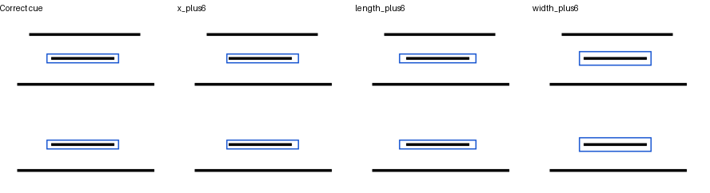

# 提示框扰动对状态判断的影响

2026-10-17完成。**固定黑色笔迹，仅把框向下移动6像素，完成判断从52/56降至42/56；所有变体均正确的完成题只有36/56。** 本轮固定完整Show-o2及原状态适配器，保持问题、标签和解码，仅改变完整参考导出的提示框。使用3组已有开发几何、28个目标案例、两种问法，8个固定变体共896题。未训练新参数，也不根据开发成绩挑选某种框作为推理方法。

八种变化为水平／垂直平移±6像素，以及沿线／垂线方向各侧扩张或收缩6像素；参考和当前区域变化相同。框仍标示同一目标，所有黑色笔迹已逐图确认保持。正确框对照复用同一适配器此前保存的112个答案。

评价包含存在与完成正确率、相对正确框的答案变化、正确变错与错误修复、两问均对、同图不同状态的目标配对，以及包含正确框在内所有变体均正确的比例。区间按原3个几何组计算，扰动图不增加独立几何数。

## 实际结果

| 位置提示 | 存在正确 | 完成正确 | 完成答案变化数 | 完成目标配对 |
|---|---:|---:|---:|---:|
| 原准确框，已存对照 | 54/56 | 52/56 | 0 | 18/20 |
| 水平左移6像素 | 56/56 | 51/56 | 1 | 17/20 |
| 水平右移6像素 | 55/56 | 52/56 | 0 | 18/20 |
| 垂直上移6像素 | 55/56 | 48/56 | 12 | 15/20 |
| 垂直下移6像素 | 55/56 | 42/56 | 10 | 10/20 |
| 沿线方向两端各收缩6像素 | 55/56 | 52/56 | 0 | 18/20 |
| 沿线方向两端各扩张6像素 | 55/56 | 49/56 | 3 | 16/20 |
| 垂线方向两侧各收缩6像素 | 49/56 | 51/56 | 5 | 16/20 |
| 垂线方向两侧各扩张6像素 | 54/56 | 47/56 | 8 | 17/20 |

答案变化包含错误答案之间的切换，不能全计为正确变错。向下平移新增10道完成错误、没有修复；向上平移新增8道错误、修复4道；垂线扩张新增5道错误、没有修复，另有3道在错误答案之间变化。沿线收缩不改变任何完成回答，说明本次敏感性随扰动方式变化。

包含原准确框及八种变化，存在始终正确48/56，完成始终正确36/56。完成全条件正确率64.3%，3组bootstrap区间[56.2%,81.2%]；向下平移相对原框的完成变化区间[-41.7,0]个百分点。组数很少，不能据此估计真实场景误差率；确定性配对已显示多个状态回答会因无关框变化而改变。

原始回答见[run/predictions.jsonl](run/predictions.jsonl)，逐题变化见[scored.jsonl](scored.jsonl)，全部计数和区间见[score.json](score.json)。112题包含两种问法及共享画面，八个变体也共享原3组几何。

这支持继续检查状态模型对位置误差的适应能力。后续[小规模匹配训练](../cue_robustness_pilot_v1/README.md)比较准确框复习与扰动框训练，保留文字和无参考状态复习。此处不选择数值最高的提示框作为最终推理方法，也不启动顺序学习。



## 复现

```bash
python scripts/h1_cue_perturbation.py build
PYTORCH_ENABLE_MPS_FALLBACK=1 python scripts/h1_cue_perturbation.py run
```

使用原`checkpoints/h1_target_cue_boxed_v1/adapter.pt`。状态运行记录约17.6分钟，模型加载另计。固定示例已目视核对。已有目录不覆盖，另一次实验应在所有阶段指定新的`--data`与`--output`仓库内路径。原始回答与逐题评分保留，原130例视觉留出测试未使用。新增脚本、派生数据和实验记录，没有删除文件。
