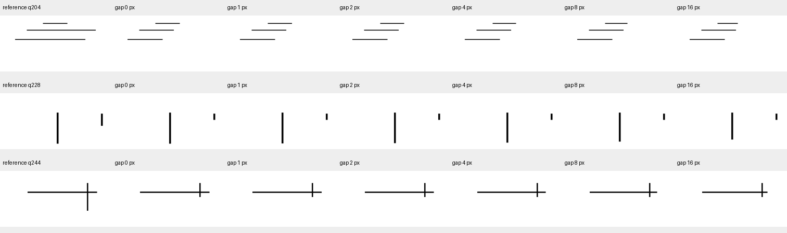

# 固定其他笔迹后的末端缺口诊断

**现有UMM状态读出不能稳定区分完整目标与细小缺口。预测区域的1像素配对仅1/56、16像素22/56；同一个头改用正确区域后分别为1/56和37/56。只改变其他线条，也会使完整判断改变。当前继续解决目标对应与完成边界，不进入顺序学习。**

## 问题与条件

上一轮扩大部分进度的训练覆盖后，90%进度判断明显改善，但97%进度与真正完整仍有错误。本轮只改变所问目标的末端，检验完整与细小缺口能否被现有UMM状态读出区分。

复用上一轮24组开发几何，每类8组，合计56个目标。其他当前线条固定在50%进度；同一目标分别保持完整，或缩短末端1、2、4、8、16像素。六张画面的其他笔迹完全相同，完整参考也相同，共336个当前画面。构造时核对可见差异，所有缺口都没有被其他笔迹遮挡。

完整Show-o2-1.5B-w-video-und及其原状态适配器、参考定位器、状态头均冻结。输入为432×432原图，沿用原生Wan VAE与理解／生成融合视觉路径。只追加编码336张当前图，复用24张参考的特征及56个参考查询的掩码，不更改模型参数。

训练前已得到的四个状态头分别为原状态复习与进度覆盖、各自使用正确或预测区域训练。本轮评价这四个头，并让两个预测区域训练头额外使用正确区域，合计六种条件。运行前固定[plan.json](plan.json)，不按结果选择阈值或检查点。

## 评价含义

- 每档缺口报告56个目标的状态正确数；0像素单独检查完整误答部分。
- 配对成功要求同一目标的完整画面和缺口画面都答对。每个非零缺口有56对；一个完整成员被五对共用，不能当作独立样本。
- 分数方向比较完整画面与缺口画面的“完整logit减部分logit”。前者更大表示方向正确，相等单列；它不要求实际答案正确，也不构成校准通过。
- 同一目标六种状态全部答对作为较严格的稳定性指标。置信区间按24个完整几何组重采样2000次，保留同组目标及共用画面的关联。
- 冻结特征的变化幅度仅用于判断输入敏感性。非零差异不能证明模型已经识别缺口，也不能替代配对答案。

所有目标都存在，均有参考，本轮不评价缺失与未知。数据几何已经在此前开发中使用，不作独立验收；静态直线的结果也不能外推到汉字、笔顺或统一学习收益。原语言适配器与130例视觉留出测试保持，尚未进入顺序学习。

## 固定模型的结果

下表均使用上一轮进度覆盖后的权重。前两列使用同一个状态头，仅替换目标区域；最后一列使用另一个在正确区域上训练的头，不能把该列差异全部归因于区域替换。

| 条件 | 预测区域头＋预测区域 | 同一个头＋正确区域 | 正确区域训练头＋正确区域 |
|---|---:|---:|---:|
| 完整画面答对 | 29/56 | 48/56 | 49/56 |
| 完整／缺1像素，两者均对 | 1/56 | 1/56 | 0/56 |
| 完整／缺2像素，两者均对 | 3/56 | 2/56 | 1/56 |
| 完整／缺4像素，两者均对 | 5/56 | 4/56 | 8/56 |
| 完整／缺8像素，两者均对 | 12/56 | 18/56 | 33/56 |
| 完整／缺16像素，两者均对 | 22/56 | 37/56 | 49/56 |
| 六种状态全部答对 | 1/56 | 1/56 | 0/56 |

预测区域覆盖头有27个真正完整目标被答成部分。1像素缺口单题答对28/56，但其中27个对应的完整画面也被答成部分，真正成对区分仅1/56。不能把“部分题答对”直接当成识别了缺口。

六种冻结条件的全体结果如下。每组含五个部分、一个完整，恒答部分可得280/336，配对成功为0；因此不按逐题总分挑选方法。全部回答均落在部分／完整两类，本轮也不据此宣称存在判断通过。

| 状态头／评价区域 | 逐题正确 | 完整与部分宏平均正确率 | 配对均对 |
|---|---:|---:|---:|
| 原状态复习／正确 | 81/336 | 53.8% | 21/280 |
| 进度覆盖／正确 | 175/336 | 66.3% | 91/280 |
| 原状态复习／预测 | 97/336 | 51.6% | 9/280 |
| 进度覆盖／预测 | 203/336 | 57.0% | 43/280 |
| 预测区域复习头／正确 | 73/336 | 51.6% | 9/280 |
| 预测区域覆盖头／正确 | 150/336 | 61.1% | 62/280 |

预测区域覆盖头配对成功15.4%，按几何组计算的95%区间[9.7%,22.6%]；同一头用正确区域为22.1%，区间[17.0%,27.9%]。正确区域训练头为32.5%，区间[27.2%,37.0%]。这些区间描述开发几何抽样，不包含训练种子变化；零成功子集的退化重采样区间也不能证明真实成功概率为零。

## 分数变化与细节读取

对每一对画面，比较完整画面的“完整logit减部分logit”是否高于缺口画面。这只检查分数变化方向，两张图仍可能给出相同错误类别。

| 缺口 | 预测区域覆盖头，方向正确 | 同一头用正确区域 | 正确区域覆盖头 |
|---|---:|---:|---:|
| 1像素 | 35/56 | 31/56 | 42/56 |
| 2像素 | 44/56 | 42/56 | 48/56 |
| 4像素 | 53/56 | 54/56 | 55/56 |
| 8像素 | 53/56 | 55/56 | 56/56 |
| 16像素 | 56/56 | 56/56 | 56/56 |

没有分数完全相等的配对。预测区域头的1像素分数差中位数0.157，8像素1.709，16像素4.545；正确区域训练头对应0.219、4.452、11.284。4–16像素通常能改变分数方向，但还没有稳定跨过分类边界。

全部1像素配对的冻结特征都有非零变化。正确区域内、按既有训练标准差归一后的差异均方根中位数0.0805；预测区域为0.0797。该量只说明编码响应不同，不说明差异可泛化地解码成正确状态。现有证据不足以认定细节已经全部丢失，也不足以认定只调一个阈值就能解决。

## 补充诊断：只改变其他线条

主结果后，将本轮完整目标与上一轮同一目标已完整的开发画面对应。完整参考、目标像素和定位掩码均相同，只有其他线条从原有进度改为50%。使用已有预测，不追加编码或训练；这是事后定位错误来源的对照。

| 固定权重与区域 | 原背景完整答对 | 其他线条改为50% | 答案改变 | 修复／新增错误 |
|---|---:|---:|---:|---:|
| 预测区域覆盖头＋预测区域 | 40/56 | 29/56 | 19/56 | 4／15 |
| 同一覆盖头＋正确区域 | 54/56 | 48/56 | 8/56 | 1／7 |
| 正确区域覆盖头＋正确区域 | 54/56 | 49/56 | 9/56 | 2／7 |

预测区域下降19.6个百分点，配对区间[-34.5,-3.6]；同一头用正确区域下降10.7个百分点，区间[-21.2,-1.7]。更准确的目标选择可减少影响，但正确区域仍存在背景敏感性。视觉特征包含上下文信息，区域池化也未必完全隔离其他笔迹；目前不能只归因于掩码错误，也不能凭这项对照断定模型采用了某一种捷径。

下一步优先在训练几何中加入两个方向的配对：固定背景改变目标末端，以及固定目标改变其他线条。用同预算复习对照检验能否同时减少提前判完整与完整误判部分；正确／预测区域分报。8–16像素和1–4像素分别报告，全部保留，不把小缺口从总结果中事后剔除。若正确区域在配对监督后仍无法读出，再用匹配的局部放大输入检验分辨率因素。当前不据此保证任何改进有效。

## 记录与成本

追加336张当前图的UMM编码665.5秒，复用24张参考特征和56个参考定位；全部六条件评价与特征敏感性汇总7.7秒。模型更新参数为0，完整UMM包含3,063,740,640个参数。耗时仅描述本机本轮阶段，不作为模型间效率比较。

原始证据：[全部状态答案与logit](predictions.jsonl)、[配对记录](pairs.jsonl)、[分组评分及区间](score.json)、[特征变化](feature_sensitivity.jsonl)、[背景配对](background_pairs.jsonl)、[补充分析](diagnosis.json)、[编码成本](extraction.json)。数据与图像见[数据说明](../../../../data/h1/endpoint_pairs_v1/README.md)。

## 本轮文件变化

- 新增[实验脚本](../../../../scripts/h1_endpoint_pairs.py)、[配对数据](../../../../data/h1/endpoint_pairs_v1/README.md)和本目录结果，保存全部固定条件与失败。
- 更新[仓库入口](../../../../README.md)、[研究进展](../../../../docs/project/STATUS.md)、[实验计划](../../../../docs/project/EXPERIMENTS.md)、[判断依据D33](../../../../docs/project/DECISIONS.md)和[门槛协议第20节](../../../../docs/experiments/h1_state_gate.md)，反映背景敏感性及后续配对监督。
- 更新[结果索引](../README.md)，在[上一轮报告](../progress_coverage_v1/README.md)增加本轮后续链接。
- 没有删除文件，没有覆盖旧数据、评分或模型权重。

## 可视样例

按数据顺序选每类首个目标。左列是完整参考，其余为目标末端六种缺口；其他线条保持半条。预览缩小到一半，1像素缺口在预览中可能不明显；模型接收原始432×432图。



## 运行

```bash
checkpoints/Show-o-env/bin/python scripts/h1_endpoint_pairs.py build
PYTORCH_ENABLE_MPS_FALLBACK=1 checkpoints/Show-o-env/bin/python scripts/h1_endpoint_pairs.py extract
checkpoints/Show-o-env/bin/python scripts/h1_endpoint_pairs.py evaluate
checkpoints/Show-o-env/bin/python scripts/h1_endpoint_pairs.py diagnose
```

重复实验可为三个阶段指定一致的新`--data`、`--output`、`--cache`路径。大特征保存在本地忽略目录，原数据、评分和权重不覆盖。
