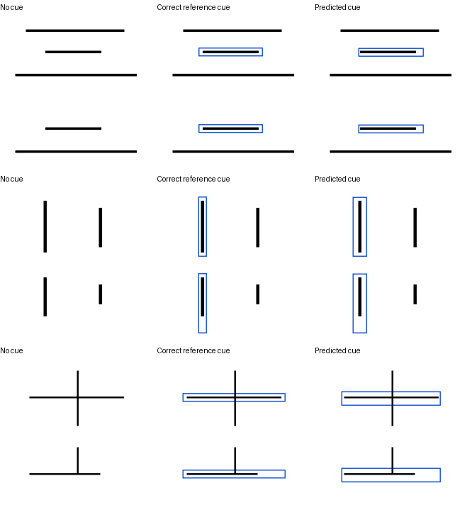

# 预测目标位置能否帮助当前状态判断

2026-10-17完成。**预测位置下存在判断56/56，完成判断42/56；完成目标配对14/20，优于无框1/20，低于正确框18/20。** 本轮将扩展几何的目标空间头接入已有Show-o2状态适配器，检验预测位置的实际用途，不以单独的框误差代替状态回答。

固定3组已有开发几何、7个完整参考目标，复用12幅状态画面、28个目标案例和112道存在／完成问题。定位只接收完整参考及目标名称，当前区域置空；将预测目标掩码与预测全部笔迹取交集，按既定连通部分换算边界，再沿用外扩12像素的蓝框规则。所有黑色笔迹保留。状态模型、提示、标签和解码保持，与历史无框／正确框结果比较。

完整参考目标定位6/7在12像素容差内，另一条竖线的一侧误差为12.5像素。位置预测使用同一个UMM的视觉与问题表示及新增头，未读取正确框或完成状态。结果不能代表原语言模块已能直接输出正确坐标。

本批只有3个此前已查看的几何组；新增头与掩码过滤来自此前开发诊断，当前测试不算独立确认。原130例视觉留出测试仍保留。

## 实际状态结果

以下三种输入均使用同一个已固定的状态适配器。无框与正确框复用已保存结果；预测框为本轮新运行。提示、状态标签和问题编号相同，输入蓝框不同。

| 输入位置 | 存在正确 | 完成正确 | 完成两种问法都正确 | 同图不同状态的目标完成配对 |
|---|---:|---:|---:|---:|
| 无框 | 49/56 | 32/56 | 15/28 | 1/20 |
| 正确参考框 | 54/56 | 52/56 | 26/28 | 18/20 |
| UMM预测框 | 56/56 | 42/56 | 20/28 | 14/20 |

预测框相对无框的完成正确率提高17.9个百分点，3组配对bootstrap区间[8.3,37.5]；相对正确框下降17.9个百分点，区间[-25.0,-12.5]。目标完成配对相对无框提高65个百分点，区间[50,75]；相对正确框下降20个百分点，区间[-33.3,0]。配对包含两种问法和共享画面，不是20个独立几何。

完成类别分别为未出现6/6、部分20/28、完整16/22。存在全部答对，仍有4次“存在答有、完成答未出现”的矛盾，均来自交叉处的部分竖线。输出格式112/112有效，由固定答案树保证，不能据此认定开放回答已稳定。当前完成正确率75%、两问均对71.4%，尚不支持进入顺序学习。

这些区间只反映当前三个组内的观测。全对项目的bootstrap区间会退化为[1,1]，不能解释为真实泛化准确率必为100%。

## 定位容差没有保证完成判断

14道完成错误对应的参考位置全部在12像素容差内。与正确框相比，10道原本正确的完成回答变错，未修复其原有4道错误；错误包含完整答部分、部分答完整、部分答未出现。唯一坐标误差略超12像素的右竖，其完成题均答对。

这表明在本批数据中，框误差阈值不能替代下游判断。原状态模型可能对提示框的边界、宽度或视觉关系较敏感，需要固定黑色笔迹、只改变提示框的控制实验来进一步区分。不能把所有失败都归为选错目标，也不能通过降低定位阈值宣称门槛已过。

下图按三类各选第一个相对正确框退化的案例：中横完整、左竖部分、交叉横线部分。三个列分别是无框、正确框和预测框；只作错误示例，完整逐题记录均保留。



证据：[实际位置预测](localizations.json)、[定位评分](localization_score.json)、[状态原始回答](state_dev/predictions.jsonl)、[状态汇总](state_dev/score/summary.json)、[完成错误](state_error_analysis.json)、[无框配对比较](pairs_vs_no_box.json)、[正确框配对比较](pairs_vs_correct_box.json)。

本轮提出固定状态模型检验提示扰动，后续已完成[8种框扰动控制](../cue_perturbation_v1/README.md)和[两组64步匹配训练](../cue_robustness_pilot_v1/README.md)。状态稳定性仍不足，下一步检验更直接的目标区域表示，并加入新状态几何与无参考未知控制；两项前置门槛通过后再进入顺序学习。

## 复现

```bash
python scripts/h1_predicted_target_cue.py build
PYTORCH_ENABLE_MPS_FALLBACK=1 python scripts/h1_predicted_target_cue.py locate
PYTORCH_ENABLE_MPS_FALLBACK=1 python scripts/h1_predicted_target_cue.py run-state
python scripts/h1_predicted_target_cue.py diagnose
```

需要先完成[扩展几何读出](../target_grid_generalization_v1/README.md)。另一次实验应在各阶段一致指定新的`--data`、`--output`仓库内路径，可用`--target-cache`指定重新训练的目标头缓存。参考定位与制图14.8秒；状态运行记录从开始到结束约111.6秒，模型加载另计。固定错误示例已目视核对。新增输入、坐标预测、原始状态回答和评分均保留；没有删除文件或改动旧模型权重。
