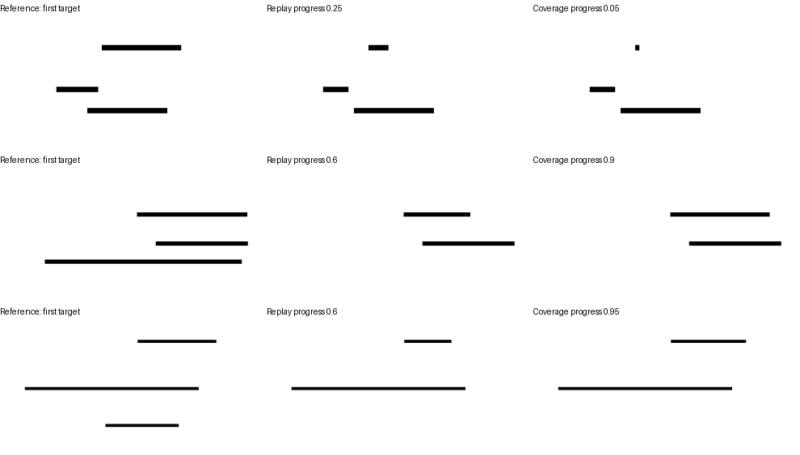

# 同预算检验短起笔与接近完成的监督

2026-10-17完成。**同预算增加进度范围使预测区域的完成判断322→370/441，90%进度12→52/56；97%仍仅17/56，真正完整的判断57→46/62。** 监督覆盖有效，但整体稳定性尚未解决。UMM、原语言适配器、定位器及读出结构保持，只继续训练区域状态头。

## 对照与数据

两组各509例，几何、目标、状态标签、顺序、类别权重和抽样索引完全相同。一组复习原数据，另一组改变多目标图中部分线条的已有长度，覆盖短起笔与接近完成；其他线条若处于部分状态也按各自的分配变化，每条线的状态类别保持。参考配对和无参考训练输入相同。

原25%进度分配到5%、10%、15%、25%、40%，原60%进度分配到60%、75%、85%、90%、95%，种子10440。每个目标依然只有两个部分状态，未增加样本数量。输入与对应关系见[数据说明](../../../../data/h1/progress_coverage_v1/README.md)。

正确区域、UMM预测区域各做一组匹配比较，共四次训练。各自从上轮对应区域头的最终权重开始，重置优化器，固定400步、每批32例、AdamW学习率0.0003、权重衰减0.01、种子10442，训练57,764参数。只评价最终权重，不按开发结果选轮次或阈值。

新开发集提前固定为36组／441例，包含新几何、新进度和新的多目标状态组合。56例97%进度作为边界压力条件单列，同时保留在总分中；其余385例作为主条件。保留上轮317例检查旧能力，原视觉独立测试继续留出。

## 评价约定

原区域头、原状态复习及进度覆盖三者都在相同新开发集上评价，正确／预测区域分别报告。预测区域继续训练后的两个头还交叉使用正确区域，观察定位影响。报告存在、完成、部分误答完整、完整误答部分、每档进度、参考配对和不同目标状态配对；区间按整组几何抽样。

输出结构仍由一个四类状态推导存在，格式和一致性不能当作语言端学习成绩。本轮没有重新训练或重测原语言模型，新增头的收益不代表统一学习收益。UMM参数与原状态适配器不更新，定位过程不读取当前进度。

## 同预算结果

原区域头在新441例上的完成判断：正确区域336/441、预测区域327/441。以下两组各继续相同400步；主条件385例与97%压力条件的划分在训练前固定。

| 区域与继续训练 | 全体完成 | 主条件完成 | 全体存在 | 不同目标状态配对 |
|---|---:|---:|---:|---:|
| 正确区域，复习原状态 | 334/441 | 334/385 | 437/441 | 95/160 |
| 正确区域，扩大进度范围 | 385/441 | 379/385 | 439/441 | 125/160 |
| 预测区域，复习原状态 | 322/441 | 317/385 | 426/441 | 75/160 |
| 预测区域，扩大进度范围 | 370/441 | 353/385 | 429/441 | 95/160 |

预测区域的全体完成提高10.9个百分点，36组配对95%区间[8.6,13.1]个百分点；主条件提高9.4个百分点，区间[6.7,11.9]。正确区域相应提高11.6和11.7个百分点。两组样本数、标签与预算一致，结果支持本配置下进度覆盖的作用。

预测区域覆盖组全体完成83.9%，区间[80.9%,87.0%]；主条件91.7%，区间[89.0%,94.6%]。真正有参考且已出现的部分／完整判断仅283/348（81.3%）。在已固定的主条件上补充汇总目标配对，预测区域为91/128，正确区域124/128，说明位置对应仍有问题。不能只用主条件总分判定门槛通过。

## 完成边界与保持情况

| 实际状态 | 正确区域：复习 → 覆盖 | 预测区域：复习 → 覆盖 |
|---|---:|---:|
| 8%起笔 | 52/56 → 54/56 | 51/56 → 53/56 |
| 90%进度 | 12/56 → 54/56 | 12/56 → 52/56 |
| 97%进度，压力条件 | 0/56 → 6/56 | 5/56 → 17/56 |
| 已完整 | 62/62 → 60/62 | 57/62 → 46/62 |

预测区域下，部分误答完整从99/286减少到43/286，但完整误答部分从5/62增加到16/62。97%条件还有38例答为完整、1例答为未出现。正确区域下也有50/56个97%案例误答完整，所以位置改善不足以解决细小缺口。

按实际渲染终点计算，97%剩余缺口分为1–3像素20例、4–7像素27例、至少8像素9例；预测覆盖组分别8、7、2例正确，正确区域覆盖组分别3、1、2例正确。这项事后分析不能证明信息已在编码中丢失，监督边界、目标表示与空间细节仍需分开检查。

旧317例用于能力保持：正确区域复习291/317、覆盖317/317；预测区域复习254/317、覆盖285/317。预测区域的旧85%进度14→49/56，但完整判断57→48/62。旧数据已经用于发现问题，不作独立验收。

四个继续训练头的无参考控制均保持：旧25/25、新37/37；新同当前不同参考配对均6/6。复习组训练拟合509/509，两个覆盖组均508/509，剩余一例都是部分误答完整。本轮只有一个训练种子，区间只描述几何抽样变化。

## 补充诊断：最大连通区域

主结果后固定覆盖组权重，仅将预测掩码保留最大四连通部分；沿用此前边界换算的连通规则，不用正确掩码筛选，不训练或调阈值。该项是事后诊断，[设置在运行前单独保存](connected_plan.json)。

新开发完整判断46→57/62，但97%进度17→6/56；总体370→358/441，修复18例、引入30例错误，差异区间[-5.7,0.2]个百分点。主条件353→352/385；旧开发285→287/317。**该规则没有形成稳定收益，不作为默认替代。** 区域混入与缺失都会影响判断，简单连通筛选也可能丢掉有用部分。

16个真正完整的误判中，15个预测区域含多余格、5个缺少目标格；同一头改用正确区域修复14例。连通筛选修复其中12例，但另使一个原本正确的完整案例出错。这些是评分后的错误归类，没有用于选择筛选规则。

同一覆盖头改用正确区域时，新开发完整判断为60/62、主条件目标配对121/128；97%仍7/56。下一步先构造其他笔迹完全相同、只改变目标末端缺口的配对，按1–16像素缺口检验UMM特征的可辨别性，再决定是否需要局部放大或更细的目标监督。保持正确／预测区域分报；原适配器不替换，原视觉独立测试保留，不进入顺序学习。

## 证据与成本

复用517张旧图，仅追加384张图的编码，实际816.6秒；复用204个目标查询，新68个查询与掩码预测30.2秒，定位52/68达到12像素容差。四次400步训练分别24.1、23.7、23.7、23.9秒；UMM更新参数数为0。连通筛选评价约1.6秒，不含加载和输入准备；不同阶段耗时不作模型提速结论。

完整结果见[score.json](score.json)、[配对比较](paired_comparisons.json)、[逐例预测](predictions.jsonl)、[补充筛选结果](connected_score.json)与[错误分析](diagnosis.json)。各轮训练损失、设置和最终权重用途均保留。

后续已完成[固定其他笔迹的末端缺口诊断](../endpoint_pairs_v1/README.md)：小缺口与完整画面的配对仍不稳定，改变其他线条也会影响完整答案；分数方向与实际分类分开报告。

## 固定训练样例

按数据顺序，选首个以第一条线为目标、进度为5%、90%、95%的案例。左右两组的目标状态标签都保持部分；完整参考相同。



## 运行

```bash
python scripts/h1_progress_coverage.py build
PYTORCH_ENABLE_MPS_FALLBACK=1 python scripts/h1_progress_coverage.py extract
PYTORCH_ENABLE_MPS_FALLBACK=1 python scripts/h1_progress_coverage.py locate
python scripts/h1_progress_coverage.py train
python scripts/h1_progress_coverage.py evaluate
python scripts/h1_progress_coverage.py connected
python scripts/h1_progress_coverage.py diagnose
```

使用已有`checkpoints/Show-o-env/bin/python`。模型、特征及新增头保存在本地缓存。复用的517张图和204个查询均来自上一轮不变的冻结模型；仅计算384张新增图和68个新参考查询。大特征库以bfloat16保存，训练时只对实际批次转float32并归一化，减少内存占用。

已有数据与结果不覆盖。重复实验时，各阶段一致指定新的仓库内`--data`、`--output`、`--cache`路径。新增实验脚本、数据与记录，没有删除文件，原模型权重和历史评分保持。
