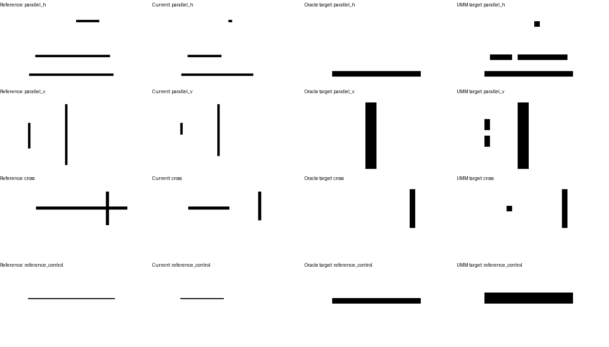

# 从UMM目标区域特征读取实际状态

2026-10-17完成。**预测区域状态头的完成判断258/317，原语言回答211/317；但85%进度从27/56降至16/56，尚未稳定。** 上一轮已确认蓝色位置框会影响完成判断，扰动训练尚无一致改善。本轮固定完整Show-o2及原状态适配器，训练独立的区域状态读出头，检验不绘制蓝框时能否利用参考与当前的空间特征。两组训练、输入对照和原语言回答比较均已完成。

## 输入与对照

参考与当前使用相同坐标分别编码，保留整图和其他线条。UMM提供729个1536维融合视觉token；目标选择使用完整参考和实际问题的UMM隐藏状态，通过既有目标头及全部笔迹头得到掩码。当前完成信息不进入目标选择。

新增状态头先将每个token映射到32维，分别计算目标区域内参考、当前、绝对差的均值和绝对差最大值，再结合是否提供参考的标记输出四类：未出现、部分、完整、未知。存在答案由状态推导，输出格式和存在／完成的一致性由结构保证，不能作为开放语言回答稳定的证据。

两组训练分别使用正确目标掩码和UMM预测掩码，初始化、抽样次序与预算相同。固定400步、每批32例、AdamW学习率0.001、权重衰减0.01、种子10432；交叉熵类别权重只用训练频次。只评价最终权重，无开发集阈值或轮次选择。所有UMM参数与原状态适配器保持冻结。

每组交叉评价正确／预测区域。预测区域训练头另测换成同参考中的另一目标、当前特征置空、参考特征置空。最后一项仍保留参考导出的目标掩码，掩码包含范围信息，不能称为完全移除参考。真正的无参考控制使用单目标图、空白参考及固定整片上半部区域，无隐藏目标范围。

既有语言回答使用相同开发案例、预测框和原加框提示，每例存在与完成各一种问法。新读出头接受了新增状态监督，输入表示也不同，因此该对照用于比较实际状态用途，不作为同参数、同训练预算的架构优劣消融。

## 数据与评价

[数据说明](../../../../data/h1/region_state_v1/README.md)：原始训练520例／72组，开发322例／36组；按实际可见输入去重后509／317例。其中开发24组包含多目标几何，6组提供同当前不同参考控制，6组提供无参考控制。原视觉独立测试保留。

报告存在与完成、各状态及进度比例、交叉结构、同当前不同参考配对、同图不同状态目标配对；区间按整组几何抽样。无参考重复空白在每个集合只计一次，其训练／开发共享性质明确保留。所有原始预测和失败保留。

## 状态读出结果

两组各更新57,764个参数，均拟合全部509个训练案例。下表为317个去重开发案例；其中292例有完整参考，25例没有参考。两个区域条件输入的信息不同，正确区域属于外部位置辅助。

| 训练区域 → 评价区域 | 存在正确 | 完成正确 | 有参考的完成正确 | 同当前不同参考配对 | 不同目标状态配对 |
|---|---:|---:|---:|---:|---:|
| 正确 → 正确 | 313/317 | 290/317 | 265/292 | 6/6 | 106/128 |
| 正确 → 预测 | 294/317 | 252/317 | 227/292 | 6/6 | 57/128 |
| 预测 → 正确 | 317/317 | 273/317 | 248/292 | 6/6 | 101/128 |
| 预测 → 预测 | 301/317 | 258/317 | 233/292 | 6/6 | 70/128 |

正确区域训练与评价的完成率91.5%，36组聚类95%区间[88.2%,94.6%]；预测区域训练与评价81.4%，区间[77.7%,85.3%]。有参考部分分别90.8%与79.8%。全部条件的无参考控制均25/25正确，其中24例非空时回答未知，1例空白回答未出现。全对的聚类区间会退化为[1,1]，不代表总体能力必为100%。

两组在不同区域之间迁移时都有变化；正确区域输入也不能保证一个按预测区域训练的头优于按正确区域训练的头。新增头的训练、目标选择与状态泛化仍需区分。

## 与原语言回答比较

| 方法 | 存在正确 | 完成正确 | 有参考的完成 | 无参考的完成 | 目标状态配对 |
|---|---:|---:|---:|---:|---:|
| 原语言适配器＋预测蓝框 | 259/317 | 211/317 | 189/292 | 22/25 | 47/128 |
| 新区域头，预测区域训练与评价 | 301/317 | 258/317 | 233/292 | 25/25 | 70/128 |

预测区域头比原语言回答多答对47/317，改善14.8个百分点，36组配对95%区间[9.5,20.0]个百分点。两者的同当前不同参考配对均6/6。新头具有额外训练数据、不同输入表示和输出结构，因此这些差异只支持此处的状态读出用途，不证明移除蓝框是唯一原因，也不证明UMM统一学习有额外收益。原语言模型权重没有改变。

原语言回答在85%进度上27/56，新预测区域头16/56，存在明确退化；15%进度则从18/56提高到48/56，完整状态从43/62提高到57/62。总体正确率无法替代完成边界的逐项检验。

原语言存在／完成两问有26/317例相互矛盾。新头只输出一个状态，再推导存在，因此一致性由结构保证，不能把这一差异解释为它学会了语言自洽。

## 接近完成是当前主要缺口

| 有参考的实际进度 | 正确区域训练与评价 | 预测区域训练与评价 |
|---|---:|---:|
| 未出现 | 56/56 | 51/56 |
| 15% | 52/56 | 48/56 |
| 45% | 56/56 | 55/56 |
| 50%，参考配对 | 6/6 | 6/6 |
| 85% | 33/56 | 16/56 |
| 完整 | 62/62 | 57/62 |

正确区域组的27个完成错误全部是部分状态误判，其中23例实际已写85%，均被答为完整。预测区域组的59个错误包括49例部分、5例未出现、5例完整；85%案例有39例被答为完整、1例被答为未出现。

85%案例还剩至少32像素时，正确区域组答对9/12，预测区域组2/12。因此错误不能全部归于最后几像素不可分辨。训练部分进度只有25%和60%，这一覆盖缺口需要直接检验；本轮结果尚不能证明补充接近完成的监督一定能解决。

下一步保持UMM与定位器固定，比较原状态复习和加入短起笔／接近完成进度的监督，使用相同更新预算，并预先固定新的开发几何与更细的完成边界。继续报告正确／预测目标区域和无参考控制；先解决完成边界与目标混入，再决定独立验收，不进入顺序学习。

## 输入依赖与目标定位

预测区域头保持权重不变，换成同一参考中的另一目标区域后，完成145/317、目标配对1/128；当前图像特征置空后57/317，全部回答未出现；参考特征置空后191/317，同当前不同参考配对0/6。这支持该读出实际使用当前特征、参考特征和目标区域。置空属于分布变化，不能凭此断言已具备所有实际场景的理解能力。

本批参考目标的既有定位器命中训练102/136、开发47/68，仍按四边界12像素容差计算。状态头使用完整预测掩码，语言基线使用其最大连通部分的外框；两种表示的误差影响不同。固定首个85%案例与首个长参考配对的图例见下图，预测区域中仍能看到其他线条碎片。

预测区域头的59个完成错误中，35个对应的定位框仍达12像素容差。同一头换成正确区域修复24例、引入9例错误，总体增加15例正确；区域变化与训练分布之间存在相互影响。错误清单及剩余笔迹长度分析见[diagnosis.json](diagnosis.json)。



## 成本与证据

提取517张图的冻结视觉特征1119.0秒，完整UMM保留3,063,740,640个参数；参考目标查询与掩码预测89.2秒。正确／预测区域头各400步，优化分别21.7／21.1秒；全程未更新UMM参数或原状态适配器。

原语言基线实际运行644道存在／完成问题，记录内用时1351.2秒，约22.5分钟，不含载入；去重后每项317题。头训练时间与语言完整推理时间对应不同工作，不作为公平推理提速结论。

实际设置见[plan.json](plan.json)，各条件与类别见[score.json](score.json)，原始状态预测见[head_predictions.jsonl](head_predictions.jsonl)，合并语言结果见[all_predictions.jsonl](all_predictions.jsonl)，配对比较见[language_comparisons.json](language_comparisons.json)。新增数据、脚本及实验记录，原权重和历史评分保持，没有删除文件。

## 运行

```bash
python scripts/h1_region_state.py build
PYTORCH_ENABLE_MPS_FALLBACK=1 python scripts/h1_region_state.py extract
PYTORCH_ENABLE_MPS_FALLBACK=1 python scripts/h1_region_state.py locate
python scripts/h1_region_state.py train
python scripts/h1_region_state.py evaluate
python scripts/h1_region_state.py build-baseline
PYTORCH_ENABLE_MPS_FALLBACK=1 python scripts/h1_region_state.py run-baseline
```

使用已有Show-o环境，例如`checkpoints/Show-o-env/bin/python`；模型、特征和读出头存于本地`checkpoints/h1_region_state_v1`。上列为新实验的阶段顺序。已有数据与结果目录不覆盖；重复整套实验时，各阶段一致指定新的仓库内`--data`、`--output`、`--cache`路径。

本轮只检验UMM特征上的新增状态头；尚不涉及汉字实际笔顺、原语言端同步改善、统一学习收益或生成反馈。
