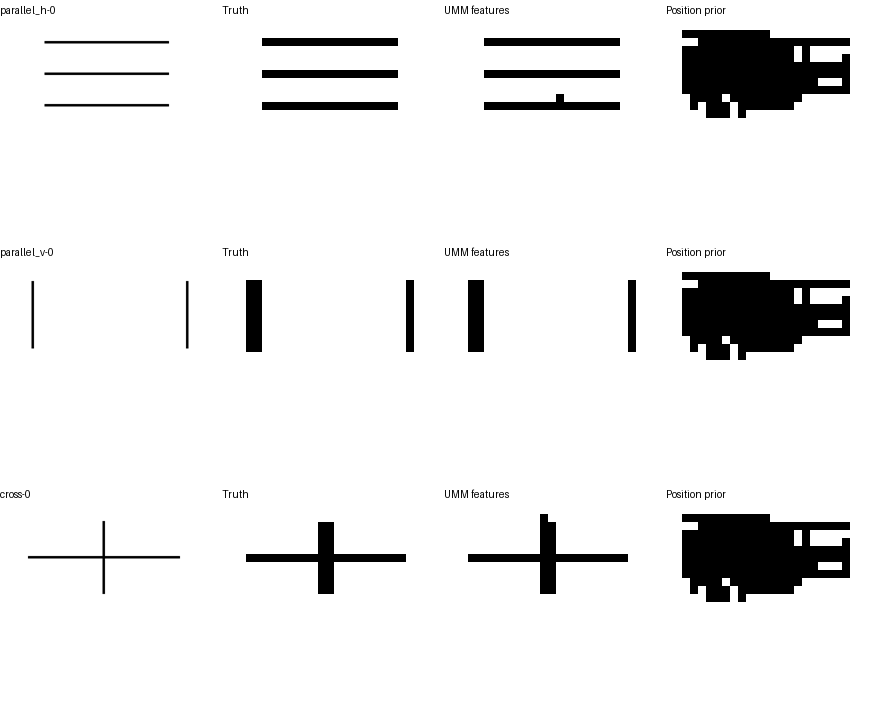

# 冻结UMM视觉表示的空间读出

2026-10-17完成。**完整Show-o2的冻结视觉表示中，仍可读出这批简单线条的粗略位置。** 在12个开发几何组上，前景网格IoU为92.1%，位置先验为16.7%；这缩小了定位失败的排查范围，但没有证明语言模块能选中指定目标。

## 实验设置

读取完整`showlab/show-o2-1.5B-w-video-und`检查点，保留全部3,063,740,640个参数。Wan VAE在CPU float32执行，理解／生成图像嵌入、语义变换和融合模块在MPS bfloat16执行；语言模块保留在CPU，本次不执行。已有LoRA只影响语言模块，视觉特征与此前状态及坐标实验一致。

复用36组训练参考、12组开发参考，每组只取一幅图，去掉目标名称和坐标。提取融合后的729个视觉token，每个1536维。全部UMM参数冻结，只训练一个共享线性二分类头，共1537个参数；不向读出头另外输入坐标。

按模型27×27空间网格，对原图分成16×16像素格。一个格内至少8个像素的RGB三通道均小于128，就标为有笔迹。标签包含全部线条，不区分笔画实例。每个token有空间索引和对应的标注；这些索引来自图像编码结构，不是模型自行输出的坐标。

训练通道均值和标准差只由训练token计算。固定种子10419、AdamW、学习率0.01、权重衰减0.01、300次更新、每次4096个训练token；二分类损失的正类权重为训练负格数／正格数25.244。阈值固定0.5，只评价最终头，不通过开发集选择阈值。配置见[plan.json](plan.json)。

## 结果与对照

| 方法 | 训练平均IoU／F1 | 开发平均IoU／F1 | 开发汇总精确率／召回率 |
|---|---:|---:|---:|
| 真实图UMM特征＋线性头 | 88.3%／93.4% | 92.1%／95.6% | 91.1%／100.0% |
| 每个位置的训练前景频率 | 15.6%／26.3% | 16.7%／28.0% | 17.8%／75.2% |
| 同一线性头＋空白图特征 | 0.0%／0.0% | 0.0%／0.0% | 0.0%／0.0% |

IoU和F1先按每幅图计算，再平均；区间按几何组重采样，不把729个格当作729幅独立图片。真实图开发IoU的95%区间为[85.7%,97.6%]；相对位置先验的IoU改善75.4个百分点，配对区间[68.7,81.7]。开发真前景格484个，预测全部覆盖，另有47个误报格，不能忽略误报。

位置先验只使用训练图在各格出现笔迹的频率，应用相同正类权重和0.5阈值。空白图仍含编码器的位置表示，但没有实际线条；同一读出头预测一个误报格，与真前景无重合。全白背景占比很高，故不以背景准确率作为主要结论。

下图固定展示每种布局的首个开发组，未按结果挑选。依次为原图、标注网格、UMM特征读出、位置先验：



## 解释与下一步

简单线条的粗略空间信息没有在融合视觉表示中全部丢失。此前坐标输出失败，不能只解释为“编码器看不到线条”。但本实验没有判断指定实例、完成程度、坐标端点或实际先后，也没有说明语言模块会利用这些信息。16像素网格的粗略读出不能等同精确定位；原开发几何仍为同一渲染方式和简单形状。

据此追加[目标条件空间读出](../target_grid_v1/README.md)：结合UMM对实际目标问题的内部表示，只预测被问到的线条，并用同图换问题检验目标对应。这是新增空间头的实验，不作为旧语言输出已改善的证据。原130例视觉留出测试保留，顺序学习未启动。

## 复现与文件

```bash
python scripts/h1_spatial_probe.py build
python scripts/h1_spatial_probe.py extract
python scripts/h1_spatial_probe.py fit
```

本机使用`checkpoints/Show-o-env/bin/python`。特征提取108.2秒，线性头优化2.4秒，不含后处理与写文件。完整输入清单、训练损失、逐图预测和评分保存在本目录；缓存和读出头权重保存在本机`checkpoints/h1_spatial_probe_v1/`。UMM参数没有更新。

本次新增脚本、配置、结果和固定示例图；复用已有数据，没有重写原案例或删除文件。真实运行与示例目视核对完成；文件检查不作为H1能力证据。
