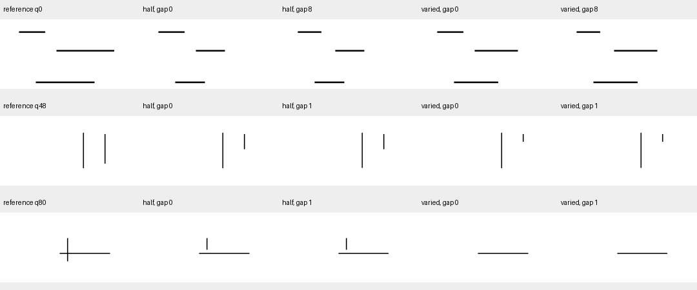

# 末端与背景配对的匹配训练

**状态：仅数据构造和特征编码完成。2026-10-18按H1-v3任务转向时间事件，计划中的六次训练和评价均未执行。以下训练内容为原预注册计划，不代表结果。**

## 要检验的问题

上一轮固定模型时，预测区域状态头对完整／缺1像素的配对仅1/56，完整／缺16像素22/56；目标保持完整、只改变其他线条也会改变19/56个答案。本轮检验两项数据干预：补充末端缺口状态是否改善完成边界，进一步改变其他线条是否增加背景稳定性。

## 固定方法

完整Show-o2-1.5B-w-video-und、原语言适配器、目标定位器和笔迹头全部冻结。参考与当前原图通过原生Wan VAE和理解／生成融合视觉路径编码，状态头仍为57,764参数。正确区域与预测区域各从上轮对应的进度覆盖头继续训练，分别运行三个组，共六次训练。

| 组别 | 每个训练目标的四个补充位置 |
|---|---|
| 原状态复习 | 原完整、原最高部分进度，各重复两次 |
| 末端监督 | 半条背景下目标完整／指定缺口，各重复两次 |
| 末端＋背景监督 | 同样目标状态，在半条背景与变化背景中各出现一次 |

112个目标来自原48组训练几何；每目标按种子10450分配一个1、2、4、8或16像素缺口，每档22或23个目标。半条背景指其他线条均写至50%；变化背景为每条其他线独立从0%、25%、75%、100%中选择。补充位置各448个，标签均为224完整、224部分。三组位置、目标、标签顺序和更新预算一致，不同画面的数量有意不同。

每组400步，每步32例：16例来自相同509个原状态案例，另外16例为四个目标各自的四个补充位置。使用相同随机种子10452、原案例索引和目标族索引；AdamW学习率0.0003、权重衰减0.01。损失为四类交叉熵，没有额外一致性或排序损失。类别权重按原案例与补充位置各占一半的混合概率取倒数，训练前固定。优化器重新初始化，只评价最终权重。

原状态复习与末端监督之间同时改变缺口范围和背景形式，因此属于组合数据干预。末端监督与末端＋背景监督之间只把重复的半条背景位置换成变化背景，检验背景变化带来的额外作用。不能据此认定某种额外损失或UMM统一学习收益。

## 评价范围

保留原317例、上一轮441例与末端配对336例。新增56个开发目标的背景对照：目标完整／缺8像素／缺16像素各配半条背景和独立15%／85%背景，合计336例，其中168张新图。15%／85%组合在训练前按种子10451固定；几何此前用于开发，尚未用于训练。这项新输入评价仍属开发，不作独立验收。

初始头、六个最终头各在自己的区域上评价；初始和三个预测区域头还使用正确区域交叉评价。正确／预测区域分报，既检查完整误答部分，也检查部分提前答完整。每个缺口报告完整／部分两个成员均正确；背景配对要求同一目标状态在两种背景都答对，同时记录答案翻转。置信区间以完整几何组重采样2000次，共用成员保留在同组。

原状态保持评价继续报告存在、未知、同当前不同参考与不同目标状态配对。原130例视觉独立测试未用；没有训练原语言输出，也未进入汉字笔顺、H2或H3。

## 固定训练样例

按数据顺序选择三类几何的首个目标。参考之后四列是半条背景的完整／缺口、变化背景的完整／同一缺口。预览缩小，模型输入保持432×432。



## 运行

```bash
checkpoints/Show-o-env/bin/python scripts/h1_state_pairs.py build
PYTORCH_ENABLE_MPS_FALLBACK=1 checkpoints/Show-o-env/bin/python scripts/h1_state_pairs.py extract
checkpoints/Show-o-env/bin/python scripts/h1_state_pairs.py train
checkpoints/Show-o-env/bin/python scripts/h1_state_pairs.py evaluate
```

每阶段可指定一致的新`--data`、`--output`、`--cache`路径。原特征与新增特征分开保存，模型参数和大特征位于本地忽略目录。旧权重、数据和评分保持。
