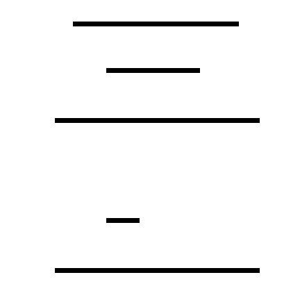

# 集中学习同图不同目标的状态

2026-10-16，Apple M5／16GB本机。**集中训练后，原开发完成判断从36/52提高到44/52，但同图不同目标的完成配对仅从0/20提高到1/20；缺少参考时的完成判断从44/50降至12/50。两项前置门槛仍未通过，本轮权重不替代原基线。**

## 固定设置与成本

原适配器在同图不同目标训练题上的完成配对为0/84。本轮保持最后8层q/v LoRA，从`h1_target_contrast_lora_v1`继续，集中学习全部432道参考＋当前训练题，检查增加直接训练能否改善目标对应。48幅画面、108个目标案例来自6个几何组；原图、问题和标签不变。

训练前设置见[plan.json](plan.json)：固定6轮、648步、累积4、rank 8、alpha 16、学习率2e-4、种子731，沿用答案及EOS交叉熵。只更新311,296个参数；完整Show-o2视频理解UMM、冻结视觉编码及生成模块均保留。本轮不混入文字、仅当前或旧视觉题，不启用梯度检查点。只评价最终权重，没有中途选择。

图像编码147.3秒、梯度训练1796.1秒，合计约32.4分钟，不含模型载入。六轮平均答案损失为0.1153、0.1114、0.1089、0.0909、0.0882、0.0766；损失包括固定JSON和EOS，不能当作状态正确率。完整记录见[training/run.json](training/run.json)及[training/training.jsonl](training/training.jsonl)。权重留在本机`checkpoints/h1_target_focus_v1/adapter.pt`。

## 训练内与开发结果

均使用相同固定答案JSON接口；推理不读取标签，格式由解码器保证。存在题询问指定线条是否实际出现，完成题区分未出现、部分、完整或依据不足。“两问均对”要求同一状态的两种等价问法同时正确。

| 输入与任务 | 训练前 | 训练后 | 分组 |
|---|---:|---:|---:|
| 已见训练题：存在正确 | 175/216 | 187/216 | 6 |
| 已见训练题：完成正确 | 138/216 | 154/216 | 6 |
| 已见训练题：存在／完成两问均对 | 83/108、67/108 | 88/108、72/108 | 6 |
| 原参考＋当前开发：存在正确 | 47/52 | 48/52 | 7 |
| 原参考＋当前开发：完成正确 | 36/52 | 44/52（84.6%） | 7 |
| 原参考＋当前开发：存在／完成两问均对 | 23/26、17/26 | 23/26、22/26 | 7 |
| 同图换目标开发：存在正确 | 51/56 | 51/56 | 3 |
| 同图换目标开发：完成正确 | 30/56 | 37/56 | 3 |
| 同图换目标开发：存在／完成两问均对 | 25/28、13/28 | 25/28、18/28 | 3 |

训练存在、完成正确率改善的几何组配对bootstrap 95%区间分别为[1.9,9.3]、[1.9,13.4]个百分点。原参考＋当前开发的完成改善区间为[0.0,30.4]个百分点；样本组少、仅一个训练种子，不能据此声称稳定泛化。

原开发的存在两问均对88.5%，完成逐题及两问均对均84.6%，仍低于各自门槛。完成类别分项为未出现12/12、部分24/26、完整8/14；“完整”仍明显偏弱。同一当前画面配短／长参考的唯一配对，两种问法均未同时答对。原130例视觉留出测试未运行。

训练对照见[train_vs_initial.json](train_vs_initial.json)，开发对照见[reference_dev_vs_initial.json](reference_dev_vs_initial.json)与[all_targets_dev_vs_initial.json](all_targets_dev_vs_initial.json)。

## 能否根据问题切换目标

对同一图中真值不同的两个目标，固定任务与问法，要求两个回答均正确。两种问法分别计数；这些配对共享图像和几何组，不应按独立图片计数。

| 配对条件 | 训练前 | 训练后 |
|---|---:|---:|
| 训练：存在两个目标均对 | 6/56 | 18/56 |
| 训练：完成两个目标均对 | 0/84 | 11/84 |
| 开发：存在两个目标均对 | 1/8 | 1/8 |
| 开发：完成两个目标均对 | 0/20 | 1/20 |

训练完成配对改善区间为[4.2,25.0]个百分点，但仍只有11/84正确。开发完成配对改善区间为[0.0,8.3]个百分点，仅3个几何组。完整配对见[训练比较](train_target_pairs_vs_initial.json)与[开发比较](all_targets_dev_target_pairs_vs_initial.json)。

补充统计[同图换目标时答案是否变化](target_response_changes.json)：训练完成题从8/84对答案不同提高到15/84；开发从0/20提高到2/20。因此多数情况下，换目标仍得到相同答案。答案发生变化也不保证两个都对。

训练期间、最终评价前已固定以下示例，完整12个回答见[illustrative_case.json](illustrative_case.json)。上半图为完整参考，下半图中上横缺失、中横只画35%、下横完整。

| 询问的目标 | 正确完成答案 | 训练前两种问法 | 训练后两种问法 |
|---|---|---|---|
| 上横 | 未出现 | 部分／部分 | 未出现／未出现 |
| 中横 | 部分 | 部分／部分 | 未出现／未出现 |
| 下横 | 完整 | 部分／部分 | 未出现／未出现 |

该图的三个存在判断训练前后均回答“有”。训练后完成答案整体变化，但仍未区分三个目标，且出现“有”与“未出现”的矛盾。该例用于说明错误，不替代总体统计。

## 能力保持：缺少参考的判断明显退化

仅当前开发104次调用去重后100题、25个状态、7组；文字开发208次调用去重后192题、48个状态、13组。重复要求问题及RGB像素相同，不能仅因文件名不同重复计数。

| 条件 | 训练前存在／完成正确 | 训练后存在／完成正确 | 训练前→后完成两问均对 |
|---|---:|---:|---:|
| 仅当前图像 | 45/50、44/50 | 41/50、12/50 | 22/25→6/25 |
| 准确文字状态 | 96/96、95/96 | 93/96、91/96 | 47/48→45/48 |

仅当前图像的所有完成回答都变成“未出现”，应答“未知”的38道不同输入全部答错。完成正确率下降64个百分点，配对95%区间[-73.7,-53.6]。这项退化足以阻止替换基线；原始104次调用的类别与逻辑一致性见[current_dev/score/summary.json](current_dev/score/summary.json)。

文字状态的存在、完成改善区间分别[-8.0,0.0]、[-10.0,0.0]个百分点；属于开发回归，不能继承旧权重的独立文字测试成绩。文字输入包含场景中各条线的状态记录，再询问指定目标，并非只给目标的答案。配对去重结果见[current_dev_vs_initial.json](current_dev_vs_initial.json)和[text_dev_vs_initial.json](text_dev_vs_initial.json)。

本轮只训练参考＋当前条件，未训练“未知”类别；这一条件与退化同时存在，但没有等预算混合复习对照，尚不能将原因唯一归到某项训练设置。

## 计算路径的补充对照

此前[数值核查](../fit_scope_v1/initialization_numerics.json)发现MPS／bfloat16训练与推理分数受梯度路径影响。本轮训练结束后，对同一最终权重、全部112道同图换目标开发题补做前向对照：保持模型eval状态与原图像路径，只保留LoRA参数的autograd，不反向传播、不更新参数、不读取标签。

结果为**112/112答案与普通推理相同**，完成目标配对仍1/20。详见[运行配置](all_targets_dev_grad_forward/run.json)、[答案比较](grad_forward_answer_changes.json)和[评分比较](grad_forward_vs_inference.json)。这说明切换该前向路径未改善本批答案；没有验证训练轨迹是否受数值差异影响，也没有证明不同设备或所有输入均一致。

复现可按[门槛协议](../../../../docs/experiments/h1_state_gate.md)训练，在原评价命令中增加`--adapter-grad-forward`运行上述诊断。该选项仅允许已加载适配器和固定答案解码，默认推理不变。

## 判断与后续

本轮支持“增加集中训练可以改善部分已见状态与原开发题”；仍未获得稳定的目标对应或参考比较。缺少参考的能力明显下降，说明后续需要同时约束目标选择、完成比较和依据不足判断，不能只追求原开发总体分数。

下一步优先检验带明确目标位置监督的学习，并保留文字与仅当前题的复习对照。位置提示只能来自完整参考与目标名称，不能依据当前进度或答案生成；辅助定位与自主定位分别报告。该方向是待验证设计，现有成绩不构成它有效的证据。先固定训练预算、检查训练内不同目标及不同参考的成对正确，再评价开发迁移和能力保持。

该干预同时增加训练暴露并集中任务比例，没有等预算混合复习对照，不能将收益分解到单一因素。数据为少量合成线条，未覆盖未见汉字、字体或真实视频。顺序学习、H2/H3未开始。

## 文件修改说明

新增本目录的训练、逐题预测、评分、配对比较和分析；修改`scripts/h1_run_showo.py`，添加上述前向诊断选项和运行模式记录；同步更新根README、研究进度、实验计划、结论依据、门槛协议及Show-o2结果总览。原数据、训练器、评分器和测试未修改，没有删除文件。112题真实前向运行验证该选项，281条目录记录及92份Markdown的离线检查通过；这些检查不作为模型能力证据。
