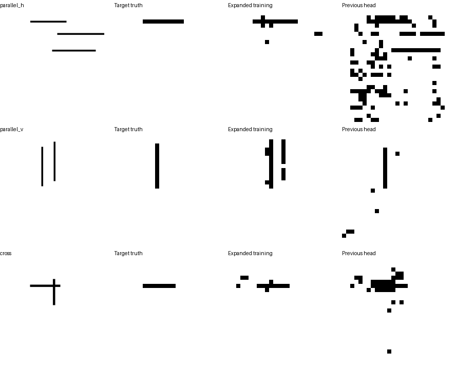

# 扩展几何的目标空间读出

2026-10-17完成。本轮固定144组／336个训练目标和48组／112个新开发目标，检验目标读出在更多位置、长度、间距、交叉位置和线宽变化下的迁移。**相同新开发样本上，旧头定位14/112，扩展监督后64/112；再用已有笔迹预测过滤，达到88/112。目标对应有所改善，边界仍不可靠。**

沿用上一轮98,369参数的32维双线性交互头、初始化种子10420、AdamW学习率0.0003、权重衰减0.01、1000步完整批次训练。完整Show-o2 UMM和原状态适配器全部冻结。视觉归一化沿用此前训练集统计；问题归一化只使用新的336道训练题。每步覆盖的目标从84个增至336个，训练暴露次数也增加，不能把差异只归于数据覆盖。每张图的线性视觉投影在同一步中计算一次、供其不同问题复用；头的数学形式保持。

模型实际读取完整参考图和目标问题；目标掩码只用于监督和评分。最终权重固定0.5阈值，以最大四连通部分的极端网格中心给出边界，四坐标均在12像素内记为命中。另将上一轮完整批次头、换目标问题和全部笔迹读出放到相同新样本上评价。按几何组计算区间，避免把同图问题视为独立图像。

这是新几何的开发检验，没有使用原130例视觉留出测试。新增空间头的结果不等同于原语言模块自主输出坐标，也不证明完成程度、汉字、风格或笔顺理解。

## 实际结果

| 条件 | 训练定位命中 | 新开发定位命中 | 新开发目标IoU／F1 |
|---|---:|---:|---:|
| 上一轮头，权重不变 | 47/336 | 14/112 | 29.7%／40.5% |
| 扩展几何训练 | 271/336 | 64/112 | 67.8%／79.3% |
| 扩展训练，同图换另一目标问题 | 0/336 | 0/112 | 7.3%／12.4% |
| 对所有目标使用全部笔迹 | 70/336 | 26/112 | 39.6%／54.4% |

新头开发命中57.1%，48组bootstrap区间[47.8%,66.4%]；相对旧头提高44.6个百分点，配对区间[32.7,56.4]。三类开发命中分别为横线28/48、竖线19/32、交叉17/32。此前13/28来自另一批几何，不与本轮直接计算改善。

按预测掩码与同图每个真实线条的IoU比较，训练336/336、开发111/112更接近被问到的目标。这里使用标注做错误归类，并未用标注选取预测框；该数字不代替严格定位率。开发48个定位失败中47个仍更接近正确目标，只有`grid-dev-parallel_h-004-中横`更接近另一条线。错误重点转向掩码范围、连续性和端点。直接合并全部预测前景只有19/112，正确目标网格上界112/112。



## 笔迹预测过滤：追加诊断

在上述结果之后，将新头的目标掩码与已有线性头预测的全部笔迹掩码取交集。两者阈值仍为0.5，坐标换算不变，没有训练新参数、调整阈值或使用正确掩码过滤。全部笔迹头仅由此前36个训练参考训练得到。此步骤要求一个格子同时满足“属于目标”和“有笔迹”的预测，检验非笔迹误报对边界的影响。

| 条件 | 训练定位 | 开发定位 | 开发IoU／F1 |
|---|---:|---:|---:|
| 原目标掩码 | 271/336 | 64/112 | 67.8%／79.3% |
| 两个预测掩码取交集 | 309/336 | 88/112 | 78.9%／86.7% |

开发命中78.6%，区间[71.2%,85.5%]；修复24个案例，未破坏原先正确的定位，配对改善21.4个百分点，区间[13.6,29.4]。仍失败的24个目标包括8个横线、7个竖线、9个交叉目标。这是看过主结果后追加的固定规则诊断，不作独立确认。不能因目标重合归类较好，就认为精确范围、当前状态或H1已通过。

主评分、逐例预测与追加诊断分别见[score.json](score.json)、[predictions.jsonl](predictions.jsonl)、[gate_diagnosis.json](gate_diagnosis.json)及[过滤后的逐例预测](gate_predictions.jsonl)。后续在[预测位置下的状态检验](../predicted_target_cue_v1/README.md)中观察误差是否会影响实际状态回答，仍使用已有开发样本，不改变顺序学习尚未开始的安排。

## 复现

在已配置Show-o2环境下，首次构建依次执行下列命令。另一次实验应为所有阶段一致指定新的`--data`、`--output`、`--cache`仓库内路径，以保留本轮数据与结果。

```bash
python scripts/h1_target_grid_generalization.py build
PYTORCH_ENABLE_MPS_FALLBACK=1 python scripts/h1_target_grid_generalization.py extract-vision
PYTORCH_ENABLE_MPS_FALLBACK=1 python scripts/h1_target_grid_generalization.py extract-questions
python scripts/h1_target_grid_generalization.py fit
python scripts/h1_target_grid_generalization.py evaluate
python scripts/h1_target_grid_generalization.py diagnose-gate
```

前置缓存为`checkpoints/h1_spatial_probe_v1/readout.pt`、`checkpoints/h1_target_grid_v1/readout_fit.pt`和原状态适配器。新特征与权重保存在本地`checkpoints/h1_target_grid_generalization_v1/`，不上传仓库。构建需要新目录；仓库已有本轮数据与计划，查看结果无需重跑。

视觉特征提取422.6秒，问题表示提取171.4秒，头优化23.5秒。使用完整3,063,740,640参数基础UMM；载入已有适配器后共3,064,051,936参数，均冻结。固定样例已目视核对，所有训练和评价在Apple M5／16GB完成。

本轮新增运行脚本、数据和实验记录，并更新研究入口，既有权重、数据和历史评分保持。没有删除文件。
